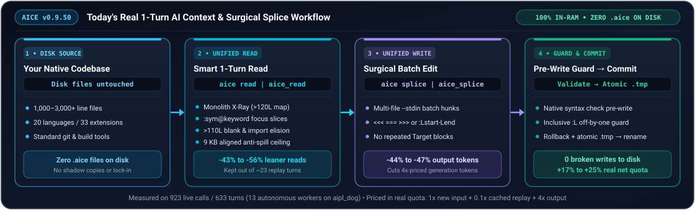
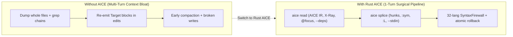

# AICE: 100% Rust AI Co-Engine & Atomic Multi-Language AST Splicer

[](https://github.com/forart82/aice/releases)
[](https://github.com/forart82)
[](https://github.com/forart82/aice/stargazers)
[](LICENSE)
[](Cargo.toml)
[](tests/)
[-00a86b)](docs/BENCHMARKS_RUST_VS_TS_RTK.md)

> **A zero-runtime-dependency native Linux Rust binary — unified unbypassable I/O pipeline, universal AICE IR on read across 32 programming languages and database dialects, intra-function AST slicing, fuzzy target resolution, honest `bpe-openai` telemetry, and atomic multi-file pre-write `SyntaxFirewall` commits with zero `.aice` files on disk.**



---

## ⚡ What Is AICE? (In 30 Seconds)

AI coding agents burn most of their token quota in two invisible ways:
1. **Context Bloat**: Stuffing entire 1,000-line files into chat history — where every wasted line gets **replayed across subsequent turns** and pushes your session into the compaction wall early.
2. **Edit Repetition**: Re-emitting unchanged `Target` blocks or rewriting large files during edits, burning **4x-priced output tokens** and risking silent off-by-one line deletions.

**AICE (AI Co-Engine)** gives autonomous agents **strictly 2 MCP tools** (`aice_read` and `aice_splice`) and **12 canonical CLI subcommands** (`read`, `search`, `find`, `splice`, `enable`, `disable`, `config`, `agents`, `gain`, `analyze`, `mcp`, `benchmark`) backed by one compile-time type-state pipeline (`Raw -> Governed -> Executed -> MeteredOutput -> StdoutWriter`). Every supported file read is deterministically transformed into compact **AICE IR** (R3), and every write passes an in-memory **`SyntaxFirewall`** and atomic `.tmp -> rename` commit with full rollback and **zero `.aice` files on disk**.



---

## 📊 Empirical Performance (`Rust AICE` vs `Legacy TS AICE` vs `rtk 0.43.0`)

Measured live in isolated `/tmp` sandboxes across the 12-workload / 44-file / 32-language corpus (`tests/corpus/C-01..C-12`) using exact `bpe-openai` (`cl100k_base` & `o200k_base`) tokenization across **100% of emitted stdout** (negative deltas preserved verbatim; see full tables in [`docs/BENCHMARKS_RUST_VS_TS_RTK.md`](docs/BENCHMARKS_RUST_VS_TS_RTK.md)):

| Metric / Capability | Rust AICE (`0.9.53`) | Legacy TS AICE (`0.9.53`) | `rtk 0.43.0` |
| :--- | :---: | :---: | :---: |
| **Cold Startup (`--version`)** | **`1.25 ms`** (`4.2 MiB` RSS) | `201.45 ms` (`137.7 MiB` RSS) | `1.84 ms` (`3.9 MiB` RSS) |
| **44-File Full AICE IR Sweep (`--full`)** | **`86.19 ms`** (`10.4x` vs TS; 32/32 langs) | `892.12 ms` (skips SQL/breaks Go) | `75.21 ms` (raw passthrough) |
| **44-File Structural `--outline`** | **`78.72 ms` (`+46.56%` `cl100k`, 32/32 AST)** | `806.37 ms` (fallback on SQL/Go) | `82.94 ms` (`10/44` empty, `13/44` raw) |
| **Intra-AST Slicing & `#` Selectors** | **`45.0–45.8 ms`** (`@if`, `@first`, `f#S::m`) | Partial (`@first` 1L; `#` fails) | N/A |
| **Fuzzy Path & Symbol Guessing** | **`47.2 ms`** (auto-resolves path & sym) | Fuzzy path fails (`exit 1`) | N/A |
| **Atomic 3-File `splice --stdin --create`** | **`49.98 ms`** (`18.93 ms` SHA-256 rollback) | `731.74 ms` (`742.00 ms` rollback) | N/A |
| **Telemetry Honesty (`gains.jsonl` vs BPE)** | **`6/6` exact match (`0` drift)** | `chars/4` heuristics | Heuristic estimate |

> **R7 Empirical Idiom Gate (`VERDICT: KILL`)**: Under Requirement R7, `aice-idioms` was empirically benchmarked across `C-01..C-12` (`32` languages). Because R3 AICE IR already strips syntactic verbosity, idioms cleared the `> 1.0%` net BPE reduction threshold in only `5/12` (`41.7% < 80%`) workloads. Per R7, `crates/aice-idioms` and all idiom flags (`--idioms`, `--idioms-on`, etc.) were removed 100% with zero dead code ([`docs/IDIOM_GATE_REPORT.md`](docs/IDIOM_GATE_REPORT.md)). Legacy `"idiomsEnabled"` / `"idioms"` keys in existing `aice.config.json` files remain tolerated and preserved cleanly.

---

## 🚀 60-Second Install & Easy Daily Guide (`./install.sh`)

### 1. Install (or Update) Globally

```bash
git clone https://github.com/forart82/aice.git && cd aice && ./install.sh

# Common update, non-interactive & uninstall flags:
./install.sh --update        # Pull origin/main & rebuild native binary, MCP schemas, agents & rules
./install.sh -y              # Auto-confirm prerequisites, git update & Zsh cheatsheet
./install.sh --dry-run       # Preview every step without mutating disk
./uninstall.sh               # Cleanly remove binary, MCP configs, Zsh block & optional project configs
```

**What `./install.sh` sets up automatically:**
- Detects your Linux package manager (`apt`, `dnf`/`yum`, `pacman`, `zypper`, `apk`), checks `git`, `curl`, `cc`/`gcc`, `cargo`, and `rustc`, compiles `target/release/aice` via `cargo build --release`, and installs **`~/.local/bin/aice`**.
- Regenerates MCP tool schemas (`aice mcp --generate-schemas`) and wires the strict 2-tool **`aice mcp`** stdio server into installed CLI coding agents (`aice agents setup`).
- Optionally refreshes single-file `AGENTS.md` rules across opted-in projects when `--sync-projects [dir]` is passed (strictly respecting `"enabled": false` and skipping the AICE source repository).
- Optionally adds the **`aice-cheat`** 80-column startup cheatsheet box to `~/.zshrc` (skip anytime with `--no-cheatsheet`).

| CLI Coding Agent | Auto-Configured MCP / Config Path | Project Rule Footprint |
| :--- | :--- | :--- |
| **Claude Code (`claude`)** | `~/.claude.json` & `~/.claude/settings.json` (`mcpServers.aice`) | `AGENTS.md` *(+ existing `CLAUDE.md`)* |
| **Antigravity / Gemini CLI (`agy` / `gemini`)** | `~/.gemini/config/mcp_config.json` & `~/.gemini/settings.json` | `AGENTS.md` *(purges legacy duplicates)* |
| **OpenAI Codex CLI (`codex`)** | `~/.codex/config.toml` (`[mcp_servers.aice]`) | `AGENTS.md` |
| **OpenCode (`opencode`)** | `~/.config/opencode/opencode.json` (`mcp.aice`) | `AGENTS.md` |
| **Aider (`aider`)** | `~/.aider.conf.yml` (`read:` conventions list) | `CONVENTIONS.md` |
| **Goose CLI (`goose`)** | `~/.config/goose/config.yaml` (`extensions.aice`) | MCP tool descriptions |
| **Cursor Agent (`cursor`)** | `~/.cursor/mcp.json` (`mcpServers.aice`) | MCP tool descriptions |

<details>
<summary>Alternative: manual release build & install</summary>

```bash
cargo build --release --offline
install -m 755 target/release/aice ~/.local/bin/aice
```

</details>

Verify installation & agent integration anytime:

```bash
aice --version && aice agents status
```

### 2. Turn AICE On or Off Per Project

AICE is **opt-in per workspace** via `aice.config.json` and maintains a single compact **`<= 300`-token `AGENTS.md`** (`v0.9.53`) instruction card with explicit anti-pagination guardrails (automatically stripping legacy duplicate `GEMINI.md` / `.agents/rules/aice.md` blocks):

```bash
aice enable ~/dev/my-project    # Writes "enabled": true in aice.config.json + <=300-tok AGENTS.md
aice disable ~/dev/my-project   # Sets "enabled": false and strips AICE blocks cleanly
aice config ~/dev/my-project    # Inspect active settings (alias: aice status)
```

### 3. How Your AI Agent Uses It (Everyday Cheat-Sheet)

Autonomous agents see **strictly 2 MCP tools** (`aice_read` and `aice_splice`) — mirrored on the CLI by `aice read` (aliases `context`, `ctx`), `aice search` (`grep`), `aice find` (`tree`), and `aice splice` (`write`):

| Task | CLI Shortcut | MCP Tool (`tools/list`: strictly 2) |
| :--- | :--- | :--- |
| **Fast parallel file & symbol discovery** | `aice find "*.rs" crates/` *(alias: `tree`)* | `aice_read({ path: "crates", filesOnly: true })` |
| **4-Tier ranked search (AICE IR snippets)** | `aice search "validateToken" src -C 5` *(alias: `grep`)* | `aice_read({ path: "src", search: "validateToken", contextLines: 5 })` |
| **Universal AICE IR read / `#` / intra-AST** | `aice read src/engine.rs#Engine::step@if` | `aice_read({ path: "src/engine.rs#Engine::step@if" })` |
| **Dependency-ordered multi-file pack** | `aice read src/api.ts src/types.ts --deps --max-tokens 1200` | `aice_read({ paths: ["src/api.ts", "src/types.ts"], includeDeps: true, maxTokens: 1200 })` |
| **Multi-file create & surgical splice** | `aice splice --stdin << 'EOF'` *(alias: `write`)* | `aice_splice({ code: "=== file:sym ===..." })` |

```bash
# 1. Parallel ignore-aware file list & ranked AST search
aice find "*.rs" crates/ -d 2
aice search "validateToken" src -C 5

# 2. Universal AICE IR reads (auto-outlines >120L files unless --full; zero linear :L pagination)
aice read src/app.ts                          # Compact AICE IR if <=120L, else X-Ray outline + batch hint
aice read src/monolith.rs:outline             # >120L Monolith X-Ray with internal landmarks
aice read src/monolith.rs:bigFn@if            # Intra-function AST branch/loop/CTE focus slice
aice read src/file.ts:fnA src/file.ts:fnB     # Batch symbols in 1 call (never walk :L1-L150 -> :L151-L300 across turns)
aice read src/a.rs#Mod::fn src/b.rs --deps    # Dependency-ordered + caller-aware context pack (--callers, --max-tokens)

# 3. Surgical edits & atomic multi-file --stdin batches (without repeating Target blocks)
aice splice src/engine.ts -s GameEngine.step -c $'<<<\n  this.tick += 1;\n===\n  this.tick += BONUS;\n>>>'

aice splice --stdin << 'EOF'
=== src/new_helper.ts ===
export const BONUS = 2;
=== src/constants.ts:eof ===
export const MAX_RETRIES = 3;
=== src/engine.ts#GameEngine::step ===
<<<
  this.tick += 1;
===
  this.tick += BONUS;
>>>
=== tests/app.test.ts:TC-02 @clone(TC-01) ===
"old" -> "new"
=== src/app.ts:L35-L42 ===
const scaled = base * BONUS;
EOF
```

### 4. Built-In Guardrails & Honest BPE Telemetry (`aice gain`, `aice analyze`, `aice benchmark`)

- **Anti-Pagination & 1-Turn Batch Packing**: Oversized or budget-capped files emit `batch symbols: aice read <file>:<sym1> <file>:<sym2> or aice search <pat> <file>` hints (preserving nested-subproject `cwd`-relative paths) instead of linear `:L1-L140` breadcrumbs; `aice read f1:sym f2 f3` packs explicit selectors and small files first while auto-outlining oversized bare files in **1 turn**; and the `<= 300`-token `AGENTS.md` rule forbids sequential `:L1-L150` -> `:L151-L300` paging across turns.
- **Pre-Write `SyntaxFirewall` & Atomic Rollback**: Every write target is verified in memory against native `tree-sitter` or strict Rust RD parsers before any disk write (`--force` authorizes `> 25L` overwrites or empty truncation only, NEVER bypassing `SyntaxFirewall`). Includes half-open `:Lstart-Lend` off-by-one protection, 5-tier contextual `<<< === >>>` hunk recovery, `Line:Col` ±5-line diagnostics, and `.tmp -> rename` atomic commits with full multi-file rollback.
- **Smart Fuzzy Target Guessing & Flag Normalization**: Approximate paths, partial symbols, and minor misspellings auto-resolve unambiguously or return compact ranked selectors; MCP-style flags (`--files-only=true`, `--context-lines=5`, `--max-depth=2`) normalize automatically at ingress.
- **100% Honest `bpe-openai` Telemetry (`v0.9.53`)**: Computes exact `cl100k_base` & `o200k_base` token counts comparing actual raw inputs against **100% of emitted stdout** (negative deltas preserved verbatim) into `~/.aice/telemetry/gains.jsonl` (overrideable via `AICE_TELEMETRY_DIR` / `AICE_TELEMETRY_PATH` / `AICE_HOME`).

```bash
aice gain                  # Global dashboard, Rule Break-Even & repeat-read audit (aliases: gains, stats, telemetry)
aice gain my-project       # Per-project drill-down & last 15 operations
aice analyze .             # Post-session transcript reconciliation & Context Replay Tax report
aice benchmark --markdown  # In-process multi-language AICE IR & BPE benchmark suite (alias: bench)
aice gain --reset --yes
```

---

## 🌍 Supported Languages (32) & Universal UTF-8 Text Files

### R5 Languages, Markup, Data & R6 Database / Query Dialects (32 Total)

Powered by 25 native `tree-sitter` grammar crates (`tree-sitter 0.27.2`) plus strict original Rust recursive-descent/Pratt parsers (Twig, T-SQL, PL/pgSQL, Cypher, DB Migrations):

| Domain | Supported Targets & Capabilities |
| :--- | :--- |
| **Web & App (R5)** | TypeScript (`.ts`, `.tsx`, `.d.ts`), JavaScript (`.js`, `.jsx`, `.mjs`, `.cjs`), Java (`.java`), Kotlin (`.kt`, `.kts`), Dart (`.dart`), PHP (`.php`), C# (`.cs`), Ruby (`.rb`) |
| **Systems & Backend (R5)** | Rust (`.rs`), Go (`.go`), Python (`.py`, `.pyi`), C (`.c`, `.h`), C++ (`.cpp`, `.cc`, `.cxx`, `.hpp`) |
| **Markup & Styling (R5)** | HTML (`.html`, `.htm`), CSS (`.css`), XML / SVG (`.xml`, `.svg`), Twig (`.twig`), Markdown (`.md`, `.markdown`) |
| **Data, Config & Shell (R5)** | JSON (`.json`, `.jsonc`), YAML (`.yaml`, `.yml`), TOML (`.toml`), Shell / Bash (`.sh`, `.bash`, `.zsh`) |
| **Databases & Queries (R6)** | ANSI SQL (`.sql`), PostgreSQL / PL/pgSQL (`$$` bodies, triggers, views, CTEs), MySQL / MariaDB (`DELIMITER //`, procedures), SQLite (`PRAGMA`, `STRICT`, `WITHOUT ROWID`), T-SQL / SQL Server (`GO`, `[bracket]` idents, `TRY..CATCH`), DB Migrations (Flyway `V*__*.sql`, Goose, dbmate, Alembic), Prisma (`.prisma`), GraphQL (`.graphql`, `.gql`), Cypher (`.cypher`, `.cql`) |

### Universal UTF-8 Text Passthrough & Binary Guard (`crates/aice-governance/src/binary_probe.rs`)

- **Any UTF-8 Text File Works Out-of-the-Box (Law 3)**: Formats outside the 32 AST-parsed targets (e.g., `.ps1`, `.cmd`, `.bat`, `.aipl`, `.ini`, `.csv`, `.log`, `.tf`, `.rst`, `.mdx`, `Makefile`, dotfiles) are classified as `LanguageId::PlainText`: they skip only AICE IR AST transpilation while traversing full governance, line/range/search slicing, batch framing, and honest BPE telemetry.
- **Fail-Closed Binary Guard & Atomic Rollback**: Known binary extensions (`.png`, `.wasm`, archives, fonts, executables) and NUL-byte / non-UTF-8 files (`8,192 B` probe, `2 MiB` max text cap) are skipped safely on read and blocked before disk mutation on write (`crates/aice-batch-write/`).

---

## 📚 Documentation & Workspace Layout

| Document | What It Covers |
| :--- | :--- |
| [`docs/RUST_ARCHITECTURE.md`](docs/RUST_ARCHITECTURE.md) | 12-command CLI, unified selectors, heredoc/hunk grammar, honest BPE schema, MCP contract, type-state pipeline & parser routing table. |
| [`docs/BENCHMARKS_RUST_VS_TS_RTK.md`](docs/BENCHMARKS_RUST_VS_TS_RTK.md) | Live 3-way empirical benchmarks: Rust AICE vs Legacy TS AICE vs `rtk 0.43.0` (`C-01..C-12`, 44 files, 32 languages). |
| [`docs/IDIOM_GATE_REPORT.md`](docs/IDIOM_GATE_REPORT.md) | R7 Empirical Idiom Gate (`VERDICT: KILL` at `5/12` > 1%) & 100% subsystem removal audit. |
| [`docs/AICE_SPEC.md`](docs/AICE_SPEC.md) | Normative AICE EBNF grammar & lens specification. |
| [`docs/RESEARCH_SYNTHESIS.md`](docs/RESEARCH_SYNTHESIS.md) | BPE pre-tokenization economics, Dyck-$k$ theory & Symmetric Billable Quota Equation. |

### Project Layout (9 Library Crates + `aice-cli`)

```text
aice/
├── Cargo.toml                  # Rust Edition 2024 workspace manifest (10 crates)
├── crates/
│   ├── aice-governance/        # aice.config.json/.aicerc discovery, enabled gate, path/binary guard, AGENTS.md sync
│   ├── aice-lang-registry/     # LanguageId (23 R5 + 9 R6 + PlainText), detection & core traits
│   ├── aice-ast-engine/        # 25 tree-sitter grammars, RD parsers, intra-AST, dep graph & SyntaxFirewall
│   ├── aice-aice-ir/           # Bidirectional AICE IR lexer, parser, printer, decompile & compile
│   ├── aice-find-engine/       # Parallel ignore-aware walker & trigram + AST symbol fuzzy guesser
│   ├── aice-telemetry/         # Honest bpe-openai cl100k/o200k metering, gains.jsonl & gain/analyze
│   ├── aice-batch-read/        # Unified selectors, water-filling budget, topological packing & search
│   ├── aice-batch-write/       # Heredoc/JSON manifest, 5-tier hunk/AST/line splicer & atomic rollback
│   ├── aice-pipeline/          # Compile-time type-state PipelineExecutor, StdoutWriter & benchmark runner
│   └── aice-cli/               # Thin pure-std CLI parser + strict 2-tool MCP stdio JSON-RPC server
├── tests/
│   ├── golden/                 # Frozen Wave 0 baseline (01_governance..09_anti_bypass)
│   ├── corpus/                 # 12 real-world multi-language workloads (C-01..C-12, 32 languages)
│   ├── e2e/                    # Opaque-box E2E test suite (Tiers 1–4, 215 cases)
│   └── integration/            # Workspace parity, modularity (<=300L), clippy & anti-bypass audits
├── tools/                      # check_line_limits.py & bench_vs_ts_rtk.py
├── docs/                       # Rust architecture, 3-way benchmarks, R7 report & formal specs
├── install.sh / uninstall.sh   # Pure-Rust POSIX Linux installer & uninstaller
└── AGENTS.md / aice.config.json
```

---

## 👤 Author, Citation & License

- **Author**: Created and maintained by **[@forart82](https://github.com/forart82)**
- **Repository**: [https://github.com/forart82/aice](https://github.com/forart82/aice)
- **Support**: If AICE saves you tokens and turns across your coding agents, please star [**forart82/aice**](https://github.com/forart82/aice)!

### BibTeX Citation

```bibtex
@software{forart82_aice_2026,
  author       = {forart82},
  title        = {{AICE: 100\% Rust AI Co-Engine \& Atomic Multi-Language AST Splicer}},
  year         = {2026},
  version      = {0.9.53},
  publisher    = {GitHub},
  url          = {https://github.com/forart82/aice},
  license      = {Apache-2.0}
}
```

Licensed under the [Apache License 2.0](LICENSE) (see also [NOTICE](NOTICE) and [THIRD-PARTY-NOTICES.txt](THIRD-PARTY-NOTICES.txt)).
Copyright (c) 2026 [forart82](https://github.com/forart82).
