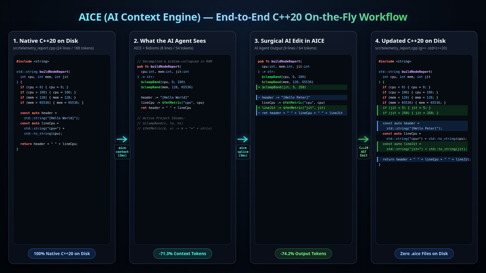

# AICE: On-the-Fly AI Context Engine & Multi-Language `$idioms` Splicer

[](https://github.com/forart82/aice/releases)
[](https://github.com/forart82)
[](https://github.com/forart82/aice/stargazers)
[](LICENSE)
[](https://www.typescriptlang.org/)
[](https://bun.sh/)
[](https://nodejs.org/)
[](tests/)
[](docs/BENCHMARKS.md)

> **A pure on-the-fly AST context packager, opt-in BPE-gated `$idiom` compressor, and surgical multi-language code splicer engineered for autonomous AI coding agents — with zero `.aice` files on disk.**

---

## ⚡ Executive Summary

Modern Large Language Models (LLMs) spend **40% to 85% of their context windows, tool calls, and output token budgets on syntactic noise and full-file re-reads**: closing XML/HTML tags (`</div>`, `</section>`), redundant curly braces (`{ ... }`), verbose ceremony (`std::cout << ... << std::endl`, `export interface`, `public readonly`), and repetitive multi-file boilerplate.

**AICE (AI Context Engine)** is a pure **On-the-Fly AI Context & Mutation Tool** that operates directly on native source files in RAM across **20 languages & 33 file extensions** with zero `.aice` files left on disk:

### Supported Languages & Formats (33 Extensions)
- **Web & Application**: TypeScript (`.ts`, `.tsx`, `.d.ts`), JavaScript (`.js`, `.jsx`, `.mjs`, `.cjs`), PHP (`.php`), Kotlin (`.kt`, `.kts`), C# (`.cs`)
- **Systems & Backend**: Python (`.py`, `.pyi`), Go (`.go`), Rust (`.rs`), C++20 (`.cpp`, `.cc`, `.cxx`, `.hpp`, `.h`)
- **Markup, Templates & Styling**: HTML (`.html`), CSS (`.css`), Twig (`.twig`), Markdown (`.md`, `.markdown`)
- **Data & Configuration**: JSON (`.json`), YAML (`.yaml`, `.yml`)
- **Shell & Scripting**: Shell (`.sh`, `.bash`, `.zsh`), PowerShell (`.ps1`), Batch (`.cmd`, `.bat`), AIPL (`.aipl`)

### Core Capability Matrix (Strict 2-Tool AI Surface)

| Pillar & AI Tool | Key Capabilities & Internal Auto-Routing | Eliminates / Replaces | Token Savings |
| :--- | :--- | :--- | :---: |
| **Pillar 1: Unified Read**<br>**`aice read`** (MCP: **`aice_read`**)<br>*(CLI aliases: `context`, `ctx` + ergonomic `search`/`grep` & `find`/`tree`)* | **1-turn numbered native output by default** (`<lineNo>│ <rawDiskLine>` on `:symbol` of all lengths `<=25L`/`>25L` & inline bare files; `--dsl` opt-in), **`computeDynamicReadBudget()` water-filling** (`28,672 B` / `7,000`-tok ceiling, `26,624 B` / `6,500`-tok soft cap so `~600–750L` / `<=25 KB` bare files settle inline in 1 turn) + **`computeDynamicSliceSpan()`** (`18,432 B`, `80..650L` AST-snapped `Next slice` hints), **AST-Aware Search Windows** (`<=40L` enclosing decl or `±10L`, `-C`), **`< 20ms` zero-AST `find`/`--files`**, **Adaptive Sibling Outlining** (`<=20` syms), and symbol contracts/callers (`[L14]`). | 2-turn `:symbol` $\to$ `:Lstart-Lend` line hunting, 5-line search peepholes, `rg`/`grep`/`find`/`cat`, and 46 KB spillover files | **70–90%**<br>read & replay tokens |
| **Pillar 2: Unified Write**<br>**`aice splice`** (MCP: **`aice_splice`**)<br>*(CLI alias: `aice write`)* | Single mutation & creation engine routing new files through greenfield **`create`** (recursive parent dirs, opt-in `$idioms`, AICE DSL) and existing targets through **Lossless Surgical AST/CST Splicing** (symbols, whitespace-resilient `<<<` hunks, `±2`-line brace-safe `:Lstart-Lend` + `±5`-line error context, `@clone`), **Guarded Overwrites**, and `--stdin` batch streams. | Monolithic file-creation loops, indentation-fragile hunks, and blind search-replace | **40–90%+**<br>write tokens |
| **Opt-In `$idioms`**<br>*(Internal Engine Layer)* | Parameterized project-wide AST macros (`"idiomsEnabled": false` by default; opt in via `--idioms` or `"idiomsEnabled": true`) collapsed and expanded in RAM with zero `.aice` files on disk. | Repetitive multi-file boilerplate without taxing 0-idiom reads | **60%+**<br>extra output savings |

---

## 🏛️ Strict 2-Tool / 2-Pillar Unified Architecture

Autonomous AI agents see **ONLY two MCP tools** — **`aice read`** (MCP `aice_read`, plus CLI ergonomic shortcuts `aice search`/`grep` & `aice find`/`tree` routing into `read()`) and **`aice splice`** (MCP `aice_splice`, CLI alias `aice write`) — backed by a single compact **`<= 650`-token `AGENTS.md`** workspace directive while 1-turn numbered native reads, dynamic byte/AST water-filling budgets, AST-aware search windows, zero-AST file discovery, greenfield creation, and resilient AST splicing route automatically inside the engine:

```
┌─────────────────────────────────────────────────────────────────────────────────────────────────────────────────────┐
│                                 AICE STRICT 2-TOOL / 2-PILLAR UNIFIED ARCHITECTURE                                  │
├──────────────────────────────────────────────────────────┬──────────────────────────────────────────────────────────┤
│                  PILLAR 1: UNIFIED READ                  │                 PILLAR 2: UNIFIED WRITE                  │
│  (MCP: aice_read | CLI: read + search/grep & find/tree)  │     (aice splice / MCP: aice_splice | alias: write)      │
├──────────────────────────────────────────────────────────┼──────────────────────────────────────────────────────────┤
│ ┌──────────────────────────────────────────────────────┐ │ ┌──────────────────────────────────────────────────────┐ │
│ │                Incoming Read Request                 │ │ │                Incoming Write Request                │ │
│ │ (dir, find, search, :outline, :sym, :L-R, bare file) │ │ │ (new file, CST/AST/hunk/range splice, or overwrite)  │ │
│ └──────────────────────────┬───────────────────────────┘ │ └──────────────────────────┬───────────────────────────┘ │
│                            ▼                             │                            ▼                             │
│ ┌──────────────────────────────────────────────────────┐ │ ┌──────────────────────────────────────────────────────┐ │
│ │  Internal Read Auto-Router (native | dsl | find/rg)  │ │ │  Internal Write Auto-Router (create | splice | ovw)  │ │
│ └──────────────────────────┬───────────────────────────┘ │ └──────────────────────────┬───────────────────────────┘ │
│              ┌─────────────┴──────────────┐              │              ┌─────────────┴──────────────┐              │
│              ▼                            ▼              │              ▼                            ▼              │
│ ┌─────────────────────────┐  ┌─────────────────────────┐ │ ┌─────────────────────────┐  ┌─────────────────────────┐ │
│ │ 1-Turn Numbered Native  │  │ Search, Find & Fast Path│ │ │ Auto-Create / Overwrite │  │ Surgical AST/CST Splice │ │
│ │ • N│ raw lines (:sym +  │  │ • <=40L AST / +-10L (-C)│ │ │ • Missing file / :create│  │ • :sym, indent-safe <<< │ │
│ │   <=25KB ~750L bare)    │  │ • Plain regex/lit search│ │ │ • Or bare :overwrite    │  │ • +-2L brace-safe :L-R  │ │
│ │ • <=20 Siblings + Deps  │  │ • <20ms 0-AST find/tree │ │ │ • mkdir -p, AICE DSL &  │  │ • +-5L err ctx, @clone  │ │
│ │ • --dsl shorthand opt-in│  │ • :L-R, cfg/doc, globs  │ │ │   opt-in --idioms       │  │ • Trivia & null-guards  │ │
│ └────────────┬────────────┘  └────────────┬────────────┘ │ └────────────┬────────────┘  └────────────┬────────────┘ │
│              └─────────────┬──────────────┘              │              └─────────────┬──────────────┘              │
│                            ▼                             │                            ▼                             │
│ ┌──────────────────────────────────────────────────────┐ │ ┌──────────────────────────────────────────────────────┐ │
│ │ <=28KB Water-Filling Budget + AST-Snapped 80..650L   │ │ │   Pre-Write Syntax Gate + Batch Rollback + Atomic    │ │
│ │  (Overflow -> :outline | 18KB Symbol-Aligned Hints)  │ │ │     .tmp -> rename Commit (Zero .aice on Disk)       │ │
│ └──────────────────────────────────────────────────────┘ │ └──────────────────────────────────────────────────────┘ │
└──────────────────────────────────────────────────────────┴──────────────────────────────────────────────────────────┘
```

### Pillar 1: Unified Read (`aice read` / MCP `aice_read` + CLI `search`/`grep` & `find`/`tree`)
- **Default 1-Turn Numbered Native Output (`--dsl` Opt-In)**: By default, `aice read` (and MCP `aice_read`) emits **exact 1-based disk-numbered native source lines** (`<lineNo>│ <rawDiskLine>`) on **both** `:symbol` queries (all symbol lengths, including `<= 25` lines and `> 25` lines) **and** inline bare files — preserving dependency contracts, `[L14]` callers, and **Adaptive Sibling Outlining** (`<= 20` symbols / `~150` tokens) on `:Class.method` reads so agents can immediately run `aice splice` (`<<< === >>>` or `:Lstart-Lend`) in **1 turn** without a second `:Lstart-Lend` line-hunting read. Pass `--dsl` (`dsl: true` in MCP) to opt into AICE shorthand decompilation.
- **Dynamic Water-Filling Byte/Token Budget & AST-Snapped Slice Hints**: Replaces static `250`/`150`-line cutoffs with **surface-aware budgeting** via **`computeDynamicReadBudget()`** (`28,672 B` / `7,000`-token ceiling for MCP/programmatic `aice_read`; `9,216 B` (`9 KB`) / `2,400`-token ceiling for CLI `aice read` to prevent host `run_command` middle-truncation; smallest-first water-filling across requested targets so small files render inline in 1 turn, auto-outlining only overflow targets unless `--full`, `--max-tokens`, or an explicit `autoOutlineLineThreshold` is passed) and **`computeDynamicSliceSpan()`** (`18,432 B` MCP / `7,936 B` (`7.75 KB`, ~135–185 lines) CLI slice budget clamped and snapped to complete top-level AST symbol boundaries so `Next slice: aice read <file>:L<start>-L<end>` never cuts a function in half).
- **AST-Aware Search Context Windows & `aice search` (`grep`)**: Tier 1 & 2 search hits expand automatically to **complete enclosing AST declarations (`<= 40` lines)** or **`±10` numbered native lines** (`~21`-line window, configurable via `-C, --context <lines>` / MCP `contextLines`), merging overlapping windows within the `28 KB` budget instead of tiny 5-line (`±2`) peepholes. `aice search <pattern> [targets...]` (alias `grep`, plus `aice read --search`) accepts plain regex or auto-escaped literal patterns without `/.../` wrappers (supporting `-C`, `-l`, `--full`, `--json`, `--max-tokens`), ranked across **4 Tiers** (production declarations $\to$ code $\to$ comments $\to$ test/mock decoys).
- **Zero-AST `< 20ms` Workspace Discovery (`aice find` / `tree` / `--files`) & Fast Path**: `aice find [pattern] [targets...]` (alias `tree`, `aice read --files`, MCP `filesOnly: true`) scans workspaces in `< 20ms` without AST parsing or 15-file truncation, emitting `<relPath> (<lines>L, <sizeKB>KB)` within the `28 KB` ceiling. Line slices (`:Lstart-Lend`), config/doc/passthrough files, and small bare files emit a minimal `// === <file> ===` zero-envelope slice (`--deps` / `--callers` opt-in).

### Pillar 2: Unified Write (`aice splice` / MCP `aice_splice`, CLI Alias `aice write`)
- **Greenfield Auto-Creation (Internal `create` Routing)**: Missing files and `:create` targets automatically synthesize parent directories (`mkdir -p`), expand inline `@idiom` or opt-in `--idioms` macros (`"idiomsEnabled": false` by default), and compile AICE DSL or native source to disk.
- **Resilient Surgical CST/AST Splicing (<50% mutations)**: Supports `:Class.method`, **whitespace-resilient `<<< / === / >>>` hunks** (unambiguous dedent fallback with automatic indentation preservation), **brace-safe `±2`-line `:Lstart-Lend` auto-alignment** (plus `±40`-line shifted-header healing and exact `±5` numbered file lines on syntax error), `@clone`, `:Heading`, `:imports`, and `:eof` while guarding lexer inputs (`maskSourceLexically(source ?? "")`).
- **Guarded Full-File Overwrite (>50% mutations)**: Selector-free calls overwrite atomically via greenfield `create` while rejecting accidental empty-string overwrites unless `--overwrite`, `--force`, or `:overwrite` is passed.
- **Pre-Write Syntax Gate & Transactional Batch Rollback**: Validates native syntax before touching disk, rejects malformed `=== ... ===` batch headers cleanly, rolls back multi-file `--stdin` streams on any error, and commits via atomic `.tmp` $\to$ `rename` writes.

> For complete formal architecture specifications, data flow, and benchmark analyses, see [`docs/ARCHITECTURE.md`](docs/ARCHITECTURE.md).

---

## 🛠️ End-to-End C++20 On-the-Fly Workflow Example



AICE reads native C++20 directly into RAM — emitting 1-based disk-numbered native lines by default for 1-turn splicing, or (when opted in via `--dsl --idioms`) compressing verbose C++ syntax and repetitive patterns into compact AICE + `$idioms` — and surgically splices the AI's edit back into the native `.cpp` file on disk.

### Built-In Idioms vs. Opt-In Project-Specific Custom Idioms (`--idioms` / `aice.config.json`)

AICE combines two layers of idiom compression (with project `$idioms` **opt-in by default**: `"idiomsEnabled": false` unless `--idioms` is passed or `"idiomsEnabled": true` is configured):
- **Built-In Language Idioms**: Verbose standard-library constructs are automatically lowered and raised by the C++20 decompiler/emitter without configuration — for example, `std::cout << "[CARD] Sessions=" << sessions << std::endl;` automatically decompiles to `print("[CARD] Sessions=", sessions)` and compiles back to `std::cout << ... << std::endl;`.
- **Opt-In Project-Specific Custom Idioms (`--idioms` / `aice.config.json`)**: Repeating multi-statement bounds checks (`$clampBand`), metric formatters (`$fmtMetric`), or custom project wrappers (such as `givemeabigstring::out(msg)` $\leftrightarrow$ `$big_out(msg)`) are mined via `aice idioms scan --save` and activated via `--idioms` or `"idiomsEnabled": true` in `aice.config.json`:

```json
{
  "idiomsEnabled": true,
  "idioms": {
    "$clampBand": {
      "name": "$clampBand",
      "kind": "stmt",
      "params": [{ "name": "$0" }, { "name": "$1" }, { "name": "$2" }],
      "templateAice": "if $0 < $1:\n  $0 = $1\nif $0 > $2:\n  $0 = $2"
    },
    "$fmtMetric": {
      "name": "$fmtMetric",
      "kind": "expr",
      "params": [{ "name": "$0" }, { "name": "$1" }],
      "templateAice": "std.string($0 + \"=\") + std.to_string($1)"
    }
  }
}
```

### Step 1: Native C++20 Source File on Disk (`src/telemetry_report.cpp` — Panel 1)

```cpp
#include <string>

std::string buildNodeReport(int cpu, int mem, int jit) {
    if (cpu < 0) { cpu = 0; }
    if (cpu > 100) { cpu = 100; }
    if (mem < 128) { mem = 128; }
    if (mem > 65536) { mem = 65536; }

    const auto header = std::string("[Hello World]");
    const auto lineCpu = std::string("cpu=") + std::to_string(cpu);

    return header + " " + lineCpu;
}
```

### Step 2: Inspect Symbol-Scoped Context (`aice read --symbol buildNodeReport --dsl --idioms` — Panel 2)

By default, `aice read src/telemetry_report.cpp --symbol buildNodeReport` emits exact 1-based disk-numbered native C++20 lines (`3│ std::string buildNodeReport...`) for immediate 1-turn native hunk/range splicing. When opting into AICE shorthand + `$idiom` collapsing via `--dsl --idioms`, `aice read` decompiles the C++20 function in RAM and collapses the repeating bounds checks into `$clampBand(...)` and the string metric formatter into `$fmtMetric(...)` (`-71.3%` context tokens):

```bash
$ aice read src/telemetry_report.cpp --symbol buildNodeReport --dsl --idioms --no-callers
```

```aice
// Decompiled & $idiom-collapsed in RAM
pub fn buildNodeReport(cpu:int, mem:int, jit:int) -> str:
  $clampBand(cpu, 0, 100)
  $clampBand(mem, 128, 65536)

  header := "[Hello World]"
  lineCpu := $fmtMetric("cpu", cpu)
  ret header + " " + lineCpu

// Active Project Idioms:
// $clampBand(v, lo, hi)
// $fmtMetric(k, v) -> k + "=" + str(v)
```

### Step 3: Apply Surgical Edit in AICE (`aice splice --symbol buildNodeReport --idioms` — Panel 3)

The AI agent writes a compact AICE + `$idioms` edit that keeps `cpu` and `mem`, adds `$clampBand(jit, 5, 250)` and `lineJit := $fmtMetric("jit", jit)`, updates `header := "[Hello Peter]"`, and splices it directly into `src/telemetry_report.cpp` (`-74.2%` output tokens):

```bash
$ aice splice src/telemetry_report.cpp \
    --symbol buildNodeReport \
    --idioms \
    --in-place \
    --code 'pub fn buildNodeReport(cpu:int, mem:int, jit:int) -> str:
  $clampBand(cpu, 0, 100)
  $clampBand(mem, 128, 65536)
  $clampBand(jit, 5, 250)

  header := "[Hello Peter]"
  lineCpu := $fmtMetric("cpu", cpu)
  lineJit := $fmtMetric("jit", jit)
  ret header + " " + lineCpu + " " + lineJit'
```

### Step 4: Updated Native C++20 on Disk (`src/telemetry_report.cpp` — Panel 4)

```cpp
#include <string>

std::string buildNodeReport(int cpu, int mem, int jit) {
    if (cpu < 0) { cpu = 0; }
    if (cpu > 100) { cpu = 100; }
    if (mem < 128) { mem = 128; }
    if (mem > 65536) { mem = 65536; }
    if (jit < 5) { jit = 5; }
    if (jit > 250) { jit = 250; }

    const auto header = std::string("[Hello Peter]");
    const auto lineCpu = std::string("cpu=") + std::to_string(cpu);
    const auto lineJit = std::string("jit=") + std::to_string(jit);

    return header + " " + lineCpu + " " + lineJit;
}
```

`src/telemetry_report.cpp` is updated atomically in-place on disk with valid C++20 (`g++ -std=c++20 -fsyntax-only` verified) and **zero `.aice` files created**.

---

## 📊 Empirical Benchmarks

AICE is rigorously benchmarked across both live adversarial AI coding agent sessions and deterministic offline suites:

- **Live Autonomous AI Agents ([`docs/BENCHMARKS.md`](docs/BENCHMARKS.md))**: Across 33 live adversarial cold-start sessions (10 multi-file scenarios `RW-01`..`RW-10` + `RW-11` hostile 1-file 0-idiom Lone Needle across 15 languages and 3 progressive layers), AICE won **11/11 scenarios** in both Pure AICE (default `"idiomsEnabled": false`) and Opt-In `+Idioms` modes with **100% 3-layer disk & compiler verification (22/22 AICE runs)** — cutting LLM output tokens by **62.9% to 84.3%**, working payload tokens by **57.8% to 72.6%**, LLM turns by **67.1% to 68.9%**, tool calls by **77.5% to 79.2%**, total API context tokens by **75.5% to 76.0%**, and real API cost by **71.0% to 73.5%**, while enforcing a single `<= 650`-token `AGENTS.md` prompt budget and zero-envelope fast-path slices. Full audit trail: [`docs/BENCHMARKS.md`](docs/BENCHMARKS.md).
- **Deterministic Offline Suite ([`docs/BENCHMARKS_OFFLINE.md`](docs/BENCHMARKS_OFFLINE.md))**: Evaluated across all 10 production scenarios covering 15 languages (`o200k_base` BPE), winning **10/10 scenarios** with **-41.7% to -71.5%** token reductions and **-59.0% to -69.3%** turn reductions. Full breakdown: [`docs/BENCHMARKS_OFFLINE.md`](docs/BENCHMARKS_OFFLINE.md).

---

## 🚀 Quick Start & Universal Linux Installation

### Option 1: One-Line Git Clone & Universal Linux Installer (`./install.sh` — Recommended)
Automatically detects your Linux distro (`apt-get`, `dnf`/`yum`, `pacman`, `zypper`, `apk`), verifies/installs `git`, `curl`, `node >= 20`, and `npm`, detects installed vs. local vs. `origin/main` versions, registers `~/.local/bin/aice`, regenerates MCP tool schemas (`~/.gemini/antigravity-cli/mcp/aice/`), refreshes single-file `AGENTS.md` rules across AICE-enabled projects in `~/dev/*` (respecting `"enabled": false` and purging legacy duplicates), and wires `aice mcp` + system instructions into your installed CLI coding agents:

```bash
git clone https://github.com/forart82/aice.git && cd aice && ./install.sh

# In-place update & non-interactive / CI flags (works even when AICE is already installed):
./install.sh --update           # Pull newest origin/main (if ahead) & refresh binary, MCP schemas, global agents & ~/dev/* rules
./install.sh --yes              # Auto-confirm dependencies, git update & Zsh cheatsheet
./install.sh --no-update        # Skip remote git check and refresh local working tree in-place
./install.sh --no-cheatsheet    # Skip Zsh startup cheatsheet prompt
./install.sh --no-agents        # Skip automatic CLI agent configuration
./install.sh --dry-run          # Preview all actions without mutating disk
```

### Universal Linux Uninstaller (`./uninstall.sh`)
Cleanly removes the `~/.local/bin/aice` symlink, CLI coding agent MCP/prompt registrations (`aice agents remove`), the Zsh startup cheatsheet in `~/.zshrc`, global `~/.aice` telemetry state, and all `aice.config.json` files across your projects:

```bash
./uninstall.sh

# Optional flags:
./uninstall.sh --projects-dir ~/dev     # Scan a specific root directory for aice.config.json files
./uninstall.sh --keep-project-configs   # Preserve project aice.config.json files
./uninstall.sh --keep-telemetry         # Preserve ~/.aice telemetry ledger
./uninstall.sh --dry-run                # Preview all files/configs that would be removed
```

### Option 2: Manual Symlink or Standalone Single Binary
```bash
# Manual symlink:
cd /path/to/aice
ln -sf "$(pwd)/bin/aice.mjs" ~/.local/bin/aice

# Or compile a standalone single binary with Bun:
bun build --compile /path/to/aice/bin/aice.ts --outfile ~/.local/bin/aice
```

> **Note for standalone binary distribution:** When distributing standalone binaries compiled with `bun build --compile`, accompany the executable with [THIRD-PARTY-NOTICES.txt](THIRD-PARTY-NOTICES.txt) to satisfy third-party licenses (MIT, BSD, ISC, Apache-2.0, Bun runtime).

Verify installation & agent integration:
```bash
aice --version
aice agents status
aice gain
```

---

## 🤖 Automatic CLI Coding Agent Integration (`aice agents` & Single-File `AGENTS.md`)

`aice agents` automatically registers the global `aice mcp` stdio server across major Linux CLI coding agents. Prompt rules are **project-scoped** via a **single compact `AGENTS.md` file (`<= 650` BPE tokens)** — only active when `aice.config.json` has `"enabled": true`, with an explicit zero-overhead bypass for non-coding/Q&A sessions and board-only swarm monitors. Both `aice enable` and `aice disable` automatically strip legacy `GEMINI.md` / `.GEMINI.md` AICE blocks and delete `.agents/rules/aice.md` so CLI harnesses never inject 3x duplicate copies into `<user_rules>` (`CLAUDE.md` is synced only when an existing `CLAUDE.md` lacks `@AGENTS.md`).

| CLI Coding Agent | MCP Server Config | Project Rules (Default 1x Footprint) | Global Rules (`--global-rules`) |
| :--- | :--- | :--- | :--- |
| **Claude Code (`claude`)** | `~/.claude.json` & `~/.claude/settings.json` (`mcpServers.aice`) | `AGENTS.md` *(+ existing `CLAUDE.md` without `@AGENTS.md`)* | `~/.claude/CLAUDE.md` |
| **Antigravity / Gemini CLI (`agy` / `gemini`)** | `~/.gemini/config/mcp_config.json` & `~/.gemini/settings.json` (`mcpServers.aice`) | `AGENTS.md` *(<= 650 tok; auto-purges legacy `GEMINI.md` & `.agents/rules/aice.md`)* | `~/.gemini/GEMINI.md` & `~/.gemini/config/rules/aice.md` |
| **OpenAI Codex CLI (`codex`)** | `~/.codex/config.toml` (`[mcp_servers.aice]`) | `AGENTS.md` | `~/.codex/AGENTS.md` |
| **OpenCode (`opencode`)** | `~/.config/opencode/opencode.json` (`mcp.aice` & `mcpServers.aice`) | `AGENTS.md` | `~/.config/opencode/AGENTS.md` |
| **Aider (`aider`)** | `~/.aider.conf.yml` (`read:` conventions list) | `CONVENTIONS.md` | `~/.aider/CONVENTIONS.md` |
| **Goose CLI (`goose`)** | `~/.config/goose/config.yaml` (`extensions.aice`) | MCP tool descriptions | MCP tool descriptions |
| **Cursor Agent (`cursor`)** | `~/.cursor/mcp.json` (`mcpServers.aice`) | MCP tool descriptions | MCP tool descriptions |

```bash
aice agents setup                 # Configure MCP for installed CLI agents (project-scoped 1x AGENTS.md rules)
aice agents setup --all           # Pre-configure all agent targets
aice agents setup --global-rules  # Also inject global prompt rules into home configs
aice agents status [--json]       # Inspect binary detection, MCP config, and rule sync status
aice agents remove                # Cleanly strip AICE entries without losing user settings
```

---

## ⚙️ Project-Level Controls (`aice.config.json`) & Strict 2-Tool MCP Server (`aice mcp`)

To eliminate tool-selection friction and schema bloat, `aice mcp` exposes **strictly 2 AI tools** in `tools/list` (`aice_read` and `aice_splice`) — while the CLI pairs `aice read` and `aice splice` (`write`) with ergonomic `aice search` (`grep`) and `aice find` (`tree`) shortcuts routing directly into `read()` — enforcing strict workspace path sandboxing and respecting project-level configuration in `aice.config.json` (or `.aicerc` / `package.json#aice`):

| MCP Tool (`tools/list`: strictly 2) | CLI Equivalents | Capabilities, Optional Schema Properties & Internal Auto-Routing |
| :--- | :--- | :--- |
| **`aice_read`**<br>*(optional props: `search`, `filesOnly`, `contextLines`, `dsl`, `full`, `maxTokens`, `includeDeps`, `includeCallers`, `idioms`)* | **`aice read`** *(aliases: `context`, `ctx`)*<br>**`aice search`** *(alias: `grep`)*<br>**`aice find`** *(alias: `tree`)* | **Unified Read Engine**: Emits **1-based disk-numbered native source lines** (`<lineNo>│ <rawDiskLine>`) by default on `:symbol` (all lengths, including `<=25L`) and inline bare files (`dsl: true` / `--dsl` opts into AICE shorthand); enforces **`computeDynamicReadBudget()`** (`28,672 B` / `7,000`-tok ceiling, `26,624 B` / `6,500`-tok soft cap, smallest-first water-filling) + **`computeDynamicSliceSpan()`** (`18,432 B`, `80..650L` AST-snapped `Next slice` hints); expands **AST-Aware Search Windows** (`<=40L` enclosing decl or `±10L`, configurable via `contextLines` / `-C`) on plain regex or auto-escaped literal `search`; and runs **`< 20ms` zero-AST workspace discovery** (`filesOnly: true` / `--files` / `aice find`) emitting `<relPath> (<lines>L, <sizeKB>KB)`. |
| **`aice_splice`** | **`aice splice`**<br>*(alias: `aice write`)* | **Unified Write Engine**: Routes missing files, `:create`, and selector-free overwrites (`force` / `overwrite`) through greenfield **`create`** (recursive parent directories, opt-in `$idioms`, AICE DSL compilation), and routes existing files with selectors/hunks through lossless surgical AST/CST replacement, whitespace-resilient `<<< / === / >>>` hunks, `±2`-line brace-safe `:Lstart-Lend` ranges (`±5` numbered lines on syntax error), `@clone(SourceSym)`, or unified multi-file batch streams (`=== <filePath>:<symbol> ===`). |

- **Disable AICE completely for a project (`"enabled": false`)**:
  ```json
  {
    "enabled": false
  }
  ```
  Both `aice disable` and `npm run bump` (`tools/bump-version.ts`) strictly honor `"enabled": false`, stripping workspace AICE rule blocks and never re-injecting them into disabled projects:
  ```bash
  aice disable [dir]            # Sets "enabled": false and strips AGENTS.md + legacy GEMINI.md / .agents/rules/aice.md
  aice enable [dir]             # Sets "enabled": true, injects <=650-tok AGENTS.md & purges legacy duplicate rule files
  aice config [dir]             # Inspect current project AICE & $idioms status
  ```
- **Opt-In `$idioms` Macro Compression (`"idiomsEnabled": false` by default)**:
  Project `$idiom` collapsing and expansion default to **`"idiomsEnabled": false`** so 0-idiom and targeted slice reads never pay `$idiom` legend overhead. Enable explicitly per call via `--idioms` or per project via `aice idioms on` / `aice.config.json`:
  ```json
  {
    "enabled": true,
    "idiomsEnabled": true
  }
  ```

---

## 📈 Honest Signed BPE Telemetry, Turn-Amplification Forensics & Break-Even (`aice gain` & `aice analyze`)

`aice gain` (CLI aliases `aice gains`, `aice stats`) and `aice analyze` track real-world token deltas and multi-turn read behavior using exact `cl100k_base` and `o200k_base` BPE tokenizers with **100% honest signed accounting**:
- **Compact Numeric Ledger (`< 250 B/event`, Zero Raw Source Text)**: Persists compact numeric JSONL records (`< 250` bytes/line) in `~/.aice/telemetry/gains.jsonl` with zero raw source strings on disk, plus `compactTelemetryLedger()` streaming compaction.
- **Zero Gain Clamping & Signed Negative Deltas**: Never clamps `Math.max(0, ...)` across `read`, `context`, `splice`, or `telemetry` — when an envelope or error exceeds the raw baseline, negative `savedCl100k` / `savedO200k` deltas and `overheadCalls` are recorded and summed honestly with `-` signs.
- **Realistic Slice, Regex & Failed-CLI Baselines**: `:Lstart-Lend` reads are baselined against only the requested line window (`±10` lines) rather than whole files; `:/pattern/` and `search` queries are baselined against `rg -n`-equivalent match lines rather than whole-repo byte totals; and failed CLI invocations log negative `<cli-error>` token overhead.
- **`Rule Overhead Break-Even` & `< 90s` `Repeat-Read Turn Warnings` (`aice gain`)**: Compares cumulative net `savedCl100k` against the active 1x `MANDATORY_AGENT_RULES_MARKDOWN` (`<= 650`-token `AGENTS.md`) prompt budget, and detects back-to-back read events on the same `(projectRoot, filePath)` within **`< 90s`** (`repeatReadCalls`), surfacing **`Repeat-Read Turn Warnings`** so multi-turn line hunting is never masked by positive single-call stdout deltas.
- **Post-Session `readLoopAudit` & Context Replay Token Tax (`aice analyze`)**: Captures all `aice` CLI invocations (`read`, `write`, `search`, `grep`, `find`, `tree`, `splice`, etc.) across session transcripts and reports **`readLoopAudit`**: `readTurns`, `totalTurns`, `readTurnRatioPct`, `maxConsecutiveReadStreak`, `sameFileRepeatReadChains` (files read in `>= 2` consecutive turns before any `splice`), and the estimated **Context Replay Token Tax** (`extraReadTurns * avgSessionContextTokens`).

```bash
aice gain                                 # Global summary, Rule Overhead Break-Even, Repeat-Read Turn Warnings & project tables
aice gain <project-name-or-.>             # Per-project drill-down: net signed savings, repeatReadCalls & last 15 ops
aice gain --unique                        # Deduplicate repeated identical operations by SHA-256 contentHash
aice gain --json                          # Emit full structured JSON telemetry report (including repeatReadCalls)
aice gain --reset --yes                   # Clear telemetry ledger

aice analyze [project-or-dir]             # Reconstruct sessions, readLoopAudit, Context Replay Token Tax & friction audit
aice analyze <project> --json             # Emit structured JSON ProjectAnalyzeReport (with readLoopAudit)
aice analyze . --transcripts-dir <dir>    # Scan a custom agent conversation transcripts directory
```

### Ephemeral Sandbox & Worktree Telemetry Isolation
To preserve clean production statistics, AICE telemetry recording inspects `process.cwd()`, `input.projectRoot`, and `input.targetPath` to automatically suppress ephemeral sandboxes (unless an explicit `--telemetry-path` or `AICE_HOME` is provided):
- Paths in `/tmp` or `/var/tmp` (including `/tmp/aice-rw-*`, `/tmp/sbx-*`, and `os.tmpdir()` benchmark sandboxes)
- Agent swarm worktree checkouts matching `swarm-*`

---

## 🛡️ Resilience & Smart Error Diagnostics ("Did You Mean?" & Self-Healing Splices)

AICE provides intelligent feedback and automatic boundary alignment to prevent wasted retry turns:
- **Missing Symbols, Regexes & Files**: Suggests closest declaration names via Levenshtein distance (`Did you mean: getUserById`), auto-escapes invalid regex patterns to literal search without crashing, surfaces top file symbols when a pattern matches zero lines, and fuzzy-matches missing file paths in parent directories.
- **Quoted Glob Expansion & Zero-AST Discovery**: Expands quoted glob patterns (`aice read "src/**/*.ts" "tests/*.test.ts"`) deterministically and scans workspaces in `< 20ms` via `aice find` (`tree` / `--files`) while skipping `node_modules`, `.git`, and `dist`.
- **Whitespace-Resilient `<<< / === / >>>` Hunks**: Falls back to unambiguous dedent-normalized line matching inside the target file or `:symbol` span and preserves target block indentation automatically.
- **Brace-Safe `±2`-Line `:Lstart-Lend` Alignment & `±5`-Line Error Context**: Auto-heals unambiguous off-by-one/two brace boundary mismatches on `:Lstart-Lend` splices, and includes the exact surrounding `±5` numbered lines (`35│ ...`) whenever a splice fails syntax validation so agents repair in 1 turn without re-reading.

---

## 💻 CLI Command Reference

### 1. Unified Read (`aice read` + `search`/`grep` & `find`/`tree`) & Unified Write (`aice splice` / `aice write`)
```bash
# --- PILLAR 1: UNIFIED READ (aice read | MCP: aice_read | CLI aliases: context, ctx, search/grep, find/tree) ---

# 1-turn numbered native reads, dynamic water-filling budget (<= 9 KB CLI / <= 28 KB MCP) & AST-snapped slice hints:
aice read src/app.ts                                     # Bare file fitting budget renders inline in 1 turn with 1│ numbered native lines!
aice read bin/aice.ts                                    # Overflow bare files auto-outline with AST-snapped Next slice hints (7.75 KB CLI / 18 KB MCP)
aice read src tests                                      # Auto-outlines dirs; surface-aware water-filling budget (<= 9 KB CLI / <= 28 KB MCP)
aice read "src/**/*.ts"                                  # Expands quoted globs deterministically (skips node_modules/.git/dist)
aice read tests/app.test.ts:outline                      # Emits named test "..." # [Lstart-Lend] & describe "..." # [Lstart-Lend]

# Symbol-scoped 1-turn numbered native reads (--dsl opt-in) & Zero-Envelope Fast Path:
aice read src/app.ts -s "GameApp.step"                   # 1-based numbered native lines (all lengths <=25L & >25L) + <=20 Siblings + Deps + Callers [L14]
aice read src/app.ts -s "GameApp.step" --dsl --idioms    # Explicit opt-in AICE shorthand decompilation (--dsl) + $idiom collapsing (--idioms)
aice read src/a.ts:fnA,fnB src/b.ts:L10-L50              # 1-turn multi-file stream (water-filling budget <= 28 KB)
aice read src/app.ts:L180-L240                           # Zero-envelope fast path: minimal // === header + 180│ lines (pass --deps/--callers if needed)
aice read tests/app.test.ts -s "TC-MENU-001"             # Extract numbered native test block by test ID or title prefix
aice read README.md -s "Quick Start"                     # Zero-envelope Markdown section slice by heading

# Ergonomic AST-Aware Search (aice search / grep / aice read --search) & <20ms Zero-AST Find (aice find / tree / --files):
aice search "OracleIncoherenceAuditor" src               # Plain regex or auto-escaped literal (no /.../ needed); <=40L AST decl or +-10L window
aice grep "validateToken" src -C 5                       # Explicit -C / --context <lines> radius override; merges overlapping windows
aice search "TODO" src -l                                # -l / --files-with-matches concise relative path listing (also supports --full, --json, --max-tokens)
aice read --search "computeDynamicReadBudget" -C 8       # Equivalent flags directly on aice read (targets default to ["."])
aice find "*.test.ts" tests                              # < 20ms zero-AST scan emitting <relPath> (<lines>L, <sizeKB>KB) (alias: aice tree)
aice tree src                                            # List all non-ignored files in src/ with line counts & KB sizes (or aice read --files)

# --- PILLAR 2: UNIFIED WRITE (aice splice | MCP: aice_splice | CLI alias: write) ---

# Greenfield Auto-Creation (automatically routes to internal create: parent dirs, inline @idiom / opt-in --idioms, AICE DSL):
aice splice src/services/auth/TokenValidator.ts -c 'export class TokenValidator { isValid(t: string): boolean { return !!t; } }'
aice splice src/renderer.ts --idioms -c '@idiom $clamp($0,$1,$2) = Math.min(Math.max($0,$1),$2)\npub fn bound(x:num) -> num => $clamp(x, 0, 100)'

# Full-File Overwrite (when no selector or hunk is provided; pass --force / --overwrite when forcing):
aice splice src/config/defaults.ts -c 'export const DEFAULT_TIMEOUT = 5000;'

# Surgical AST Splicing (<50% mutation — by symbol, hunk, line-range, or clone):
aice splice src/engine.ts -s GameEngine.step -c $'<<<\n  this.tickCount += 1;\n===\n  this.tickCount += BONUS_MULTIPLIER;\n>>>'
aice splice src/tax.ts -s calculateTax -c "export function calculateTax(n: number): number { return n * 1.2; }"
aice splice README.md -s "Quick Start" -c "## Quick Start\nRun ./install.sh --yes"
aice splice src/sim/Hazard.ts -s HazardManager.obsoleteHelper --delete

# 1-turn unified mixed stream (creates, overwrites, and AST splices batched in 1 turn via --stdin):
aice splice --stdin << 'EOF'
=== src/new_helper.ts ===
export const BONUS_MULTIPLIER = 2;
=== src/constants.ts:eof ===
export const COMBO_BONUS = 50;
=== src/app.ts:imports ===
import { BONUS_MULTIPLIER } from "./new_helper.js";
=== src/board.ts:Board.isBoardEmpty ===
public isBoardEmpty(): boolean {
  return this.grid.every((row) => row.every((cell) => cell === null));
}
=== tests/board.test.ts:TC-BOARD-002 @clone(TC-BOARD-001) ===
"empty" -> "initialized"
true -> false
=== src/app.ts:L35-L42 ===
const scaledScore = baseScore * BONUS_MULTIPLIER;
=== src/generated.ts:overwrite ===
export const SCHEMA_VERSION = 2;
EOF
```

### 2. Project Controls, Telemetry, Agent Integration & MCP Server
```bash
# Toggle project-level AICE or $idiom collapsing in aice.config.json:
aice enable [dir]
aice disable [dir]
aice config [dir] [--json]

# Inspect honest signed BPE token-savings telemetry, Repeat-Read Turn Warnings & readLoopAudit analysis:
aice gain
aice gain <project>
aice analyze [project]
aice analyze <project> --json

# Manage global CLI coding agent integrations:
aice agents setup
aice agents status
aice agents remove

# Launch the First-Class Model Context Protocol (MCP) server over stdio (exposes strictly aice_read & aice_splice):
aice mcp

# Run the Offline & Real-Agent Benchmark Suites:
npm run benchmark:offline
npm run benchmark
```

*(Note: Low-level maintainer & internal engine subcommands such as `idioms`, `diff`, `patch`, `tokens`, and `verify` remain available for direct CLI scripting while hidden from default `--help`, keeping MCP strictly at 2 tools (`aice_read`, `aice_splice`) alongside CLI `read`, `search`/`grep`, `find`/`tree`, and `splice`/`write`.)*

---

## 🛠️ Project Structure

```
aice/
├── LICENSE                     # Apache-2.0 license
├── NOTICE                      # Apache-2.0 attribution notice (@forart82)
├── CITATION.cff                # GitHub academic / software citation metadata (v0.9.43)
├── AGENTS.md                   # Single-file <= 650-token workspace AICE agent rules
├── vitest.config.ts            # Vitest test runner configuration
├── install.sh                  # Universal Linux installer & optional Zsh startup cheatsheet
├── uninstall.sh                # Universal Linux uninstaller & project config cleaner
├── assets/
│   ├── aice-banner.jpg         # Official wide title banner
│   ├── aice-cpp-workflow.jpg   # End-to-End C++20 On-the-Fly Workflow diagram
│   └── aice-logo.jpg           # Official square logo
├── benchmarks/
│   ├── index.ts                # Benchmark suite public exports
│   ├── offline-suite.ts        # Deterministic 10-scenario / 15-language BPE benchmark engine
│   ├── real-agent-suite.ts     # Live 33-session autonomous agent benchmark verifier
│   ├── run-offline.ts          # CLI runner for offline benchmarks
│   ├── run-real-agents.ts      # CLI runner for live adversarial cold-start agent sessions
│   └── run.ts                  # CLI runner for full benchmark suite
├── bin/
│   ├── aice.ts                 # AICE CLI entrypoint (read + search/grep + find/tree & splice/write)
│   └── aice.mjs                # Node/Bun executable wrapper (symlink-safe)
├── docs/
│   ├── ARCHITECTURE.md         # Strict 2-Tool / 2-Pillar Unified Architecture specification
│   ├── AICE_SPEC.md            # Normative language & AST specification (EBNF)
│   ├── AI_SYSTEM_PROMPT.md     # System prompt for LLM code generation & 2-tool CLI/MCP usage
│   ├── BENCHMARKS.md           # Real AI agent benchmark report (33 live sessions + amortization)
│   ├── BENCHMARKS_OFFLINE.md   # Deterministic offline benchmark report
│   ├── CST_TRIVIA_SPEC.md      # Bidirectional lens and CST trivia table specification
│   └── RESEARCH_SYNTHESIS.md   # Tokenomics and AST anti-unification research synthesis
├── src/
│   ├── agents/                 # Global CLI coding agent integration engine (single-file AGENTS.md sync)
│   ├── cache/                  # Persistent AST & idiom provenance disk cache
│   ├── compat/                 # TypeScript compiler API compatibility layer
│   ├── config/                 # Project config (aice.config.json / enabled / opt-in idiomsEnabled)
│   ├── core/                   # Lexer, Pratt Parser, AST, Tokens, Span, CST Trivia Lens
│   ├── decompiler/             # On-the-fly reverse transpilers across 20 languages / 33 extensions
│   ├── emitters/               # Multi-target native code generators across 20 languages / 33 extensions
│   ├── idioms/                 # Opt-in BPE-gated AST anti-unification idiom miner & transformer
│   ├── mcp/                    # Workspace-sandboxed MCP stdio server (strict 2-tool surface: aice_read & aice_splice)
│   ├── rules/                  # Compact <= 650-token mandatory agent rules SSOT (mandatory-rules.ts)
│   ├── telemetry/              # Honest signed <250B BPE ledger (repeatReadCalls) & readLoopAudit session analyzer
│   ├── tokenomics/             # TikToken BPE (`cl100k_base` / `o200k_base`) tokenomics engine
│   ├── tools/                  # Unified read (numbered native, dynamic water-filling & AST search) & resilient splice
│   ├── typechecker/            # Static typechecker & autonomous self-repair engine
│   └── version.ts              # Single source of truth for AICE_VERSION (v0.9.43)
└── tests/
    ├── unit/                   # Unit test suites
    └── integration/            # Multi-file roundtrip & operator pipeline integration suites
```

---

## 👤 Author, Citation & Support

- **Author**: Created and maintained by **[@forart82](https://github.com/forart82)**
- **Repository**: [https://github.com/forart82/aice](https://github.com/forart82/aice)
- **Star on GitHub**: If AICE saves you tokens, turns, and API cost across your AI coding agents, please consider giving [**forart82/aice**](https://github.com/forart82/aice) a ⭐ on GitHub!

### BibTeX Citation

```bibtex
@software{forart82_aice_2026,
  author       = {forart82},
  title        = {{AICE: On-the-Fly AI Context Engine \& Multi-Language \$idioms Splicer}},
  year         = {2026},
  version = {0.9.43},
  publisher    = {GitHub},
  url          = {https://github.com/forart82/aice},
  license      = {Apache-2.0}
}
```

---

## 📜 License

Licensed under the [Apache License 2.0](LICENSE) (see also [NOTICE](NOTICE) and [THIRD-PARTY-NOTICES.txt](THIRD-PARTY-NOTICES.txt)).
Copyright (c) 2026 [forart82](https://github.com/forart82).