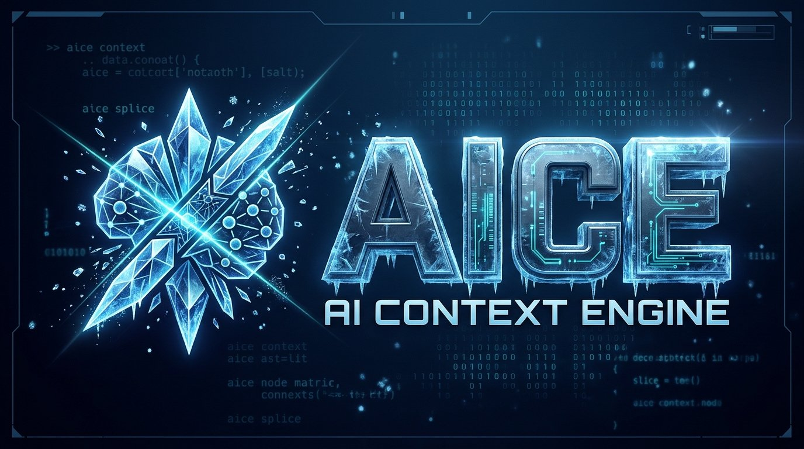
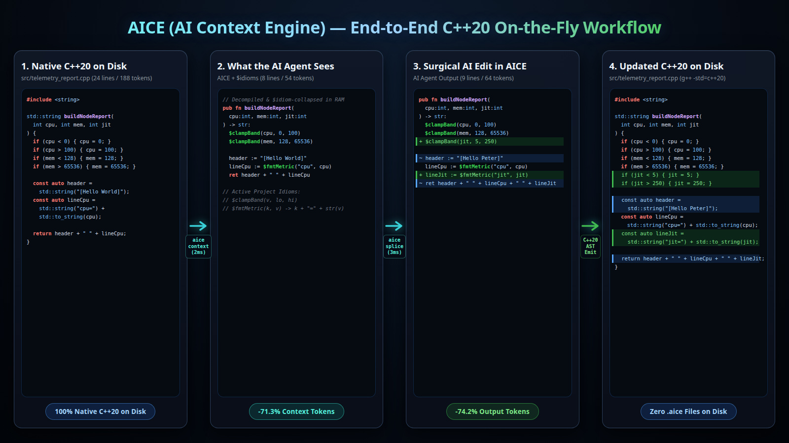

# AICE: On-the-Fly AI Context Engine & Multi-Language `$idioms` Splicer

[](https://github.com/forart82/aice/releases)
[](https://github.com/forart82)
[](https://github.com/forart82/aice/stargazers)
[](LICENSE)
[](https://www.typescriptlang.org/)
[](https://bun.sh/)
[](https://nodejs.org/)
[](tests/)
[](docs/BENCHMARKS.md)

> **A pure on-the-fly AST context packager, BPE-gated `$idiom` compressor, and surgical multi-language code splicer engineered for autonomous AI coding agents — with zero `.aice` files on disk.**

---

## ⚡ Executive Summary

Modern Large Language Models (LLMs) spend **40% to 85% of their context windows, tool calls, and output token budgets on syntactic noise and full-file re-reads**: closing XML/HTML tags (`</div>`, `</section>`), redundant curly braces (`{ ... }`), verbose language ceremony (`std::cout << ... << std::endl`, `export interface`, `public readonly`), and repetitive multi-file patterns.
**AICE (AI Context Engine)** is a pure **On-the-Fly AI Context & Mutation Tool** that operates directly on native source files in RAM across **20 languages & 33 file extensions** (`TypeScript`, `TSX`, `JavaScript`, `Python`, `Go`, `Rust`, `C++20`, `C#`, `Kotlin`, `PHP`, `CSS`, `HTML`, `Twig`, `JSON`, `YAML`, `Shell (.sh/.bash/.zsh)`, `PowerShell (.ps1)`, `Batch (.cmd/.bat)`, `Markdown (.md/.markdown)`, and `AIPL (.aipl)`):
2. **In-RAM AST Decompilation & Line-Range Skeleton Outlines (`aice outline`)**: Summarizes any native file or multi-directory workspace (`aice outline src tests`) into a compact AICE structural skeleton with `[Lstart-Lend]` line-range annotations, named `test "..." # [Lstart-Lend]` / `describe "..." # [Lstart-Lend]` blocks, Markdown ATX section headings (`# Heading # [Lstart-Lend]`), shell/PowerShell/batch functions & labels, and multi-language `## ⚠️ Native Syntax Diagnostics` in milliseconds (**85–90% read token reduction**).
3. **1-Turn Dependency Contract Packager, Call-Site Tracker & Search (`aice context`)**: Extracts any target symbol, `Class.method`, test ID (`-s "TC-MENU-001"`), Markdown heading (`-s "Quick Start"`), exact line range (`-s "L180-L240"`), or regex/substring search (`-s "/pattern/"`) along with its imported dependency signatures and **exact downstream caller line numbers** (`uses getCoreConstants at [L14]`) in a single tool call — completely eliminating `grep -n`, `grep -rn`, `sed -n`, `cat`, and `ls`.
4. **Lossless Multi-Language Surgical Splicing (`aice splice`)**: Applies surgical AST replacements, insertions, or deletions in RAM by symbol (`:Class.method`), test ID (`:TC-MENU-001`), Markdown heading (`:Heading Title`), script function/label, line range (`:Lstart-Lend`), `:imports`, or `:eof`, and writes back **100% standard, compiler-ready native code** while preserving untouched formatting, comments, and line endings byte-for-byte (**90%+ write token reduction**).
5. **Smart Multi-File Idioms (`$idioms` / `aice idioms`)**: Automatically discovers or lets you define parameterized project-wide AST macros (such as `$clamp($0, $1, $2)` or `$guard_pos($0)`). Every occurrence across all files is collapsed into a 1-line `$idiom(...)` call during `outline`/`context`, expanded back to native code during `create`/`splice`, and can be mutated across the entire repository in **1 turn** via `aice idioms update`.

---

## 🛠️ End-to-End C++20 On-the-Fly Workflow Example



AICE reads native C++20 directly into RAM, compresses verbose C++ syntax and repetitive patterns into compact AICE + `$idioms` for the AI agent, and surgically splices the AI's compact edit back into the native `.cpp` file on disk.

### Built-In Idioms vs. Project-Specific Custom Idioms (`aice.config.json` / `.aice-idioms.json`)

AICE combines two layers of idiom compression:
- **Built-In Language Idioms**: Verbose standard-library constructs are automatically lowered and raised by the C++20 decompiler/emitter without configuration — for example, `std::cout << "[CARD] Sessions=" << sessions << std::endl;` automatically decompiles to `print("[CARD] Sessions=", sessions)` and compiles back to `std::cout << ... << std::endl;`.
- **Project-Specific Custom Idioms (`aice.config.json` / `.aice-idioms.json`)**: Repeating multi-statement bounds checks (`$clampBand`), metric formatters (`$fmtMetric`), or custom project wrappers (such as `givemeabigstring::out(msg)` $\leftrightarrow$ `$big_out(msg)`) are mined automatically via `aice idioms scan --save` or declared in `aice.config.json`:

```json
{
  "idiomsEnabled": true,
  "idioms": {
    "$clampBand": {
      "name": "$clampBand",
      "kind": "stmt",
      "params": [{ "name": "$0" }, { "name": "$1" }, { "name": "$2" }],
      "templateAice": "if $0 < $1:\n  $0 = $1\nif $0 > $2:\n  $0 = $2"
    },
    "$fmtMetric": {
      "name": "$fmtMetric",
      "kind": "expr",
      "params": [{ "name": "$0" }, { "name": "$1" }],
      "templateAice": "std.string($0 + \"=\") + std.to_string($1)"
    }
  }
}
```

### Step 1: Native C++20 Source File on Disk (`src/telemetry_report.cpp` — Panel 1)

```cpp
#include <string>

std::string buildNodeReport(int cpu, int mem, int jit) {
    if (cpu < 0) { cpu = 0; }
    if (cpu > 100) { cpu = 100; }
    if (mem < 128) { mem = 128; }
    if (mem > 65536) { mem = 65536; }

    const auto header = std::string("[Hello World]");
    const auto lineCpu = std::string("cpu=") + std::to_string(cpu);

    return header + " " + lineCpu;
}
```

### Step 2: Inspect Symbol-Scoped Context (`aice context --symbol buildNodeReport --idioms` — Panel 2)

The AI agent requests `buildNodeReport`. AICE decompiles the C++20 function in RAM and collapses the repeating bounds checks into `$clampBand(...)` and the string metric formatter into `$fmtMetric(...)` (`-71.3%` context tokens):

```bash
$ aice context src/telemetry_report.cpp --symbol buildNodeReport --idioms --no-callers
```

```aice
// Decompiled & $idiom-collapsed in RAM
pub fn buildNodeReport(cpu:int, mem:int, jit:int) -> str:
  $clampBand(cpu, 0, 100)
  $clampBand(mem, 128, 65536)

  header := "[Hello World]"
  lineCpu := $fmtMetric("cpu", cpu)
  ret header + " " + lineCpu

// Active Project Idioms:
// $clampBand(v, lo, hi)
// $fmtMetric(k, v) -> k + "=" + str(v)
```

### Step 3: Apply Surgical Edit in AICE (`aice splice --symbol buildNodeReport --idioms` — Panel 3)

The AI agent writes a compact AICE + `$idioms` edit that keeps `cpu` and `mem`, adds `$clampBand(jit, 5, 250)` and `lineJit := $fmtMetric("jit", jit)`, updates `header := "[Hello Peter]"`, and splices it directly into `src/telemetry_report.cpp` (`-74.2%` output tokens):

```bash
$ aice splice src/telemetry_report.cpp \
    --symbol buildNodeReport \
    --idioms \
    --in-place \
    --code 'pub fn buildNodeReport(cpu:int, mem:int, jit:int) -> str:
  $clampBand(cpu, 0, 100)
  $clampBand(mem, 128, 65536)
  $clampBand(jit, 5, 250)

  header := "[Hello Peter]"
  lineCpu := $fmtMetric("cpu", cpu)
  lineJit := $fmtMetric("jit", jit)
  ret header + " " + lineCpu + " " + lineJit'
```

### Step 4: Updated Native C++20 on Disk (`src/telemetry_report.cpp` — Panel 4)

```cpp
#include <string>

std::string buildNodeReport(int cpu, int mem, int jit) {
    if (cpu < 0) { cpu = 0; }
    if (cpu > 100) { cpu = 100; }
    if (mem < 128) { mem = 128; }
    if (mem > 65536) { mem = 65536; }
    if (jit < 5) { jit = 5; }
    if (jit > 250) { jit = 250; }

    const auto header = std::string("[Hello Peter]");
    const auto lineCpu = std::string("cpu=") + std::to_string(cpu);
    const auto lineJit = std::string("jit=") + std::to_string(jit);

    return header + " " + lineCpu + " " + lineJit;
}
```

`src/telemetry_report.cpp` is updated atomically in-place on disk with valid C++20 (`g++ -std=c++20 -fsyntax-only` verified) and **zero `.aice` files created**.

---

## 📊 Empirical Benchmarks (Real AI Agents & Deterministic Offline)

### Table 1: Real AI Agent Benchmarks — 33 Live Adversarial Cold-Start Agent Transcripts (`docs/BENCHMARKS.md`)

Verified by running **33 real autonomous AI agent (`agy -p`) sessions** (`10 multi-file scenarios + 1 hostile 1-file 0-idiom scenario × 3 modes`) against **cold-start, procedurally seeded, decoy-minefielded workspaces** on disk under **blind issue prompts** (zero pre-baked `aice.config.json`, zero positional `@first` shortcuts, zero target/obsolete symbol name leakage in the prompt, un-handcuffed `multi_replace_file_content` baseline, and procedurally seeded `verifyDecoySentinel_<hex>` + `DECOY_SENTINEL_<hex>` decoys verified alongside real compiler checks). Ground-truth telemetry is parsed directly from each agent's `.system_generated/logs/transcript.jsonl` (`PLANNER_RESPONSE` turns, `tool_calls`, working payload tokens, `output_tokens`, `input_tokens`, `cache_read_tokens`, and real API dollar cost in USD), with **100% on-disk native mutation, compiler, & decoy verification** and **0 `.aice` files left on disk**:

| ID | Real-World Benchmark Scenario | Languages & Files | LLM Turns (No AICE / Pure AICE / +Idioms) | Working Tokens (No AICE / Pure AICE / +Idioms) | LLM Output Tokens (No AICE / Pure AICE / +Idioms) | Real API Cost USD (No AICE / Pure AICE / +Idioms) | Total API Context Tokens (No AICE / Pure AICE / +Idioms) |
| :--- | :--- | :--- | :---: | :---: | :---: | :---: | :---: |
| `RW-01` | **HTML5 Canvas Arcade Snake Window App (from 0)** | `ts, html, css, json` (5) | 16 / **4** (-75%) / **3** (-81%) | 13,270 / **5,796** (-56.3%) / **3,490** (-73.7%) | 4,216 / **2,998** (-28.9%) / **904** (-78.6%) | $0.0268 / **$0.0075** (-72.0%) / **$0.0050** (-81.5%) | 459,272 / **102,248** (-77.7%) / **73,246** (-84.0%) |
| `RW-02` | **Headless Python CLI Queue & Worker Daemon (from 0)** | `py, yaml, json` (4) | 15 / **4** (-73%) / **4** (-73%) | 12,236 / **5,263** (-57.0%) / **3,595** (-70.6%) | 3,379 / **2,585** (-23.5%) / **845** (-75.0%) | $0.0290 / **$0.0071** (-75.4%) / **$0.0061** (-78.9%) | 475,790 / **101,001** (-78.8%) / **96,299** (-79.8%) |
| `RW-03` | **Symfony/PHP + JS + Twig + CSS + HTML + YAML + JSON Storefront** | `php, js, twig, css, html, yaml, json` (7) | 20 / **3** (-85%) / **3** (-85%) | 16,782 / **5,736** (-65.8%) / **3,584** (-78.6%) | 4,886 / **3,464** (-29.1%) / **1,120** (-77.1%) | $0.0354 / **$0.0064** (-82.1%) / **$0.0048** (-86.4%) | 609,263 / **80,908** (-86.7%) / **74,687** (-87.7%) |
| `RW-04` | **Vite + TS + React TSX + CSS + HTML + JSON + YAML Dashboard** | `ts, tsx, css, html, json, yaml` (6) | 20 / **4** (-80%) / **3** (-85%) | 17,086 / **6,918** (-59.5%) / **3,636** (-78.7%) | 5,337 / **4,196** (-21.4%) / **1,142** (-78.6%) | $0.0353 / **$0.0081** (-77.0%) / **$0.0048** (-86.4%) | 603,769 / **105,837** (-82.5%) / **74,521** (-87.7%) |
| `RW-05` | **Go API Gateway + Rust WAL Storage Ledger Mesh** | `go, rs, yaml, json` (4) | 9 / **3** (-67%) / **3** (-67%) | 12,927 / **4,756** (-63.2%) / **3,069** (-76.3%) | 3,938 / **2,534** (-35.6%) / **738** (-81.3%) | $0.0164 / **$0.0058** (-64.9%) / **$0.0047** (-71.3%) | 259,271 / **76,634** (-70.4%) / **71,873** (-72.3%) |
| `RW-06` | **C++20 Framebuffer Physics Viewport + TS Inspector Overlay** | `cpp, ts, html, css, json` (5) | 15 / **3** (-80%) / **3** (-80%) | 12,602 / **5,200** (-58.7%) / **3,433** (-72.8%) | 4,013 / **2,778** (-30.8%) / **862** (-78.5%) | $0.0247 / **$0.0060** (-75.7%) / **$0.0048** (-80.4%) | 421,282 / **77,529** (-81.6%) / **72,534** (-82.8%) |
| `RW-07` | **C# .NET Payment Settlement + Kotlin Fraud Scoring Engine** | `cs, kt, yaml, json` (4) | 18 / **3** (-83%) / **3** (-83%) | 20,469 / **5,508** (-73.1%) / **3,252** (-84.1%) | 7,689 / **3,194** (-58.5%) / **805** (-89.5%) | $0.0337 / **$0.0063** (-81.3%) / **$0.0048** (-85.8%) | 574,518 / **78,263** (-86.4%) / **72,233** (-87.4%) |
| `RW-08` | **Python FastAPI + TSX + Twig Invoice Studio + CSS + JSON + YAML** | `py, tsx, twig, css, json, yaml` (6) | 13 / **3** (-77%) / **3** (-77%) | 14,515 / **5,582** (-61.5%) / **3,483** (-76.0%) | 4,348 / **3,325** (-23.5%) / **1,061** (-75.6%) | $0.0239 / **$0.0066** (-72.2%) / **$0.0052** (-78.3%) | 396,330 / **80,093** (-79.8%) / **74,097** (-81.3%) |
| `RW-09` | **High-Frequency Order Book Matching Engine & Risk Guard Daemon** | `rs, cpp, py, go, yaml, json` (6) | 12 / **3** (-75%) / **3** (-75%) | 16,424 / **6,078** (-63.0%) / **3,456** (-79.0%) | 5,533 / **3,840** (-30.6%) / **1,025** (-81.5%) | $0.0237 / **$0.0068** (-71.4%) / **$0.0048** (-79.7%) | 379,342 / **82,542** (-78.2%) / **74,840** (-80.3%) |
| `RW-10` | **Unified 15-Language Enterprise Cloud Observability Control Plane** | `All 15 (.ts..twig)` (15) | 43 / **27** (-37%) / **11** (-74%) | 59,831 / **29,011** (-51.5%) / **13,187** (-78.0%) | 22,094 / **10,120** (-54.2%) / **2,900** (-86.9%) | $0.1087 / **$0.0611** (-43.8%) / **$0.0223** (-79.5%) | 2,043,799 / **1,131,410** (-44.6%) / **393,765** (-80.7%) |
| **TOTAL (`RW-01..10`)** | **All 10 Multi-File Scenarios (`10/10` Wins — 30 Sessions)** | **15/15 Languages** | **181** / **57** (-68.5%) / **39** (-78.5%) | **196,142** / **79,848** (-59.3%) / **44,185** (-77.5%) | **65,433** / **39,034** (-40.4%) / **11,402** (-82.6%) | **$0.3575** / **$0.1216** (-66.0%) / **$0.0673** (-81.2%) | **6,222,636** / **1,916,465** (-69.2%) / **1,078,095** (-82.7%) |
| `RW-11 (Hostile)` | **Single-File 0-Idiom Surgical Bug-Fix (`ledger_reconciler.ts`)** | `ts` (1 file, **0 idioms**) | 5 / **3** (-40%) / **3** (-40%) | 2,028 / **1,183** (-41.7%) / **1,133** (-44.1%) | 499 / **256** (-48.7%) / **240** (-51.9%) | $0.0066 / **$0.0042** (-36.6%) / **$0.0042** (-36.8%) | 112,930 / **66,956** (-40.7%) / **66,940** (-40.7%) |

- **Why AICE On-the-Fly With Cold-Start Idioms (`--idioms`) wins `10/10` across all 4 bulletproof metrics**: Even starting from a **100% cold-start repository** (zero pre-baked `aice.config.json`) with procedurally seeded non-first target symbols (`targetIdx >= 1`), `aice context . -s "*" --idioms` automatically mines and persists repeating AST patterns (`$guard`, `$tsx_kpi_tile`, `$css_card`, `$html_metric_row`, `$twig_summary_line`, `$rec_id`, `$rec_worker`) across all 15 languages while returning compact symbol slices (`-77.5%` working payload tokens), and `aice splice --idioms --batch` propagates workspace-wide pattern refactors in $O(1)$ without touching `verifyDecoySentinel_*` (`-82.6%` LLM output tokens, `-81.2%` real API dollar cost in USD, `-82.7%` total API context tokens).
- **Why Pure AICE (`--no-idioms`) wins even on the Hostile 1-File, 0-Idiom "Lone Needle" scenario (`RW-11`) — and why Cold-Start Idioms cut multi-file output tokens by another 70.8%**: Even when `--batch` across files and `$idiom` macros provide zero advantage (`RW-11`, 1 file with 14 heterogeneous functions and 0 repeated idioms), `aice outline` + `aice context -s` + `aice splice` beats `Without AICE` across turns (`-40.0%`), working tokens (`-41.7%`), output tokens (`-48.7%`), and API cost (`-36.6%`). On multi-file repositories (`RW-01..RW-10`), discovering Project Idioms on the fly (`--idioms`) cuts LLM output tokens by an additional **`-70.8%`** (`39,034 -> 11,402`) and working payload tokens by an additional **`-44.7%`** (`79,848 -> 44,185`).
- Full 33-session ground-truth audit trail: see [`docs/BENCHMARKS.md`](docs/BENCHMARKS.md) and [`benchmarks/real-agent-results.json`](benchmarks/real-agent-results.json) (`npm run benchmark`).

### Table 2: Deterministic Offline Benchmarks — Without Idioms vs. With Idioms (`docs/BENCHMARKS_OFFLINE.md`)

Evaluated deterministically offline (exact `o200k_base` BPE token & turn accounting across `Write from 0` incl. `$idiom` definition cost, `Read`, `Surgical Update`, `Surgical Delete`, and `Multi-File Refactor`):

| ID | Real-World Benchmark Scenario | Surface | Task Kind | File Types | Write (No Id / Id) | Read (No Id / Id) | Update (No Id / Id) | Delete | Refactor (No Id / Id) | Tokens Without AICE | Tokens AICE (No Id) | Tokens AICE (With Id) | Turns Without AICE | Turns AICE (No Id) | Turns AICE (With Id) |
| :--- | :--- | :---: | :---: | :--- | ---: | ---: | ---: | ---: | ---: | ---: | ---: | ---: | ---: | ---: | ---: |
| `RW-01` | **HTML5 Canvas Arcade Snake Window App (from 0)** | `window` | `from_zero_window_app` | `.ts .html .css .json` | -21.1% / **-46.1%** | -36.5% / **-57.4%** | -57.1% / **-75.0%** | **-91.6%** | -56.9% / **-96.8%** | 11,038 | 5,944 (**-46.1%**) | 2,713 (**-75.4%**) | 46 | 17 (**-63.0%**) | 13 (**-71.7%**) |
| `RW-02` | **Headless Python CLI Queue & Worker Daemon (from 0)** | `non_window` | `from_zero_non_window_app` | `.py .yaml .json` | -13.0% / **-37.9%** | -26.1% / **-45.3%** | -47.0% / **-67.5%** | **-90.1%** | -51.3% / **-96.3%** | 7,852 | 4,791 (**-39.0%**) | 2,277 (**-71.0%**) | 37 | 14 (**-62.2%**) | 11 (**-70.3%**) |
| `RW-03` | **Symfony/PHP + JS + Twig + CSS + HTML + YAML + JSON Storefront** | `window` | `bug_fix` | `.php .js .twig .css .html .yaml .json` | -19.0% / **-39.8%** | -31.6% / **-55.9%** | -55.7% / **-74.2%** | **-92.8%** | -56.4% / **-95.0%** | 12,097 | 6,695 (**-44.7%**) | 3,207 (**-73.5%**) | 55 | 23 (**-58.2%**) | 17 (**-69.1%**) |
| `RW-04` | **Vite + TS + React TSX + CSS + HTML + JSON + YAML Dashboard** | `window` | `new_feature` | `.ts .tsx .css .html .json .yaml` | -19.1% / **-40.7%** | -40.6% / **-60.2%** | -27.5% / **-57.2%** | **-93.7%** | -55.0% / **-95.0%** | 10,303 | 6,023 (**-41.5%**) | 2,901 (**-71.8%**) | 49 | 20 (**-59.2%**) | 15 (**-69.4%**) |
| `RW-05` | **Go API Gateway + Rust WAL Storage Ledger Mesh** | `non_window` | `update_feature` | `.go .rs .yaml .json` | -25.4% / **-45.0%** | -38.6% / **-56.6%** | -52.4% / **-72.0%** | **-93.5%** | -55.3% / **-95.9%** | 9,697 | 5,269 (**-45.7%**) | 2,499 (**-74.2%**) | 36 | 14 (**-61.1%**) | 11 (**-69.4%**) |
| `RW-06` | **C++20 Framebuffer Physics Viewport + TS Inspector Overlay** | `window` | `bug_fix` | `.cpp .ts .html .css .json` | -18.9% / **-40.5%** | -36.3% / **-56.5%** | -55.5% / **-73.3%** | **-93.3%** | -56.1% / **-95.7%** | 10,119 | 5,596 (**-44.7%**) | 2,643 (**-73.9%**) | 39 | 17 (**-56.4%**) | 13 (**-66.7%**) |
| `RW-07` | **C# .NET Payment Settlement + Kotlin Fraud Scoring Engine** | `non_window` | `new_feature` | `.cs .kt .yaml .json` | -18.4% / **-40.2%** | -23.5% / **-44.2%** | -27.9% / **-54.3%** | **-94.3%** | -54.3% / **-95.8%** | 8,688 | 5,222 (**-39.9%**) | 2,495 (**-71.3%**) | 36 | 14 (**-61.1%**) | 11 (**-69.4%**) |
| `RW-08` | **Python FastAPI + TSX + Twig Invoice Studio + CSS + JSON + YAML** | `window` | `update_feature` | `.py .tsx .twig .css .json .yaml` | -14.6% / **-38.3%** | -32.0% / **-54.9%** | -52.7% / **-72.6%** | **-92.5%** | -53.4% / **-95.1%** | 10,787 | 6,321 (**-41.4%**) | 2,987 (**-72.3%**) | 49 | 20 (**-59.2%**) | 15 (**-69.4%**) |
| `RW-09` | **High-Frequency Order Book Matching Engine & Risk Guard Daemon** | `non_window` | `bug_fix` | `.rs .cpp .py .go .yaml .json` | -18.3% / **-40.8%** | -34.8% / **-53.3%** | -54.1% / **-71.6%** | **-94.4%** | -55.1% / **-95.9%** | 14,194 | 8,000 (**-43.6%**) | 3,761 (**-73.5%**) | 47 | 20 (**-57.5%**) | 15 (**-68.1%**) |
| `RW-10` | **Unified 15-Language Enterprise Cloud Observability Control Plane** | `window` | `update_feature` | `All 15 (.ts..twig)` | -18.9% / **-39.9%** | -30.8% / **-52.7%** | -56.0% / **-73.3%** | **-94.3%** | -56.1% / **-95.6%** | 32,246 | 18,016 (**-44.1%**) | 8,559 (**-73.5%**) | 108 | 47 (**-56.5%**) | 33 (**-69.4%**) |
| **TOTAL** | **All 10 Real-World Scenarios (`10/10` Wins)** | **Both** | **All 5** | **All 15** | **-18.8% / -40.8%** | **-33.0% / -54.2%** | **-52.0% / -71.2%** | **-92.8%** | **-55.3% / -95.7%** | **127,021** | **71,877 (-43.4%)** | **34,042 (-73.2%)** | **502** | **206 (-59.0%)** | **154 (-69.3%)** |

Full offline deterministic per-module breakdown: see [`docs/BENCHMARKS_OFFLINE.md`](docs/BENCHMARKS_OFFLINE.md) (`npm run benchmark:offline`).

---

## 🚀 Quick Start & Universal Linux Installation

### Option 1: One-Line Git Clone & Universal Linux Installer (`./install.sh` — Recommended)
Automatically detects your Linux distro (`apt-get`, `dnf`/`yum`, `pacman`, `zypper`, `apk`), verifies/installs `git`, `curl`, `node >= 20`, and `npm`, detects installed vs. local vs. `origin/main` versions, registers `~/.local/bin/aice`, regenerates MCP tool schemas (`~/.gemini/antigravity-cli/mcp/aice/`), refreshes AICE rule blocks across all existing AICE-enabled projects in `~/dev/*`, and wires `aice mcp` + system instructions into your installed CLI coding agents:

```bash
git clone https://github.com/forart82/aice.git && cd aice && ./install.sh

# In-place update & non-interactive / CI flags (works even when AICE is already installed):
./install.sh --update           # Pull newest origin/main (if ahead) & refresh binary, MCP schemas, global agents & ~/dev/* rules
./install.sh --yes              # Auto-confirm dependencies, git update & Zsh cheatsheet
./install.sh --no-update        # Skip remote git check and refresh local working tree in-place
./install.sh --no-cheatsheet    # Skip Zsh startup cheatsheet prompt
./install.sh --no-agents        # Skip automatic CLI agent configuration
./install.sh --dry-run          # Preview all actions without mutating disk
```

### Universal Linux Uninstaller (`./uninstall.sh`)
Cleanly removes the `~/.local/bin/aice` symlink, CLI coding agent MCP/prompt registrations (`aice agents remove`), the Zsh startup cheatsheet in `~/.zshrc`, global `~/.aice` telemetry state, and all `aice.config.json` files across your projects:

```bash
./uninstall.sh

# Optional flags:
./uninstall.sh --projects-dir ~/dev     # Scan a specific root directory for aice.config.json files
./uninstall.sh --keep-project-configs   # Preserve project aice.config.json files
./uninstall.sh --keep-telemetry         # Preserve ~/.aice telemetry ledger
./uninstall.sh --dry-run                # Preview all files/configs that would be removed
```

### Option 2: Manual Symlink or Standalone Single Binary
```bash
# Manual symlink:
cd /path/to/aice
ln -sf "$(pwd)/bin/aice.mjs" ~/.local/bin/aice

# Or compile a standalone single binary with Bun:
bun build --compile /path/to/aice/bin/aice.ts --outfile ~/.local/bin/aice
```

Verify installation & agent integration:
```bash
aice --version
aice agents status
aice gain
```

---

## 🤖 Automatic CLI Coding Agent Integration (`aice agents`)

`aice agents` automatically registers the global `aice mcp` stdio server and injects the canonical versioned `<!-- AICE:START v0.9.21 --> ... <!-- AICE:END -->` system directive across major Linux CLI coding agents so they automatically use AICE across all 33 supported file extensions (`.ts`, `.tsx`, `.d.ts`, `.js`, `.jsx`, `.mjs`, `.cjs`, `.py`, `.pyi`, `.rs`, `.go`, `.cpp`, `.hpp`, `.cc`, `.cxx`, `.h`, `.cs`, `.html`, `.css`, `.json`, `.yaml`, `.yml`, `.twig`, `.php`, `.kt`, `.kts`, `.sh`, `.bash`, `.zsh`, `.ps1`, `.cmd`, `.bat`, `.md`, `.markdown`, `.aipl`):
| :--- | :--- | :--- |
| **Claude Code (`claude`)** | `~/.claude.json` & `~/.claude/settings.json` (`mcpServers.aice`) | `~/.claude/CLAUDE.md` |
| **Antigravity / Gemini CLI (`agy` / `gemini`)** | `~/.gemini/config/mcp_config.json` & `~/.gemini/settings.json` (`mcpServers.aice`) | `~/.gemini/GEMINI.md` & `~/.gemini/config/rules/aice.md` |
| **OpenAI Codex CLI (`codex`)** | `~/.codex/config.toml` (`[mcp_servers.aice]`) | `~/.codex/AGENTS.md` |
| **OpenCode (`opencode`)** | `~/.config/opencode/opencode.json` (`mcp.aice` & `mcpServers.aice`) | `~/.config/opencode/AGENTS.md` |
| **Aider (`aider`)** | `~/.aider.conf.yml` (`read:` conventions list) | `~/.aider/CONVENTIONS.md` |
| **Goose CLI (`goose`)** | `~/.config/goose/config.yaml` (`extensions.aice`) | MCP tool descriptions |
| **Cursor Agent (`cursor`)** | `~/.cursor/mcp.json` (`mcpServers.aice`) | MCP tool descriptions |

```bash
aice agents setup               # Configure installed CLI coding agents idempotently
aice agents setup --all         # Pre-configure all 7 agent paths
aice agents status [--json]     # Inspect binary detection, MCP config, and rule version sync status (v0.9.20)
aice agents remove              # Cleanly strip AICE entries without losing user settings
```

---

## ⚙️ Project-Level Controls & Opt-Out (`aice.config.json`)

Every CLI command and MCP tool (`aice_outline`, `aice_context`, `aice_splice`, `aice_idioms`, `aice_project_config`) respects project-level configuration in `aice.config.json` (or `.aicerc` / `package.json#aice`):

- **Disable AICE completely for a project (`"enabled": false`)**:
  ```json
  {
    "enabled": false
  }
  ```
  Or toggle via CLI:
  ```bash
  aice disable [dir]            # Sets "enabled": false and strips workspace AICE rules
  aice enable [dir]             # Sets "enabled": true and injects AGENTS.md & .agents/rules/aice.md
  aice config [dir]             # Inspect current project AICE & $idioms status
  ```
- **Disable only `$idioms` while keeping AICE AST tools active (`"idiomsEnabled": false` or `"idioms": false`)**:
  ```json
  {
    "enabled": true,
    "idiomsEnabled": false
  }
  ```
  Or toggle via CLI:
  ```bash
  aice idioms off [dir]         # Sets "idiomsEnabled": false
  aice idioms on [dir]          # Sets "idiomsEnabled": true
  ```

---

## 📈 Honest BPE Token-Savings Telemetry (`aice gain`)

`aice gain` (aliases `aice gains`, `aice stats`, and MCP tool `aice_gain`) tracks real-world token reductions in `~/.aice/telemetry/gains.jsonl` using exact `cl100k_base` and `o200k_base` BPE tokenizers with **100% honest signed accounting** (never clamping negative overhead calls to zero and never double-counting MCP-to-CLI internal calls):

```bash
aice gain                       # Global summary banner, operation/surface table, language table & ranked projects
aice gain <project-name-or-.>   # Per-project drill-down: read/write/idiom split, top files & last 15 operations
aice gain --unique              # Deduplicate repeated identical operations by SHA-256 contentHash
aice gain --json                # Emit full structured JSON telemetry report
aice gain --reset --yes         # Clear telemetry ledger
```

---

## 💻 CLI Command Reference

### 1. Greenfield File Creation, On-the-Fly Context, Skeleton Outlines & Surgical Splicing
# Create brand-new native files from compact AICE, hybrid braces, or multi-file --stdin across 33 extensions:
aice create src/renderer.ts -c '@idiom $clamp($0,$1,$2) = Math.min(Math.max($0,$1),$2)\npub fn bound(x:num) -> num => $clamp(x, 0, 100)'
aice create --batch '[{"filePath":"src/a.ts","code":"pub fn fnA() -> int => 1"},{"filePath":"src/b.py","code":"fn fnB() -> int => 2"}]'

# Generate structural skeleton outline across files or multiple directories (replaces 'ls src tests' & 'grep -n'):
aice outline src tests
aice outline src tests --compact
aice outline tests/app.test.ts          # Emits named test "..." # [Lstart-Lend] & describe "..." # [Lstart-Lend]
aice outline install.sh README.md       # Emits shell functions, batch :labels, and Markdown ATX headings

# Generate 1-turn token-bounded context pack (replaces 'sed -n', 'grep -n', and 'grep -rn'):
aice context src/app.ts -s "GameApp.getCoreConstants"   # Includes Downstream Callers with exact call-site [L14]
aice context tests/app.test.ts -s "TC-MENU-001"         # Extract test block by test ID or title prefix
aice context src/app.ts -s "L180-L240"                  # Extract exact 1-based line range
aice context src -s "/OracleIncoherenceAuditor/"        # 1-turn regex/substring search across file or directory
aice context README.md -s "Quick Start"                 # Extract Markdown section by heading

# Apply surgical AST replacements in-place (:Class.method, :testId, :Heading, :Lstart-Lend, :eof, :imports):
aice splice src/telemetry_report.cpp -s buildNodeReport -c "pub fn buildNodeReport(m: TelemetryMetrics) -> str: ..." --idioms --in-place
aice splice tests/app.test.ts -s "TC-MENU-001" -c 'test("TC-MENU-001: GameApp initializes at 60Hz", () => { expect(true).toBe(true); });'
aice splice README.md -s "Quick Start" -c "## Quick Start\nRun ./install.sh -y"
aice splice src/sim/Hazard.ts -s HazardManager.obsoleteHelper --delete
```

### 2. Smart Multi-File Idioms (`$idioms`) & Project Toggles
```bash
# Scan native workspace to discover repetitive AST templates & build .aice-cache/idioms.json:
aice idioms scan [dir] --min-occurrences 3 --min-savings 10

# Inspect an idiom's template, parameters, and every file:line occurrence across the project:
aice idioms read '$clamp' [dir]
aice idioms list [dir]

# Mutate an idiom's template and rewrite all occurrences across all native files atomically:
aice idioms update '$clamp' "Math.max($1, Math.min($2, $0))" [dir]
aice idioms update --batch '[{"name":"$clamp","newTemplate":"Math.max($1, Math.min($2, $0))"}]' [dir]

# Toggle project-level AICE or $idiom collapsing in aice.config.json:
aice enable [dir]
aice disable [dir]
aice idioms on [dir]
aice idioms off [dir]
```

### 3. Telemetry, Agent Integration, Semantic Diff, Patch & MCP Server
```bash
# Inspect honest BPE token-savings telemetry (global or per-project):
aice gain
aice gain <project>

# Manage global CLI coding agent integrations:
aice agents setup
aice agents status
aice agents remove

# Structural AST diff & reversible patch application:
aice diff src/old.ts src/new.ts
aice patch src/target.ts patch.json

# Audit token efficiency and roundtrip parity:
aice tokens src/
aice verify --parity src/

# Launch the First-Class Model Context Protocol (MCP) server over stdio:
aice mcp

# Run the Offline & Real-Agent Benchmark Suites:
npm run benchmark:offline
npm run benchmark
```

---

## 🛠️ Project Structure

```
aice/
├── LICENSE                     # Apache-2.0 license
├── NOTICE                      # Apache-2.0 attribution notice (@forart82)
├── CITATION.cff                # GitHub academic / software citation metadata
├── install.sh                  # Universal Linux installer & optional Zsh startup cheatsheet
├── uninstall.sh                # Universal Linux uninstaller & project config cleaner
├── assets/
│   ├── aice-banner.jpg         # Official wide title banner
│   ├── aice-cpp-workflow.jpg   # End-to-End C++20 On-the-Fly Workflow diagram
│   └── aice-logo.jpg           # Official square logo
├── benchmarks/
│   ├── offline-suite.ts        # Deterministic 10-scenario / 15-language BPE benchmark engine
│   ├── real-agent-suite.ts     # Live 33-session autonomous agent benchmark verifier
│   ├── run-offline.ts          # CLI runner for offline benchmarks
│   ├── run-real-agents.ts      # CLI runner for live adversarial cold-start agent sessions
│   └── run.ts                  # CLI runner for full benchmark suite
├── bin/
│   ├── aice.ts                 # AICE CLI entrypoint
│   └── aice.mjs                # Node/Bun executable wrapper (symlink-safe)
├── docs/
│   ├── AICE_SPEC.md            # Normative language & AST specification (EBNF)
│   ├── AI_SYSTEM_PROMPT.md     # System prompt for LLM code generation & CLI usage
│   ├── BENCHMARKS.md           # Real AI agent benchmark report (33 live sessions)
│   ├── BENCHMARKS_OFFLINE.md   # Deterministic offline benchmark report
│   ├── CST_TRIVIA_SPEC.md      # Bidirectional lens and CST trivia table specification
│   └── RESEARCH_SYNTHESIS.md   # Tokenomics and AST anti-unification research synthesis
├── src/
│   ├── agents/                 # Global CLI coding agent integration engine (claude, agy/gemini, codex, opencode, aider, goose, cursor)
│   ├── cache/                  # Persistent AST & idiom provenance disk cache
│   ├── config/                 # Project config (aice.config.json / enabled / idiomsEnabled) & path resolver
│   ├── core/                   # Lexer, Pratt Parser, AST, Tokens, Span, CST Trivia
│   ├── decompiler/             # On-the-fly reverse transpilers across 15 languages
│   ├── emitters/               # Multi-target native code generators across 15 languages
│   ├── idioms/                 # BPE-gated AST anti-unification idiom miner & transformer
│   ├── mcp/                    # Multi-project Model Context Protocol (MCP) stdio server
│   ├── telemetry/              # Honest BPE token-savings telemetry engine (aice gain)
│   ├── tokenomics/             # TikToken BPE (`cl100k_base` / `o200k_base`) tokenomics engine
│   ├── tools/                  # On-the-fly tools: outline, context, splice, fmt, parity-gate
│   └── typechecker/            # Static typechecker & autonomous self-repair engine
└── tests/
    ├── unit/                   # Unit test suites
    └── integration/            # Multi-file roundtrip & operator pipeline integration suites
```

---

## 👤 Author, Citation & Support

- **Author**: Created and maintained by **[@forart82](https://github.com/forart82)**
- **Repository**: [https://github.com/forart82/aice](https://github.com/forart82/aice)
- **Star on GitHub**: If AICE saves you tokens, turns, and API cost across your AI coding agents, please consider giving [**forart82/aice**](https://github.com/forart82/aice) a ⭐ on GitHub!

### BibTeX Citation

```bibtex
@software{forart82_aice_2026,
  author       = {forart82},
  title        = {{AICE: On-the-Fly AI Context Engine \& Multi-Language \$idioms Splicer}},
  year         = {2026},
  version      = {0.9.11},
  publisher    = {GitHub},
  url          = {https://github.com/forart82/aice},
  license      = {Apache-2.0}
}
```

---

## 📜 License

Licensed under the [Apache License 2.0](LICENSE) (see also [NOTICE](NOTICE)).
Copyright (c) 2026 [forart82](https://github.com/forart82).
