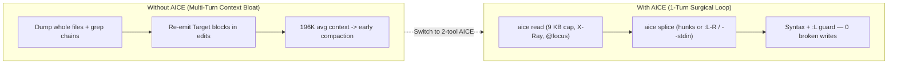

# AICE: On-the-Fly AI Context Engine & Surgical Code Splicer

[](https://github.com/forart82/aice/releases)
[](https://github.com/forart82)
[](https://github.com/forart82/aice/stargazers)
[](LICENSE)
[](https://www.typescriptlang.org/)
[](https://bun.sh/)
[](https://nodejs.org/)
[](tests/)
[](docs/BENCHMARKS.md)

> **A pure on-the-fly context engine and atomic multi-file splicer for autonomous AI coding agents — cut wasted reads, output tokens, and broken disk writes with zero `.aice` files on disk.**


---

## ⚡ What Is AICE? (In 30 Seconds)

AI coding agents burn most of their token quota in two invisible ways:
1. **Context Bloat**: Stuffing entire 1,000-line files into chat history — where every wasted line gets **replayed across ~20+ subsequent turns** and pushes your session into the compaction wall early.
2. **Edit Repetition**: Re-emitting unchanged `Target` blocks or rewriting large files during edits, burning **4x-priced output tokens** and risking silent off-by-one line deletions.

**AICE (AI Context Engine)** gives your AI agent **2 smart tools** — **`aice read`** (MCP: `aice_read`, plus `aice search` / `aice find`) and **`aice splice`** (MCP: `aice_splice`, alias `aice write`) — that read files surgically and edit multiple files atomically in RAM, leaving **zero `.aice` files on disk** and zero changes to your builds or git history.



---

## 📊 What You Actually Win in Production (Live Measured Data)

### At a Glance

| Everyday Impact | What Changes for Your Agent | How AICE Makes It Automatic |
| :--- | :--- | :--- |
| **Leaner Reads Stay Out of History** | **`-43% to -56%`** smaller read payloads | `>120L` Monolith X-Ray outlines, `:sym@keyword` focus slices, `>110L` blank/import elision, and an aligned `9 KB` anti-spill ceiling. |
| **Nearly Half the Output Tokens** | **`-44% to -47%`** fewer `4x`-priced edit tokens | Multi-file `--stdin` batch streams (`<<< === >>>` or `:Lstart-Lend`) skip repeating unchanged `Target` blocks. |
| **Zero Wasted Slice & Retry Turns** | **`0`** extra pagination or flag-retry turns | Symbol/search hints instead of linear `:L` breadcrumbs, priority 1-turn multi-target batch packing (`aice read f1:sym f2 f3`), 1-turn shifted `:L` / hunk splice recovery, and an anti-pagination `AGENTS.md` rule. |
| **Longer Sessions Before Compaction** | **`119K`** avg window vs `196K` (`-39%`) | Agents run **~35% longer** before hitting the `200K` compaction wall. |
| **Zero Broken Disk Writes** | **`0`** broken files written to disk | Pre-write native syntax validation, `±20`-line `:L` & CSS brace disambiguation, 5th-pass whitespace hunk recovery, and atomic `.tmp` -> `rename` commits. |

### Live Production Scorecard (`923` Real Calls / `633` AI Turns on `aipl_dog`)

Measured across **`13` autonomous workers** on real production tasks, priced in honest end-to-end billable quota (**`1x`** new input, **`0.1x`** cached history replay, **`4x`** output) after subtracting all AICE taxes (rule card, CLI wrapper, pagination, and retry turns):

| Metric | `v0.9.47 – v0.9.48` (880 calls / 543 turns) | `v0.9.49+` (Zero-Friction Engine) | Why It Matters |
| :--- | :---: | :---: | :--- |
| **Read / Search Payload vs Native** | `1.61M` vs `~2.82M` (`-43%`) | `49K` vs `~111K` (`-56%`) | Smaller reads stay out of chat history across ~23 subsequent turns. |
| **Edit Output Tokens (`splice` vs `edit_file`)** | `110K` vs `196K` (`-44%`) | `11.4K` vs `21.4K` (`-47%`) | Cuts **output tokens** (4x more expensive & slowest part of replies). |
| **Broken Files Written to Disk** | **`0` / 72 edits** | **`0` / 12 edits** | Pre-write syntax & `:L` guard caught **11** broken edits before disk write. |
| **Extra `9 KB` Pagination / Retry Turns** | `28` slice + `19` retry turns | **`0` wasted turns** | Coalescing, partial `9 KB` fill & flag normalization eliminated retry tax. |
| **Average Context Window Size** | `196K` tok / turn | **`119K` tok / turn (`-39%`)** | Agents work ~35% longer before hitting the `200K` compaction wall. |
| **Real Net End-to-End Quota Saved** | **`+5% to +11%` Net** | **`+17% to +25%` Net** | Honest bottom-line savings on your real LLM quota meter. |

> Controlled cold-start lab benchmarks (`RW-01`..`RW-11`, `11/11` wins) and full production telemetry breakdowns live in [`docs/BENCHMARKS.md`](docs/BENCHMARKS.md) and [`docs/BENCHMARKS_OFFLINE.md`](docs/BENCHMARKS_OFFLINE.md).
>
> **Deterministic Offline Suite (`RW-01`..`RW-10`, 15 languages, `10/10` wins, `Zero .aice Left: true`)**: Tokens `127,011` (Without) → **`73,777` (`-41.9%`, Pure AICE)** → **`35,942` (`-71.7%`, With Idioms)**; Turns `502` → **`206` (`-59.0%`)** → **`154` (`-69.3%`)**; powered by bounded `mtime+ctime+size+ino` LRU caching (`benchmark:offline` `9.2s → 3.3s` `-64%`, `verify:tokenomics` `18.7s → 4.8s` `-75%`, warm caller scans `~15x` faster, warm outlines `~8x` faster).

---

## 🚀 60-Second Install & Easy Daily Guide (`./install.sh`)

### 1. Install (or Update) Globally

```bash
git clone https://github.com/forart82/aice.git && cd aice && ./install.sh

# Common update, non-interactive & uninstall flags:
./install.sh --update        # Pull origin/main & refresh binary, MCP schemas, agents & ~/dev/* rules
./install.sh -y              # Auto-confirm dependencies, git update & Zsh cheatsheet
./install.sh --dry-run       # Preview every step without mutating disk
./uninstall.sh               # Cleanly remove binary, MCP configs, Zsh block & optional project configs
```

**What `./install.sh` sets up automatically:**
- Detects your Linux package manager (`apt`, `dnf`/`yum`, `pacman`, `zypper`, `apk`), checks `git`, `curl`, `node >= 20`, `npm`, builds the bundle, and installs **`~/.local/bin/aice`**.
- Regenerates MCP tool schemas (`aice mcp --generate-schemas`) and wires the strict 2-tool **`aice mcp`** stdio server into installed CLI coding agents (`aice agents setup`).
- Refreshes single-file `AGENTS.md` rules across AICE-enabled projects in `~/dev/*` (strictly respecting `"enabled": false`).
- Optionally adds the **`aice-cheat`** startup cheatsheet box to `~/.zshrc` (skip anytime with `--no-cheatsheet`).

| CLI Coding Agent | Auto-Configured MCP / Config Path | Project Rule Footprint |
| :--- | :--- | :--- |
| **Claude Code (`claude`)** | `~/.claude.json` & `~/.claude/settings.json` (`mcpServers.aice`) | `AGENTS.md` *(+ existing `CLAUDE.md`)* |
| **Antigravity / Gemini CLI (`agy` / `gemini`)** | `~/.gemini/config/mcp_config.json` & `~/.gemini/settings.json` | `AGENTS.md` *(purges legacy duplicates)* |
| **OpenAI Codex CLI (`codex`)** | `~/.codex/config.toml` (`[mcp_servers.aice]`) | `AGENTS.md` |
| **OpenCode (`opencode`)** | `~/.config/opencode/opencode.json` (`mcp.aice`) | `AGENTS.md` |
| **Aider (`aider`)** | `~/.aider.conf.yml` (`read:` conventions list) | `CONVENTIONS.md` |
| **Goose CLI (`goose`)** | `~/.config/goose/config.yaml` (`extensions.aice`) | MCP tool descriptions |
| **Cursor Agent (`cursor`)** | `~/.cursor/mcp.json` (`mcpServers.aice`) | MCP tool descriptions |

<details>
<summary>Alternative: manual symlink or Bun standalone single binary</summary>

```bash
ln -sf "$(pwd)/bin/aice.mjs" ~/.local/bin/aice
# Or compile a standalone binary with Bun (include THIRD-PARTY-NOTICES.txt when distributing):
bun build --compile "$(pwd)/bin/aice.ts" --outfile ~/.local/bin/aice
```

</details>

Verify installation & agent integration anytime:

```bash
aice --version && aice agents status
```

### 2. Turn AICE On or Off Per Project

AICE is **opt-in per workspace** via `aice.config.json` and maintains a single compact **`<= 300`-token `AGENTS.md`** (`v0.9.52`) instruction card with explicit anti-pagination guardrails (automatically stripping legacy duplicate `GEMINI.md` / `.agents/rules/aice.md` blocks):

```bash
aice enable ~/dev/my-project    # Writes "enabled": true in aice.config.json + <=300-tok AGENTS.md
aice disable ~/dev/my-project   # Sets "enabled": false and strips AICE blocks cleanly
aice config ~/dev/my-project    # Inspect active settings (project $idioms are OFF by default)
```

> **Opt-in `$idioms` & `--dsl`**: Project `$idioms` (`"idiomsEnabled": false` by default) and AICE shorthand decompilation (`--dsl`) stay off unless explicitly enabled per call (`--dsl --idioms`) or per project (`aice idioms on`).

### 3. How Your AI Agent Uses It (Everyday Cheat-Sheet)

Autonomous agents see **strictly 2 MCP tools** (`aice_read` and `aice_splice`) — mirrored on the CLI by `aice read` (plus ergonomic `aice search` / `aice find`) and `aice splice` (alias `aice write`):

| Task | CLI Shortcut | MCP Tool (`tools/list`: strictly 2) |
| :--- | :--- | :--- |
| **List files (`< 20ms`, zero AST)** | `aice find "*.ts" src` *(alias: `tree`)* | `aice_read({ path: "src", filesOnly: true })` |
| **4-Tier ranked search (`<=40L` AST / `±10L`)** | `aice search "validateToken" src -C 5` *(alias: `grep`)* | `aice_read({ path: "src", search: "validateToken", contextLines: 5 })` |
| **1-Turn numbered native read (`<= 9 KB`)** | `aice read src/file.ts:sym@kw` | `aice_read({ path: "src/file.ts:sym@kw" })` |
| **Multi-file create & surgical splice** | `aice splice --stdin << 'EOF'` *(alias: `write`)* | `aice_splice({ code: "=== file:sym ===..." })` |

```bash
# 1. Fast workspace map (<20ms zero-AST file list) & ranked search
aice find "*.ts" src
aice search "validateToken" src -C 5

# 2. Smart 1-turn reads (9 KB cap, 1-based line numbers, zero linear :L pagination)
aice read src/app.ts                         # Bare file inline if <= 9 KB, or auto-outline + batch symbol/search hint
aice read src/monolith.ts:outline            # >120L Monolith X-Ray with internal landmarks
aice read src/monolith.ts:bigFn@keyword      # Focus slice inside a giant symbol around @keyword
aice read src/file.ts:fnA src/file.ts:fnB    # Batch symbols in 1 call (never walk :L1-L150 -> :L151-L300 across turns)
aice read src/a.ts:fnA src/big.ts src/b.ts   # 1-turn batch packing: explicit/small targets inline + oversized bare file auto-outlined

# 3. Surgical edits & multi-file --stdin batches (without repeating Target blocks)
aice splice src/engine.ts -s GameEngine.step -c $'<<<\n  this.tick += 1;\n===\n  this.tick += BONUS;\n>>>'

aice splice --stdin << 'EOF'
=== src/new_helper.ts ===
export const BONUS = 2;
=== src/constants.ts:eof ===
export const MAX_RETRIES = 3;
=== src/engine.ts:GameEngine.step ===
<<<
  this.tick += 1;
===
  this.tick += BONUS;
>>>
=== tests/app.test.ts:TC-02 @clone(TC-01) ===
"old" -> "new"
=== src/app.ts:L35-L42 ===
const scaled = base * BONUS;
EOF
```

### 4. Built-In Guardrails & Real Savings Telemetry (`aice gain` & `aice analyze`)

- **Anti-Pagination & 1-Turn Batch Packing (`v0.9.52`)**: Oversized or budget-capped files emit `batch symbols: aice read <file>:<sym1> <file>:<sym2> or aice search <pat> <file>` hints (preserving nested-subproject `cwd`-relative paths) instead of linear `:L1-L140` breadcrumbs; `aice read f1:sym f2 f3` packs explicit selectors and small files first while auto-outlining oversized bare files in **1 turn**; and the `<= 300`-token `AGENTS.md` rule forbids sequential `:L1-L150` -> `:L151-L300` paging across turns.
- **1-Turn `:Lstart-Lend` & Hunk Splice Recovery (`v0.9.52`)**: Pre-write native syntax validation, inclusive `:L` off-by-one guard, `±20`-line shifted anchor & prefix+suffix envelope `:Lstart-Lend` recovery, CSS off-by-1 brace disambiguation, 5th-pass interior-whitespace `<<< === >>>` hunk matching, actionable retry `Tip:` diagnostics (`±5` numbered lines), and atomic `.tmp` -> `rename` commits settle edits in 1 turn with zero broken disk writes.
- **Smart Self-Healing Diagnostics**: Missing symbols trigger Levenshtein `Did you mean` hints, invalid regex patterns fall back safely to literal search, and MCP-style flags (`--files-only=true`, `--context-lines=5`) passed to CLI calls normalize automatically.
- **Honest Signed BPE & Session Accounting (`v0.9.52`)**: Tracks `cl100k_base` & `o200k_base` deltas in a `< 250 B/event` numeric ledger (`~/.aice/telemetry/gains.jsonl`, overrideable via `AICE_TELEMETRY_DIR` / `AICE_TELEMETRY_PATH` / `AICE_HOME`), while `aice analyze` counts `extraReadTurns` strictly on true same-file repeat reads, strips shell redirects (`2>/dev/null`, `2>&1`), and separates post-`&&` non-AICE command failures from AICE errors.

```bash
aice gain              # Global summary, Rule Break-Even & <90s Repeat-Read Turn Warnings (alias: aice stats)
aice gain my-project   # Per-project drill-down & last 15 operations
aice analyze .         # Post-session readLoopAudit & Context Replay Token Tax report
aice gain --reset --yes
```

> **Optional Opt-In DSL & Custom `$idioms`**: Default `aice read` emits exact 1-based disk-numbered native code (`1│ ...`) for zero-translation 1-turn splicing. Pass `--dsl --idioms` (or enable `"idiomsEnabled": true` in `aice.config.json`) when you want compact AICE shorthand + project `$idioms` macro compression (see the full C++20 `$clampBand` walkthrough in [`docs/ARCHITECTURE.md`](docs/ARCHITECTURE.md)).

---

## 🌍 Supported Languages & Universal UTF-8 Text Files

### Structured AST, Decompiler & Pre-Write Syntax-Validated Languages (22+ Languages)

| Domain | Languages & Hardened Capabilities |
| :--- | :--- |
| **Web & App** | TypeScript (`.ts`, `.tsx`, `.d.ts`), JavaScript (`.js`, `.jsx`, `.mjs`, `.cjs`), **Java (`.java`)** *(native routing, `"""` text blocks & symbol splicing)*, PHP (`.php`, heredoc/nowdoc, `#[Attr]`), Kotlin (`.kt`, `.kts`, raw `"""`, nested `/* /* */ */`), C# (`.cs`, nested classes, `@""` / `"""` strings) |
| **Systems & Backend** | Python (`.py`, `.pyi`, zero-import `python3 -S -I` `compile()`), Go (`.go`, backticks, runes), Rust (`.rs`, nested `/* /* */ */`, `'static` lifetimes, `r#"..."#`, `A::B::C`, `..spread`, `as Type`), C++20 (`.cpp`, `.cc`, `.cxx`, `.hpp`, `.h`, `std::` scope, `1'000'000` digit separators, `R"delim(...)delim"`) |
| **Markup & Styling** | **XML & SVG (`.xml`, `.svg`)** *(fast in-process well-formedness validator with `Line:Col` diagnostics & outlining)*, HTML (`.html`, `.htm`), CSS (`.css`), Twig (`.twig`), Markdown (`.md`, `.markdown`) |
| **Data & Config** | JSON (`.json`, `.jsonc`, `.webmanifest`), YAML (`.yaml`, `.yml`, `.cff`) |
| **Shell & Agents** | Shell (`.sh`, `.bash`, `.zsh`), PowerShell (`.ps1`), Batch (`.cmd`, `.bat`), AIPL (`.aipl`) |

### Universal UTF-8 Text-File Support & Binary Guard (`src/config/file-classification.ts`)

- **Any UTF-8 Text File Works Out-of-the-Box**: `aice find`, `aice search`, `aice read`, `aice splice`, and `aice write` (plus MCP `aice_read` / `aice_splice`) support arbitrary & unknown text formats — including `.svg`, `.xml`, `.toml`, `.ini`, `.csv`, `.log`, `.tf`, `.rst`, `.mdx`, extensionless files (`Makefile`, `NOTES`), dotfiles (`.env.local`, `.customrc`), inline SVG/data blobs, and unknown extensions (`.customblob`).
- **Fail-Closed Binary Guard & Transactional Rollback**: Known binary extensions (`.png`, `.wasm`, images, archives, fonts, executables) and NUL-byte / non-UTF-8 files are skipped cleanly in `find`/`search`/`read` and rejected before disk mutation in `splice`/`write`/MCP, backed by lossless `Buffer` rollback snapshots in `spliceBatch`/`createBatch`.

---

## 📚 Deep-Dive Documentation (Advanced & Internal Details)

| Document | What It Covers |
| :--- | :--- |
| [`docs/ARCHITECTURE.md`](docs/ARCHITECTURE.md) | Unified 2-tool engine, `9 KB` CLI/MCP water-filling budgets, `>120L` X-Ray, `:sym@pattern`, `>110L` elision, `>65L` search focus, inclusive `:L` guard, flag normalization & C++20 `--dsl --idioms` walkthrough. |
| [`docs/AICE_SPEC.md`](docs/AICE_SPEC.md) | Normative AICE EBNF grammar, canonical standard library, refinement calculus, lens theorems & CLI/MCP contract. |
| [`docs/AI_SYSTEM_PROMPT.md`](docs/AI_SYSTEM_PROMPT.md) | Full LLM system prompt & canonical `<= 300`-token `AGENTS.md` cheat-card specification. |
| [`docs/BENCHMARKS.md`](docs/BENCHMARKS.md) | Live 33-session adversarial benchmark (`RW-01`..`RW-11`) + 923-call `aipl_dog` multi-worker production ledger. |
| [`docs/BENCHMARKS_OFFLINE.md`](docs/BENCHMARKS_OFFLINE.md) | Deterministic 10-scenario / 15-language offline BPE (`o200k_base`) benchmark breakdown. |
| [`docs/CST_TRIVIA_SPEC.md`](docs/CST_TRIVIA_SPEC.md) | Bidirectional lens & lossless Concrete Syntax Tree (CST) trivia table specification. |
| [`docs/RESEARCH_SYNTHESIS.md`](docs/RESEARCH_SYNTHESIS.md) | BPE pre-tokenization economics, Dyck-$k$ theory & the Symmetric Billable Quota Equation. |

### Project Layout

```text
aice/
├── bin/
│   └── aice.ts             # Slim CLI entrypoint & barrel (read, search/grep, find/tree, splice/write)
├── src/
│   ├── cli/                # 7 acyclic CLI command & MCP-to-CLI flag-normalization submodules
│   ├── config/
│   │   ├── file-classification.ts # Universal UTF-8 text-file SSOT & binary guard
│   │   ├── path-resolver.ts       # Project root & universal target path resolution
│   │   └── project-config.ts      # aice.config.json, TARGET_EXT_MAP & rule sync
│   ├── cache/
│   │   ├── lru.ts          # BoundedLruCache, TwoGenBoundedCache, FileStatLruCache (mtime+ctime+size+ino)
│   │   └── disk-cache.ts   # Optional on-disk compilation cache helpers
│   ├── core/
│   │   ├── parser.ts       # Thin parser barrel re-exporting acyclic src/core/parser/ (7 submodules, :: scope)
│   │   └── lexer.ts / ast.ts / trivia.ts # Indentation lexer, AST nodes & CST trivia
│   ├── decompiler/         # Hardened polyglot decompilers (TS, Python, Rust, C++, Go, C#, Kotlin, PHP, ...)
│   ├── emitters/           # Lossless multi-language native emitters & TargetLanguage SSOT
│   ├── tools/
│   │   ├── read.ts         # Thin barrel -> src/tools/read/ (6 acyclic discovery/search/budget/engine submodules)
│   │   ├── context.ts      # Thin barrel -> src/tools/context/ (8 acyclic search/focus/elision/callers submodules)
│   │   ├── splice.ts       # Thin barrel -> src/tools/splice/ (11 acyclic hunk/stream/span/batch submodules)
│   │   ├── syntax-validator.ts / preprocessor.ts # Lexical masking, native syntax & XML/SVG well-formedness
│   │   └── outline.ts / create.ts / diff-patch.ts / fmt.ts / parity-gate.ts
│   ├── mcp/                # Strict 2-tool MCP stdio server (aice_read, aice_splice)
│   ├── rules/              # Single-file <= 300-token AGENTS.md rule SSOT (mandatory-rules.ts)
│   ├── tokenomics/         # Cached exact js-tiktoken BPE (cl100k_base & o200k_base)
│   └── telemetry/          # Honest signed < 250 B JSONL ledger (aice gain & aice analyze)
├── benchmarks/             # Live real-agent (RW-01..RW-11) & deterministic offline (RW-01..RW-10) suites
├── docs/                   # Architecture, EBNF spec, CST trivia, research synthesis & benchmark reports
└── tests/                  # Unit & integration test suites (barrels/DAGs, universal files, polyglot, MCP, CLI)
```

---

## 👤 Author, Citation & License

- **Author**: Created and maintained by **[@forart82](https://github.com/forart82)**
- **Repository**: [https://github.com/forart82/aice](https://github.com/forart82/aice)
- **Support**: If AICE saves you tokens and turns across your coding agents, please star [**forart82/aice**](https://github.com/forart82/aice)!

### BibTeX Citation

```bibtex
@software{forart82_aice_2026,
  author       = {forart82},
  title        = {{AICE: On-the-Fly AI Context Engine \& Multi-Language \$idioms Splicer}},
  year         = {2026},
  version = {0.9.52},
  publisher    = {GitHub},
  url          = {https://github.com/forart82/aice},
  license      = {Apache-2.0}
}
```

Licensed under the [Apache License 2.0](LICENSE) (see also [NOTICE](NOTICE) and [THIRD-PARTY-NOTICES.txt](THIRD-PARTY-NOTICES.txt)).
Copyright (c) 2026 [forart82](https://github.com/forart82).
