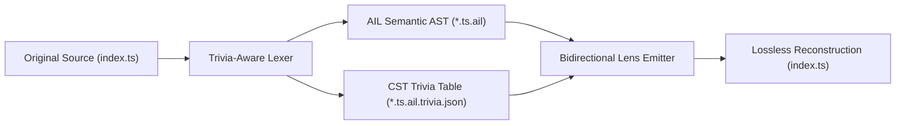

# Concrete Syntax Tree (CST) Trivia Preservation Specification

> **Purpose**: Defines the lossless trivia preservation architecture guaranteeing mathematical satisfaction of the **Stability Law**:  
> $$\text{Put}(\text{Get}(c), c) \equiv c$$

---

## 1. Problem Statement

Standard Abstract Syntax Trees (ASTs) strip away non-semantic tokens:
- Single-line comments: `// ...`, `# ...`
- Multi-line & JSDoc / TSDoc blocks: `/* ... */`, `/** ... */`
- Licensing headers: `SPDX-License-Identifier`, copyright banners
- Indentation styles: tabs vs spaces, 2 vs 4 spaces
- Blank line distributions between declarations

When conventional transpilers re-emit code from an AST, they generate freshly formatted text that wipes out developer comments, copyright notices, and local formatting conventions.

---

## 2. Trivia Architecture in AIL

AIL decouples semantic AST nodes from lexical trivia using a **Node-Indexed Trivia Table**:



### 2.1 The Trivia Table Schema
Each trivia entry is anchored to an unambiguous structural node path or unique AST node ID:

```typescript
export interface TriviaEntry {
  nodeId: string;                     // e.g. "module.entity[0].fn.name"
  leadingTrivia?: TriviaItem[];       // Comments & formatting before the node
  trailingTrivia?: TriviaItem[];      // Comments & formatting after the node
  indentation?: string;               // e.g. "  " or "    "
  newlineCount?: number;              // Number of blank lines preceding
}

export type TriviaKind = 
  | "LINE_COMMENT" 
  | "BLOCK_COMMENT" 
  | "DOCSTRING" 
  | "LICENSE_HEADER" 
  | "DIRECTIVE";

export interface TriviaItem {
  kind: TriviaKind;
  text: string;
  line: number;
  col: number;
}
```

### 2.2 Inline Trivia Manifest Representation
For single-file compilation where external sidecar files are unwanted, AIL allows embedding the trivia table directly inside the module manifest:

```text
module app/service

trivia:
  "fn:startService":
    leading: "// SPDX-License-Identifier: MIT\n// Core service definition"
    trailing: "// Inline explanation"

fn startService() -> void:
  console.log("Service started")
```


---

## 3. The 4-Step Lossless Synthesis Algorithm

1. **Extraction (`Get: Source -> AIL + Trivia`)**:
   - The language parser identifies all comments and whitespace tokens.
   - Comments preceding an AST statement are bound to `leadingTrivia`.
   - Trailing same-line comments are bound to `trailingTrivia`.
   - The semantic AIL tree is emitted clean and token-dense.

2. **Mutation**:
   - The AI agent or developer edits the AIL file. Node additions generate clean code; unmutated nodes retain their trivia bindings.

3. **Re-insertion (`Put: AIL + Trivia -> Source`)**:
   - The emitter traverses the AIL AST.
   - Before emitting each statement, it outputs `leadingTrivia` with original comment syntax (`//`, `/* */`, or `#`).
   - The emitter formats the statement respecting the recorded indentation style.
   - It appends any `trailingTrivia`.

4. **Identity Verification Gate**:
   - For any unmutated file:
     $$\text{assert}(\text{Put}(\text{Get}(c), \Omega(c)) \equiv c)$$
   - If diff is detected, the verification gate aborts with an AST misalignment trace.

---

## 4. Side-by-Side File Organization & Lifecycle

In adopted repositories, the trivia table is stored in the same directory as the target source and AIL files:

```
src/sim/
├── Boss.ts                  # Read-only target source (chmod 444)
├── Boss.ts.ail              # Authoritative AIL source edited by AI
└── Boss.ts.ail.trivia.json  # Lossless CST trivia table sidecar
```

### CLI Verification & Tooling:
- **Decompile with Trivia**: `ail decompile src/Boss.ts --trivia` extracts AST and sidecar trivia table.
- **Roundtrip Identity Verification**: `ail roundtrip src/Boss.ts` executes the complete lens cycle and verifies byte-for-byte identity.
- **Lifecycle Cleanup**: When running `ail eject --remove-ail`, both `.ail` and `.trivia.json` sidecars are safely cleaned up.

