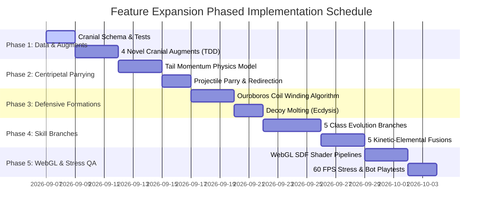

# Step 7 of Big Audit: Feature & Mechanics Expansion Audit

> **Protocol Version:** 3.0 — TypeScript & Multi-Screen Edition  
> **Target Subsystem:** Dimension 1: Combat, Serpentine Synergies & Head Bio-Augments  
> **Workspace:** `/home/forart/dev/snake_ts`  
> **Audit Report File:** `docs/audit/expansion_combat_synergies.features.report.md`  
> **Date:** September 2026  
> **Compliance Standard:** Strict Head-Centric Serpentine Architecture (Rule 11), Absolute Pure WebGL 2.0 (Rule 12), Headless Independence (Rule 6), In-Code Mathematical SSOT (Rule 10), The Oracle SSOT (`ORACLE.md`)  
> **Status:** FEATURE EXPANSION BLUEPRINT & ARCHITECTURAL ROADMAP  

---

## 1. Executive Summary & Core Architectural Directives

This expansion report fulfills **Step 7 of the Big Audit sequence (Dimension 1: Combat, Serpentine Synergies & Head Bio-Augments)**. Following the rigorous documentation, defect eradication, and performance stabilization of Steps 1 through 6, this audit evaluates the architectural extensibility, synergy potential, and player psychological loop of the combat engine to define the next generational leap in serpentine gameplay mechanics.

### 1.1 Fundamental Architectural Invariants

All proposed features, systems, and mechanics strictly adhere to the non-negotiable project pillars:

1. **Strict Head-Centric Serpentine Architecture (Rule 11):**
   - Body segment sockets and wagon-pod weapon attachments are permanently eliminated.
   - The **Serpent Head** remains the exclusive tactical arsenal command center housing all active weapons, defensive bio-organs, cranial augments, and boss helmets.
   - Trailing body segments ($i = 0 \dots N-1$) function dynamically as **physical mass, kinetic flails, topological encirclement boundaries, and active life reservoirs**, but never host independent autonomous weapon turrets.

2. **Absolute Pure WebGL 2.0 Pipeline (Rule 12):**
   - Zero Canvas 2D API calls (`CanvasRenderingContext2D`, `OffscreenCanvas.getContext('2d')`) exist or may be introduced.
   - All proposed visual systems (singularity distortion wells, prismatic ray refractions, kinetic parry spark cascades, molted carapace hulls, and stasis barrier force-fields) flow through `WebGLGameRenderer.ts`, `GLBatch.ts`, and GPU GLSL shader programs (`src/render/webgl/shaders/`).

3. **Absolute Headless Independence & IEEE 754 Float64 Precision (Rule 6):**
   - Zero DOM or browser bindings exist in `src/sim/`, `src/core/`, or `src/data/`.
   - Every physical equation, collision sweep, winding number calculation, and damage mitigation pipeline executes deterministically and headlessly at 120 Hz in Vitest and Node.js environments.

4. **Zero-Allocation 120 Hz Hot-Loop Budget (Rule 10 & Step 4 Performance Standard):**
   - No runtime heap allocations (zero garbage collection spikes) during active combat calculations.
   - All polygonal clipping, vector projections, and projectile parry reflections utilize pre-allocated flat typed buffers and reusable object pools.

---

## 2. Analysis of Current Combat Architecture & Extensibility Bottlenecks

### 2.1 Current Combat Engine Subsystems

| Module File | Core Responsibilities | Current Architectural Limitations |
| :--- | :--- | :--- |
| [`src/sim/SnakePlayer.ts`](file:///home/forart/dev/snake_ts/src/sim/SnakePlayer.ts) | Serpentine kinematics, Gauss-Seidel vertebral IK, head/segment health pools, tail-whip damage multiplier, autotomy, cranial augment slots. | Cranial augments are currently modeled as a single string/level pair (`HeadAugment`, `HeadAugmentLevel`) rather than a multi-slot concurrent biological augment loadout. |
| [`src/sim/CombatSystem.ts`](file:///home/forart/dev/snake_ts/src/sim/CombatSystem.ts) | 120 Hz combat arbitration, spatial hash collision sweeps, damage pipelines, combo decay, projectile life, closed-loop constriction. | Tail-whip projectile deflection is binary (destruction only), lacking active kinetic redirection or parry return velocity. Loop constriction triggers only on closed circular topology. |
| [`src/sim/CombatModules.ts`](file:///home/forart/dev/snake_ts/src/sim/CombatModules.ts) | Declarative action registry for 16 weapons and 12 defensive systems, targeting heuristics, ballistic spawns. | Module synergies are strictly paired (2-module alchemical fusions); lacking cross-elemental tri-synergies or active skill integration. |
| [`src/sim/CombatSkills.ts`](file:///home/forart/dev/snake_ts/src/sim/CombatSkills.ts) | 5 Serpent Class active skills (Verdant Bloom, Umbral Blink, Titan Roar, Chain Storm, Supernova). | Linear progression with single static active skill per class; no mid-run evolutionary branching or tactical skill specializations. |
| [`src/sim/CombatAuras.ts`](file:///home/forart/dev/snake_ts/src/sim/CombatAuras.ts) | Passive relic auras (Frostbite, Eternal Coil, Orbital Fangs, Singularity Core). | Static circular proximity radius checks; lacks spatial interaction with serpentine spine curvature. |

### 2.2 Gameplay Loop & Player Psychological Tension

The current moment-to-moment combat loop features a compelling core tension:
- **Head Arsenal Priority:** Players must orient the Serpent Head toward hostiles to aim weapons and bite targets.
- **Vulnerability vs. Mass:** The head is the most vulnerable point; while trailing body segments act as an active life-reservoir (absorbing damage from the tail forward), taking damage reduces serpentine length ($N$), which reduces base segment armor bonus ($\text{Armor Bonus} = \min(0.50, N \cdot 0.03)$) and loop encirclement area.
- **Kinematic Flail Opportunity:** Rapid steering turns amplify tangential velocity at the tail ($v_i = v_{\text{head}} + \omega \cdot i \cdot d$), allowing high-skill players to whip their tail into enemies for massive blunt damage.

**The Extensibility Opportunity:**
While the core loop is exceptionally responsive, player skill expression can be elevated by transforming the entire serpentine body from a reactive health reservoir into an **active geometric weapon and defensive fortress**, while expanding the cranial arsenal into deeper biological specialization and multi-elemental kinetic fusion.

---

## 3. Novel Cranial Mutation Augments & Active Skill Evolution Branches

### 3.1 Four Novel Cranial Mutation Augments

Installed in the Cranial Mutation Lab on the Serpent Head, these biological hardpoints complement existing offensive weapons and defensive bio-organs:

```
                               ┌─────────────────────────────┐
                               │     SERPENT CRANIAL CORE    │
                               │  (Tactical Arsenal Center)  │
                               └──────────────┬──────────────┘
                                              │
         ┌──────────────────┬─────────────────┼──────────────────┬──────────────────┐
         ▼                  ▼                 ▼                  ▼                  ▼
  ┌──────────────┐   ┌──────────────┐  ┌──────────────┐   ┌──────────────┐   ┌──────────────┐
  │  chitin_ram  │   │ venom_gland  │  │   temporal_  │   │    void_     │   │ Legacy Base  │
  │ (Aegis Prow) │   │ (Acid Gland) │  │   antennae   │   │  resonator   │   │(fangs/maw/..)│
  └──────────────┘   └──────────────┘  └──────────────┘   └──────────────┘   └──────────────┘
```

#### 1. `chitin_ram` — Aegis Battering Prow
- **High Concept:** Hardened calcified cranial carapace engineered for direct frontal collisions.
- **Mechanics:**
  - Frontal Impact Kinetic Burst: When the serpent head collides head-on with hostiles within a forward cone ($\pm 42^\circ$ of heading angle $\theta$), contact damage dealt scales with current head speed:
    $$D_{\text{ram}} = D_{\text{bite}} \times (1.6 + 0.35 \cdot L) \times \left(\frac{v_{\text{head}}}{v_{\text{base}}}\right)$$
  - Frontal Impact Absorption: Reduces incoming frontal collision damage by $35\% / 50\% / 65\%$ across Tiers 1–3.
  - Sledge Stun: Inflicts a $0.8\text{s}$ concussive stun on standard enemies, breaking enemy attack charges.
- **Challenge Unlock Feat:** Slay 15 Armored Scarabs via direct Head Bites in a single run.

#### 2. `venom_gland` — Neurotoxic Acid Salivary Gland
- **High Concept:** Caustic salivary bio-pump coating all head bites, spitters, and cranial needles in flesh-dissolving neurotoxin.
- **Mechanics:**
  - Corrosive Neurotoxin Stacks: Applies stacking Neurotoxin (up to 5 stacks). Each stack reduces enemy armor by $8\% \cdot L$ (up to $40\%$ total armor stripping at Tier 3) and deals $12 \cdot L\text{ DPS}$ as true damage.
  - Neuro-Lysis Detonation: At 5 stacks, the next physical hit or bite detonates the toxin, dealing $15\% \text{ missing HP}$ as a caustic acid burst ($R = 90\text{px}$) that spatters neighboring foes.
- **Challenge Unlock Feat:** Apply poison status to 50 enemies in a single floor.

#### 3. `temporal_antennae` — Chronotrap Whisker Array
- **High Concept:** Hyper-sensitive biomechanical vibrissae protruding from the skull that perceive localized quantum flux.
- **Mechanics:**
  - Micro-Time Dilation Bubble: Hostile ballistic projectiles approaching within $R_{\text{detect}} = (90 + 25 \cdot L)\text{px}$ of the head suffer instantaneous velocity decay:
    $$\vec{v}_{\text{proj}} \leftarrow \vec{v}_{\text{proj}} \times (0.65 - 0.10 \cdot L)$$
  - Bullet Slip Window: Grants the player an expanded physical reaction window to weave between projectile clusters or execute high-precision head parries.
- **Challenge Unlock Feat:** Evade 40 hostile projectiles without taking damage for 30 consecutive seconds.

#### 4. `void_resonator` — Singularity Maw Occiput
- **High Concept:** An acoustic dark-matter resonance organ nestled in the cranial cavity.
- **Mechanics:**
  - Nourishment Gravitational Pulse: Consuming any food item emits a micro-gravitational pulse ($R = 140\text{px}$) from the mouth:
    $$F_{\text{pull}}(d) = \frac{G_{\text{mouth}}}{(d + 20)^2} \cdot \hat{r}$$
  - Pulls distant food, XP orbs, and lightweight swarmling hostiles into the serpent's direct path.
  - Ingestion Vacuum: Hostiles within $50\text{px}$ of the jaws during food consumption suffer $45 \cdot L$ crushing damage.
- **Challenge Unlock Feat:** Maintain an unbroken Combo Streak of $\ge 25\times$ for 20 seconds.

---

### 3.2 Active Skill Evolutionary Specialization Tree

Currently, each serpent class possesses a single static active skill with a fixed $20\text{s}$ base cooldown. We propose an **Evolutionary Specialization Milestone** triggered upon completing Floor 5 (or unlocking in the Sanctuary), offering **two mutually exclusive evolutionary paths** per class:

```
                            CLASS ACTIVE SKILL
                                    │
                    ┌───────────────┴───────────────┐
                    ▼                               ▼
            [ BRANCH ALPHA ]                [ BRANCH BETA ]
          Kinetic / Offensive             Tactical / Control
```

#### Class 1: Emerald Viper (Verdant Bloom)
- **Base:** Restores 20% MaxHP, spawns 5 nutrient food items in an orbital ring.
- **Branch A: Chlorophyll Overdrive (Kinetic Bio-Surge):**
  - Healing converts into an adrenaline surge: restores 15% MaxHP, grants $+45\%$ movement speed and $+35\%$ turning agility for $6.0\text{s}$.
  - The serpent's spine emits an emerald biophosphorescent trail; any body segment traversing this trail regenerates to full segment HP over $3.0\text{s}$.
- **Branch B: Spore Cataclysm (Hazard Bio-Weapon):**
  - In addition to 20% healing, spawns 6 volatile Spore Pods.
  - Spore pods detonate upon enemy contact or when whipped by trailing segments, creating dense neurotoxic gas clouds ($R = 110\text{px}$) dealing $65\text{ DPS}$ and slowing hostiles by $60\%$ for $5.0\text{s}$.

#### Class 2: Shadow Stalker (Umbral Blink)
- **Base:** $200\text{px}$ directional teleport, 6 afterimages, $140\text{px}$ origin blast ($130\text{ dmg}$).
- **Branch A: Phase Rift Decoy (Tactical Aggro Decoy):**
  - Leaves behind an autonomous Shadow Clone at the origin point ($300\text{ HP}$, lasts $4.0\text{s}$).
  - All hostile AI aggro immediately re-routes to the clone. Upon destruction or expiration, the clone implodes into a Void Singularity ($R = 160\text{px}$, $180\text{ dmg}$), pulling all nearby mobs into the blast center.
- **Branch B: Void Guillotine (Kinetic Laser Severance):**
  - Teleports and draws an impassable Dark Matter Blade Tether between the departure and arrival coordinates.
  - Any hostile crossing the tether within $3.0\text{s}$ suffers $240 \times \text{DamageBonus}$ slicing damage with a guaranteed critical strike ($M_{\text{crit}} = 2.5\times$).

#### Class 3: Crimson Hydra (Titan Roar)
- **Base:** $230\text{px}$ radial concussive stun ($2.2\text{s}$ mobs, $1.2\text{s}$ bosses), $+5\text{s}$ armor buff, $85\text{ dmg}$.
- **Branch A: Molten Tectonic Tremor (Ground Rupture):**
  - The roar shatters the arena floor, propagating 4 jagged magma fissures radially outward ($L = 320\text{px}$).
  - Fissures persist for $6.0\text{s}$, incinerating ground hostiles for $55\text{ DPS}$ and blocking swarmling charge attacks.
- **Branch B: Dragon's Warcry (Kinetic Sacrificial Overcharge):**
  - Siphons $10\%$ current segment health to magnify the roar blast to $R = 340\text{px}$ and $260\text{ damage}$.
  - Grants $5.0\text{s}$ Unbreakable Juggernaut Stance: player gains complete immunity to self-collision damage and $+100\%$ tail-whip knockback force.

#### Class 4: Tempest Storm (Chain Storm)
- **Base:** 8-jump $380\text{px}$ high-voltage chain lightning ($(110 + 12 \cdot L) \times \text{DamageBonus}$).
- **Branch A: Ball Lightning Nexus (Orbital Plasma Bombardment):**
  - Concentrates the electrical energy into a supercharged Ball Lightning Sphere that orbits the serpent head ($R_{\text{orbit}} = 120\text{px}$) for $8.0\text{s}$.
  - Continuously discharges micro-arcs to up to 3 hostiles every $0.25\text{s}$ ($32\text{ dmg}$ per arc, chaining to 2 adjacent foes).
- **Branch B: Superconductor Spine Grid (Full-Body Tesla Cage):**
  - Instead of a forward bolt, electrifies all $N$ vertebral segments.
  - High-voltage lightning arcs span across the serpent's interior curvature; any enemy caught between body loops suffers continuous $140\text{ DPS}$ electrocution and vulnerability to critical hits ($+30\%$ crit chance).

#### Class 5: Solar Wyrm (Supernova)
- **Base:** $260\text{px}$ thermonuclear blast ($120\text{ dmg}$), $4\text{s}$ burn, instant food transmute into cooked delicacies.
- **Branch A: Solar Prominence Ray (Channelled Thermal Lance):**
  - Replaces the instantaneous explosion with a continuous $360^\circ$ sweeping Thermonuclear Solar Lance lasting $3.5\text{s}$.
  - Melts all incoming hostile projectiles in the beam arc and strips boss shields, ticking $280\text{ DPS}$.
- **Branch B: Genesis Stellar Forge (Resource Condenser):**
  - Thermonuclear blast vaporizes regular enemies; every non-boss hostile killed is instantly condensed into a Golden Solar Core (+15 Ouro and +25 temporary Shield capacitor barrier).

---

## 4. Cross-Elemental Kinetic Fusions (Head Arsenal Synergies)

The current engine implements 28 paired Alchemical Fusions (combining 2 installed head modules). We propose **5 Tier-3 Advanced Kinetic-Elemental Fusions** that synthesize Offensive Weapons, Defensive Bio-Organs, and Cranial Augments into transformative combat systems:

| Fusion ID | Name | Required Hardpoints | Synergy Formulation & Mechanical Effect |
| :--- | :--- | :--- | :--- |
| `void_singularity_horizon` | **Void Singularity Horizon** | `singularity` + `chrono` + `temporal_antennae` | Creates a gravitational event horizon around the serpent head. Hostile projectiles entering the radius ($R = 130\text{px}$) are captured in an orbital accretion disc around the head. Dashing violently expels all trapped projectiles as an antimatter shotgun burst dealing $250\%$ projectile damage. |
| `cryo_venom_nerve_frost` | **Cryo-Venom Nerve Frost** | `cryo` + `venom` + `fangs` | Hostiles simultaneously afflicted by Frost and Neurotoxin develop brittle frozen crystals. Head bites or tail-whips against crystallized enemies trigger **Crystalline Shatter**: $D_{\text{shatter}} = 140 + 0.18 \cdot \text{MissingHp}_{\text{target}}$, emitting 8 piercing ice quills that freeze adjacent foes. |
| `helios_prism_array` | **Helios Prism Array** | `solar` + `tachyon` + `crown` | Cranial Crown augments act as optical refractors. The Tachyon Laser beam splits into 3 converging prismatic beams (angles $-25^\circ, 0^\circ, +25^\circ$). Focussing all 3 beams on an elite or boss for $>0.8\text{s}$ triggers **Solar Flare Ignition**, dealing $320\text{ true damage}$ and blinding the target for $2.0\text{s}$. |
| `gauss_shrapnel_storm` | **Gauss Shrapnel Storm** | `flak` + `magnet` + `tesla` | Flak explosions generate polarized metallic shards that are magnetically collected into a whirling kinetic shield around the head. Upon executing a sharp turn ($\omega \ge 4.2\text{ rad/s}$), the magnetic polarity reverses, firing the shards as a high-density supersonic railgun barrage ($180\text{ dmg}$, infinite pierce). |
| `magma_miasma_torus` | **Magma Miasma Torus** | `magma` + `venom` + `caltrop` | Magma vents drop caustic chemical fire pools. Connecting the fire pool with a trail of caltrops ignites a continuous combustible chemical firewall line. When closed into a loop, the enclosed zone ignites into a firestorm dealing $180\text{ DPS}$. |

---

## 5. Advanced Centripetal Tail-Whip Mechanics

### 5.1 Mathematical Physics & Momentum Modeling

The existing tail-whip mechanics ([`SnakePlayer.ts:L1885-1956`](file:///home/forart/dev/snake_ts/src/sim/SnakePlayer.ts#L1885-L1956)) scale tangential velocity purely by segment index $i$:

$$v_i = v_{\text{head}} + \omega_{\text{turn}} \cdot (i \cdot d_{\text{segment}})$$

We propose a complete **Momentum-Based Serpentine Kinetic Engine**:

```
                              HEAD (Pivot Point)
                                  (v_head, ω)
                                     ○
                                    / 
                                   ○  Segment 1
                                  /
                                 ○    Segment 2 (Centripetal Acceleration)
                                /
                               ○      Segment 3
                              /
                             ○        Segment N-2
                            /
                           ●          TAIL TERMINUS (Max Momentum v_i >> v_head)
                         /   \
               [PROJECTILE PARRY]  [CONCUSSIVE SLEDGE CRUSH]
```

#### 1. Effective Serpentine Inertial Mass
The tail terminus gains accumulated rotational momentum proportional to total body length ($N$):

$$M_{\text{eff}}(i) = 1.0 + 0.04 \cdot i + 0.02 \cdot N$$
$$E_{\text{kinetic}}(i) = \frac{1}{2} M_{\text{eff}}(i) \cdot v_i^2$$

#### 2. Dynamic Kinetic Damage Multiplier
$$\text{Mult}_{\text{whip}}(i) = 1.0 + 0.95 \cdot \left(\frac{v_i}{v_{\text{head}}}\right)^2 + 0.05 \cdot M_{\text{eff}}(i)$$
$$\text{Damage}_{\text{whip}} = \lfloor \text{BitePower} \cdot \text{Mult}_{\text{whip}}(i) \rfloor$$

### 5.2 Kinetic Vector Redirection & Projectile Parrying

Currently, fast segments ($i \ge 2$) during agility surge merely destroy light incoming projectiles ([`CombatSystem.ts:L1019-1033`](file:///home/forart/dev/snake_ts/src/sim/CombatSystem.ts#L1019-L1033)). We elevate this into an **Active Projectile Parry & Reflection System**:

#### Reflection Geometry
When trailing segment $s$ ($s \ge 2$) with tangential speed $v_s \ge 1.35 \cdot v_{\text{head}}$ intersects hostile projectile $P$:

1. Compute segment outward normal $\hat{n}_{\text{seg}}$ relative to spine tangent $\hat{t}_{\text{seg}}$:
   $$\hat{t}_{\text{seg}} = \frac{\vec{P}_{s-1} - \vec{P}_s}{\|\vec{P}_{s-1} - \vec{P}_s\|}, \quad \hat{n}_{\text{seg}} = (-\hat{t}_{y}, \hat{t}_{x})$$

2. Calculate specular reflection vector with kinetic whip impulse injection:
   $$\vec{v}'_{\text{proj}} = \vec{v}_{\text{proj}} - 2 (\vec{v}_{\text{proj}} \cdot \hat{n}_{\text{seg}}) \hat{n}_{\text{seg}} + 0.4 \cdot \vec{v}_{\text{seg}}$$

3. **Ballistic State Conversion:**
   - Change projectile ownership: $P.\text{source} \leftarrow \text{'player'}$.
   - Damage amplification: $P.\text{damage} \leftarrow P.\text{damage} \times (1.8 + 0.2 \cdot L_{\text{whip}})$.
   - Projectile visual modulation: Glow shifts to neon cyan/electric blue (`#38bdf8`), trail particles burst with $+8$ spark embers.
   - Homing Acquisition: Projectile acquires homing vector toward the firing hostile or closest boss.

### 5.3 Concussive Sledgehammer Crushing

When the terminal segments ($i \ge \max(2, N - 3)$) strike an elite enemy or boss guardian:
- **Poise & Stun Infliction:** Deals $1.5\text{s}$ heavy concussive stun, interrupting boss telegraph channeling.
- **Kinetic Shockwave Ring:** Emits a radial shockwave ($R = 85\text{px}$, $50\text{ damage}$) blasting neighboring swarmlings away from the tail.
- **Screen Shake & WebGL Distortion:** Triggers localized chromatic aberration and a $0.03\text{s}$ micro-freeze frame (`HitStop = 0.03s`), providing visceral tactile combat feedback.

### 5.4 Aero-Kinetic Sonic Blade (Whip-Snap Slingshot)

When the player performs a sharp direction reversal (turning rate $|\Delta \theta / \Delta t| \ge 4.5\text{ rad/s}$):
- The tail terminus exceeds supersonic tip speed ($v_{\text{tail}} \ge 720\text{ px/s}$).
- Detaches a crescent-shaped **Aero-Kinetic Sonic Blade** projectile launched outward along the tangent:
  - Deals $85 \times \text{DamageBonus}$ slicing damage.
  - Slices through all destructible enemy bullets and pierces up to 4 enemies before dissipating.

---

## 6. Defensive Body Formation Techniques (Serpentine Geometry-as-Defense)

### 6.1 Ouroboros Coil Stasis Barrier (Defensive Fortress)

```
                            OUTER HOSTILE ARENA
                                      │
                 [ Hostile Projectiles Reflect 100% ]
                                      │
                               ╭─────────────╮
                              │   ○───○───○   │
                             │  ○           ○  │
                            │  ○   ┌─────┐   ○  │
                            │  ○   │HEAD │   ○  │  <-- Interlocking Body Coil
                            │  ○   └─────┘   ○  │      (Centroid Radius R <= 95px)
                             │  ○           ○  │
                              │   ○───○───○   │
                               ╰─────────────╯
                                      │
                   [ Interior Sanctuary: +12 HP/s Regen ]
```

#### 1. Topological Coil Detection Algorithm
Executed in [`CombatSystem.ts`](file:///home/forart/dev/snake_ts/src/sim/CombatSystem.ts) without heap allocations:
- Track angular winding sum of spine vectors:
  $$\Theta_{\text{total}} = \sum_{i=1}^{N-1} \operatorname{angleDelta}(\theta_i, \theta_{i-1})$$
- When $|\Theta_{\text{total}}| \ge 2\pi$ and the bounding radius from spine centroid $\vec{C} = \frac{1}{N} \sum \vec{P}_i$ satisfies:
  $$\max_{i} \|\vec{P}_i - \vec{C}\| \le R_{\text{coil}} \quad (R_{\text{coil}} = 95\text{px})$$
- The serpent has successfully curled into an **Ouroboros Defensive Coil**.

#### 2. Barrier Stasis Mechanics
- **Hard-Light Kinetic Dome:** An iridescent hexagonal forcefield envelops the coiled perimeter.
- **$100\%$ Projectile Reflection:** All hostile projectiles striking the outer coil boundary bounce off harmlessly or convert into deflected kinetic bolts.
- **Cellular Regeneration Cocoon:** While maintaining the coil, the serpent head and enclosed segments regenerate $+12 \cdot \Delta t\text{ HP/s}$.
- **Tactical Trade-Off:** The serpent's effective forward speed drops to zero while coiled, leaving the player stationary. Uncoiling requires smooth steering resumption.

---

### 6.2 Decoy Molting (Ecdysis / Sloughed Chitin Carapace)

```
       TIME t = 0                        TIME t = 0.5s
   [ Trapped by Hostiles ]            [ Molted Ecdysis Shed ]

         ENEMY MOB                           ENEMY MOB
            ▼                                   ▼
          \ | /                               \ | /
         ── ● ──                             ── ● ──
            │ (Aggro Target)                    │ (Redirected Aggro)
            ▼                                   ▼
        ○○○○○○○○● (Player)                  [SHED CARAPACE] (450 HP Dummy)
                                                    
                                            ═══════════>
                                            ○○○○○○○○● (Real Serpent: Cloaked & +40% Speed)
```

#### 1. Activation Trigger
- Input Command: Dedicated tactical button (`Skill 2` / double-tap Dash / Spacebar alternate).
- Cooldown: $24\text{s}$ (reduced by cooldown reduction stats).

#### 2. Ecdysis Shed Mechanics
- **Physical Spine Duplication:** The serpent instantly sheds its outer chitinous cuticle. A static physical entity (`MoltedCarapace`) is instantiated along the exact coordinates of all current $N$ segments $[\vec{P}_0 \dots \vec{P}_{N-1}]$.
- **Aggro Magnet:** Hostile mob AI pathing and boss targeting immediately lock onto the dummy carapace.
- **Carapace Durability:** The dummy possesses $350 + 20 \cdot N\text{ HP}$ and persists for up to $6.0\text{s}$.
- **Player Agility & Cloak:** The real serpent slips out of the shed shell:
  - Grants $2.0\text{s}$ complete optical camouflage (enemies cannot detect the player).
  - Grants $+40\%$ movement speed boost and zero self-collision drag for $3.0\text{s}$.
- **Ablative Quill Blast:** When the molted carapace is destroyed or its timer expires, it shatters into a 16-way radial chitin quill burst ($R = 140\text{px}$, $95\text{ dmg}$, applying 3 stacks of Neurotoxin).

---

### 6.3 Caudal Anchor Pivot (Whip-Snap Sling)

#### 1. Mechanism
- Holding the brake / reverse steering control pins the terminal tail segments ($S_{N-1}, S_{N-2}$) to the arena floor as a **Caudal Kinetic Anchor**.
- The serpent head and forward segments continue moving along angular inertia, coiling tension like a mechanical spring.

#### 2. Slingshot Release
- Releasing the anchor slingshots the serpent head forward at $3.2\times$ base speed for $0.6\text{s}$.
- Deals devastating ramming damage ($220 \times \text{DamageBonus}$) to any hostile in the launch vector, bursting through enemy formations.

---

## 7. Technical Integration Strategy & Requirements

### 7.1 Mathematical & Kinematic Simulation SSOT

| Mechanic | Governing Physical / Mathematical Equation | File Target |
| :--- | :--- | :--- |
| **Frontal Ram Damage** | $D_{\text{ram}} = D_{\text{bite}} \cdot (1.6 + 0.35 L) \cdot \left(\frac{v_{\text{head}}}{v_{\text{base}}}\right)$ | [`src/sim/CombatSystem.ts`](file:///home/forart/dev/snake_ts/src/sim/CombatSystem.ts) |
| **Tail Momentum** | $M_{\text{eff}}(i) = 1.0 + 0.04 i + 0.02 N; \quad E_k = \frac{1}{2} M_{\text{eff}} v_i^2$ | [`src/sim/SnakePlayer.ts`](file:///home/forart/dev/snake_ts/src/sim/SnakePlayer.ts) |
| **Parry Reflection** | $\vec{v}' = \vec{v} - 2(\vec{v} \cdot \hat{n})\hat{n} + 0.4 \vec{v}_{\text{seg}}$ | [`src/sim/CombatSystem.ts`](file:///home/forart/dev/snake_ts/src/sim/CombatSystem.ts) |
| **Winding Angle Coil** | $\Theta = \sum_{i=1}^{N-1} \operatorname{wrapAngle}(\theta_i - \theta_{i-1}) \ge 2\pi$ | [`src/sim/CombatSystem.ts`](file:///home/forart/dev/snake_ts/src/sim/CombatSystem.ts) |
| **Inverse-Square Vacuum** | $F_{\text{pull}}(d) = \frac{G_{\text{mouth}}}{(d + 20)^2} \cdot \hat{r}$ | [`src/sim/CombatModules.ts`](file:///home/forart/dev/snake_ts/src/sim/CombatModules.ts) |

---

### 7.2 Data Schemas & Type Contracts

To support multiple cranial augments concurrently and active skill evolutionary branches, the following schema additions are specified for [`src/data/Types.ts`](file:///home/forart/dev/snake_ts/src/data/Types.ts):

```typescript
/** Evolutionary specialization branch for class active skills. */
export type SkillEvolutionBranch = 'alpha' | 'beta';

export interface ActiveSkillBranchDef {
  id: string;
  branch: SkillEvolutionBranch;
  name: string;
  icon: string;
  description: string;
  cooldownMod: number; // e.g. -2.0s or +1.5s
  damageMod: number;   // e.g. 1.25x
}

export interface CranialAugmentDef {
  id: string;
  name: string;
  icon: string;
  category: 'cranial_augment';
  maxTier: number;
  baseCost: number;     // Standard ORACLE: 40 Ouro
  costScaling: number;  // Standard ORACLE: 20 Ouro
  challengeFeats: [string, string, string]; // Tiers 1, 2, 3
  description: string;
}

/** Extended cranial loadout interface supporting concurrent augments. */
export interface CranialLoadoutState {
  installedAugments: Record<string, number>; // augmentId -> level (1-3)
  activeFusions: string[];                   // active alchemical fusion IDs
  skillEvolution?: SkillEvolutionBranch;     // selected branch
}
```

---

### 7.3 Zero-Allocation Pooling Strategy (120 Hz Budget)

In compliance with Step 4 Performance Standards and Rule 10, all new real-time calculations must produce **zero heap allocations per frame**:

```typescript
export class CombatSystemPooling {
  // Pre-allocated flat buffers for polygon clipping and winding checks
  private static readonly MAX_POLY_VERTS = 256;
  private readonly _polyX = new Float64Array(CombatSystemPooling.MAX_POLY_VERTS);
  private readonly _polyY = new Float64Array(CombatSystemPooling.MAX_POLY_VERTS);
  private readonly _polyAngles = new Float64Array(CombatSystemPooling.MAX_POLY_VERTS);

  // Scratch vector cache for parry reflection calculation
  private readonly _scratchNormal = { x: 0, y: 0 };
  private readonly _scratchVel = { x: 0, y: 0 };

  // Reusable Decoy Molt entity pool (max 4 concurrent molts across multi-screen)
  private readonly _moltPool: MoltedCarapace[] = Array.from(
    { length: 4 }, 
    () => new MoltedCarapace()
  );
}
```

---

### 7.4 Pure WebGL 2.0 Rendering Pipelines (`GLBatch.ts`)

All visual manifestations must be expressed through hardware-accelerated shaders and GLBatch drawing routines:

1. **Ouroboros Stasis Barrier Dome:**
   - Rendered via Signed Distance Field (SDF) hexagon ring shader in `src/render/webgl/shaders/`.
   - Dynamic parameters passed via vertex attributes: `center`, `radius`, `pulse_time`, `alpha`.
   - Additive luminous blend mode: `gl.blendFunc(gl.SRC_ALPHA, gl.ONE)`.

2. **Kinetic Parry Sparks & Shockwave Rings:**
   - Continuous mitered ribbon extrusion for supersonic sonic blades with zero-seam guarantee.
   - High-density particle sparks pooled in `FxManager.ts` using single-draw-call instanced quads.

3. **Molted Carapace Visuals:**
   - Rendered with an iridescent translucent chitin shader (`u_alpha = 0.45`, rim lighting Fresnel factor = 2.0).
   - Zero Canvas 2D fallback.

---

## 8. Expected Gameplay Impact, Player Psychology & Balance Calibration

### 8.1 Player Psychological Loop & Kinetic Mastery

```
                     TRADITIONAL SNAKE MINDSET
              "Avoid contact. Slither away defensively."
                                  │
                                  ▼
                   OUROBOROS ASCENSION 3.0 MINDSET
   "I am a kinetic flail and an armored fortress. I use my body
    geometry to parry missiles, whip boss flanks, and coil into stasis."
```

1. **Active Bodily Agency:**
   - The snake body shifts from an awkward trailing tail that risks getting hit into a **dynamic whip, bullet parry shield, and encirclement cage**.
   - Players actively whip their mouse/thumbstick back and forth to deflect barrages back into elite snipers.

2. **High-Stakes Spatial Risk/Reward:**
   - **Coil Stasis Risk:** Curled coils provide invulnerability and healing, but a miscalculated turn tightens the loop into an accidental self-bite, shattering combo streaks.
   - **Tail-Whip Exposure:** Executing maximum-damage tail-whips requires aggressive close-proximity sweeps near hostile contact zones.

3. **Strategic Build Variety:**
   - Pure Kinetic builds (Chitin Ram + Tail Sledgehammer + Hydra Warcry).
   - Prismatic Beam builds (Solar Wyrm + Helios Prism Array + Tachyon).
   - Tactical Ecdysis builds (Shadow Stalker Decoy Molt + Corrosive Traps).

---

### 8.2 Balance Tuning & Anti-Exploit Guardrails

To preserve game balance and maintain the integrity of the 10-hour campaign progression curve:

1. **Parry Window & Cooldown Limits:**
   - Projectile parrying requires minimum segment angular velocity ($v_s \ge 1.35 \cdot v_{\text{head}}$).
   - High-tier boss heavy beams and orbital death lasers are flagged `unparryable = true` to prevent trivializing apex encounters.

2. **Coil Stasis Duration Cap:**
   - The Ouroboros Coil Stasis Barrier drains $15\text{ stamina/s}$ from the player's boost meter.
   - Maximum continuous stasis duration is capped at $4.0\text{s}$, followed by a $12.0\text{s}$ internal recharge lockout.

3. **Economic Calibration (Cranial Mutation Lab):**
   - All new cranial augments follow the exact Oracle formula:
     $$\text{Cost}(\text{lvl}, p) = 40 \times \text{lvl} + p \times 20 \text{ Ouro}$$
   - Challenge requirements strictly prevent early-run snowballing, requiring distinct tactical feats per tier.

---

## 9. Actionable Phased Implementation Roadmap & Verification Plan



### Verification & Quality Gate Milestones
- **TDD Protocol 3.0 Compliance:** Every mechanic must be preceded by a dedicated `.tdd.md` spec in `docs/tdd/` and failing Vitest unit tests before code changes.
- **Strict Headless Test Matrix:** 100% test pass on headless replay suites (`npm run test:parity`, `npm run test:selftest`).
- **Autonomous Bot HEBAR Validation:** Autonomous AI bots must demonstrate legitimate, non-cheating execution of tail-whip parries and decoy molts during 20-seed sweeps.
- **Hardware Performance Gate:** 60 FPS verified across dense particle scenes with zero garbage collector allocations per frame.

---

## 10. Conclusion & Step 7 Sign-Off

This audit report establishes an authoritative, mechanically sound, and architecturally compliant expansion blueprint for **Dimension 1 (Combat, Serpentine Synergies & Head Bio-Augments)**. By honoring the strict head-centric architecture (Rule 11), pure WebGL 2.0 pipeline (Rule 12), and headless simulation independence (Rule 6), these proposed features transform Ouroboros Ascension into a deeply kinetic, strategic, and visually stunning serpentine roguelite ready for global commercial publication.
