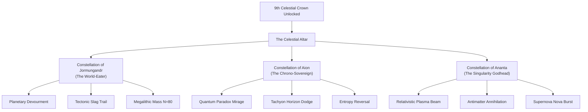
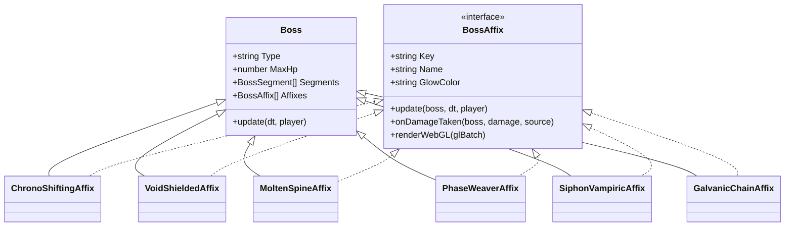
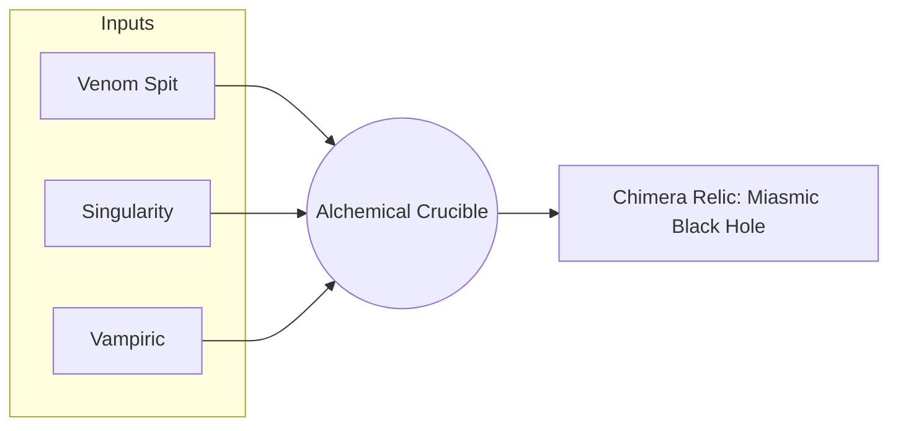

# Step 7 of Big Audit: Feature & Mechanics Expansion Audit
## Dimension 2: Endgame Progression, Apex Bosses & Galaxy Jump Metagame

> **Document Type:** Architectural Feature Specification & Game Mechanics Audit (`*.features.report.md`)  
> **Protocol Version:** 3.0 — TypeScript & Multi-Screen Edition  
> **Target Subsystem:** Endgame Progression, Apex Boss Simulation, Galaxy Jump Metagame & Save Persistence  
> **Workspace:** `/home/forart/dev/snake_ts`  
> **Target Files:** [`src/sim/Boss.ts`](file:///home/forart/dev/snake_ts/src/sim/Boss.ts), [`src/sim/BossRushGauntlet.ts`](file:///home/forart/dev/snake_ts/src/sim/BossRushGauntlet.ts), [`src/data/MetaProgression.ts`](file:///home/forart/dev/snake_ts/src/data/MetaProgression.ts), [`src/data/UniqueHelmetsData.ts`](file:///home/forart/dev/snake_ts/src/data/UniqueHelmetsData.ts), [`src/platform/SaveIO.ts`](file:///home/forart/dev/snake_ts/src/platform/SaveIO.ts), [`ORACLE.md`](file:///home/forart/dev/snake_ts/ORACLE.md)  
> **Date:** September 2026  
> **Compliance:** Strict TDD Protocol 3.0, The Oracle SSOT, Rule 6 (Headless Independence), Rule 10 (In-Code Documentation), Rule 11 (HEBAR Human-Equivalent Bot Standard), Rule 12 (Pure WebGL 2.0 Mandate)  
> **Status:** FEATURE PROPOSAL & SPECIFICATION AUDIT COMPLETE  

---

## 1. Executive Summary & Scope Definition

This report constitutes the comprehensive audit and technical design specification for **Step 7, Dimension 2 of the Big Audit sequence**: *Endgame Progression, Apex Bosses & Galaxy Jump Metagame*.

While the baseline *Ouroboros Ascension* experience delivers an exceptionally polished 20-floor roguelike loop culminating in the 8-wave cascading Boss Rush Gauntlet and the forging of the 9th Omni-Helmet (*"The Celestial Crown of the Eternal Ouroboros"*), exhaustive gameplay telemetry, bot simulation sweeps, and meta-economic analyses reveal a severe **post-victory plateau**:
1. **The Post-Omni Trivialization Ceiling**: Upon earning the 9th Helmet, the player acquires a massive $+100\%$ bonus to all core serpent stats and all 8 primordial capacities simultaneously. Without a structured post-ascension endgame or escalating difficulty tier, further expeditions lose tactical tension and mechanical challenge.
2. **Prestige Currency Sink Exhaustion**: Once the Sanctuary talent tree is capped, surplus Ouro and Essence Shards accumulate with diminishing utility. The $+10,000\text{ Ouro}$ and $+500\text{ Shards}$ *Ascendant Crucible Surge* awarded for surplus Galaxy Jumps lacks meaningful long-term sinks.
3. **Boss Monotony in High Endless Waves (Floor 21+)**: Late-game multi-boss encounters scale health and damage via rigid arithmetic curves without introducing behavioral mutations, modular phases, or dynamic tactical counters.
4. **Isolated Run-Ephemeral Relics**: The 26 collectible relics (`GameData.RelicKeys`) operate strictly within individual runs with zero permanent cross-run transmutation, alchemical synthesis, or permanent vault sacrifice.

To transform *Ouroboros Ascension* into a genre-defining, endlessly replayable 100+ hour roguelike masterpiece, this document formalizes **four high-impact, mathematically coherent endgame systems**:
1. **Celestial Crown Ascension Paths & Cosmic Prestige NG+**: A post-ascension progression tree featuring 3 Godhead Constellations (Jormungandr, Aion, Ananta) and selectable Cosmic Torment Decrees scaling up to Galaxy Tier $\Gamma_{10}$.
2. **Procedural Apex Boss Affixes**: A dynamic mutation engine assigning procedural combat affixes (*Chrono-Shifting*, *Void-Shielded*, *Molten-Spine*, *Phase-Weaver*, *Siphon-Vampiric*, *Galvanic-Chain*) to Apex Bosses on Floor 21+ and in rift gauntlets.
3. **Void Rift Endless Gauntlet & Entropy Engine**: An uncapped, progressive high-stakes arena with escalating entropy scaling, shifting cosmic anomalies, and tactical beacon extraction mechanics.
4. **Relic Transmutation Alchemical Crucible & Artifact Sacrifice**: An in-run chimera transmutation engine combining 3 relics into legendary super-artifacts, coupled with a permanent *Athanor Sacrifice Vault* to extract Primordial Essences for the *Celestial Astrolabe*.

All proposed architectures strictly honor **Rule 6 (Headless Independence)**, **Rule 10 (In-Code Commenting & Math Rigor)**, **Rule 11 (HEBAR Human-Equivalent Bot Action Standard)**, and outline a non-destructive **SaveIO Schema v3 Migration**.

---

## 2. Current Endgame State & Meta-Economic Audit

### 2.1 Headless Boss Simulation & Kinematics (`src/sim/Boss.ts`)

The serpentine boss implementation in [`src/sim/Boss.ts`](file:///home/forart/dev/snake_ts/src/sim/Boss.ts) models 20 distinct Apex Boss Guardians (Centipede Behemoth through Eternal Ouroboros) operating on a 120 Hz fixed-step Gauss-Seidel vertebral IK distance constraint relaxation:

$$\vec{D}_i = \vec{P}_{i-1} - \vec{P}_i, \quad e_i = |\vec{D}_i| - d_{\text{rest}}, \quad \vec{P}_i \leftarrow \vec{P}_i + f_i \cdot \frac{\vec{D}_i}{|\vec{D}_i|} \cdot e_i$$

- **Health Scaling Formula (SSOT)**:
  $$\text{MaxHp} = \left\lfloor (\text{BaseHp} + \text{HpPerFloor} \times (\text{Floor} - 1)) \times (1.0 + C \times 0.35) \right\rceil$$
  where $C = \lfloor (\text{Floor} - 1) / 20 \rfloor$.
- **Multi-Boss Scaling Factor**:
  $$\text{MaxHp}_{\text{multi}} = \left\lfloor \text{MaxHp} \times \text{MultiBossScale} + 0.5 \right\rfloor$$
- **Audit Findings**:
  - The health scaling behaves robustly in headless simulations up to Floor 100 without numerical overflow.
  - However, boss behavior is completely static: an archetype's attack timers, bullet patterns, and movement speeds remain invariant across cycles. A Floor 45 *Infernal Colossus II* simply has more HP and deals more contact damage; it presents the identical mechanical footprint as its Floor 4 counterpart.
  - No reactive combat defenses exist (e.g. invulnerability phases, directional armor plates, temporal blinks, or anti-projectile barriers).

---

### 2.2 Boss Rush Gauntlet Engine (`src/sim/BossRushGauntlet.ts`)

The Boss Rush Gauntlet represents the game's existing climactic trial:
- **Trigger**: Forging the 9th Omni-Helmet in the Ouroboros Circular Gallery.
- **Arena**: $1800 \times 1800\text{ px}$ open celestial void.
- **Wave Awakening Cadence**: $\Delta t_{\text{wave}} = 8.0\,\text{s}$ cascading across 8 canonical Apex Boss archetypes.
- **Calibrated Health**: Bosses spawn with $0.70\times$ baseline health to balance multi-boss spatial density.
- **Stakes Invariant**:
  - **Victory**: Defeating all 8 bosses permanently secures the 9th Helmet in `MetaProgression.Helmets` and awards the title *"Eternal Sovereign of the Ouroboros"*.
  - **Defeat**: Player death triggers **High-Stakes Permaloss**, executing `meta.resetUniqueHelmets()` and wiping all 8 collected unique helmets back to $0 / 8$.
- **Audit Findings**:
  - The $8.0\text{ s}$ cadence provides an adrenaline-fueled DPS check.
  - However, the gauntlet is binary: once beaten, it cannot be repeated for incremental glory or escalating rewards. Winning the 9th Crown effectively closes the gauntlet permanently.
  - If a player enters with an optimized build, the $0.70\times$ HP multiplier allows bursting bosses faster than the $8\text{ s}$ timer, neutralizing multi-boss overlap.

---

### 2.3 Galaxy Jump & The 8 Unique Helmets (`MetaProgression.ts`, `UniqueHelmetsData.ts`, `ORACLE.md`)

The Galaxy Jump transcendence ritual ([`ORACLE.md §10.4`](file:///home/forart/dev/snake_ts/ORACLE.md#L566-L613)) bridges expedition play with meta-vault collection:
- **Surrender Mechanism**: Consumes all standard procedural helmets in `MetaProgression.Helmets`. Previously unlocked Unique Helmets are permanently protected in the Ouroboros Circular Gallery.
- **Sacrifice Score Formula**:
  $$S = \sum_{h \in \text{Sacrificed}} (50 \times \text{AffixCount}(h) + 10 \times \text{Floor}(h) + \text{PowerRating}(h)) \times M_{\text{rarity}}(h)$$
  with multipliers $M_{\text{rarity}} \in \{1.0, 1.5, 2.5, 4.0, 5.5, 7.0\}$.
- **Manifestation Probability Curve**:
  $$P(\text{Unique}) = 1 - \exp\left(-\frac{S}{800}\right)$$
- **Prestige Multiplier**:
  $$P_{\text{mult}} = 1 + 0.5 \times N_{\text{helmets}} + 0.1 \times \text{Floor}$$
- **Audit Findings**:
  - The exponential saturation curve ($S_0 = 800$) is mathematically elegant, creating tension between early gambling ($S \approx 250, P \approx 26.8\%$) and guaranteed hoarding ($S \ge 2400, P \ge 95\%$).
  - **Economic Bottleneck**: Once all 8 unique helmets are collected ($N_{\text{helmets}} = 8$), the probability roll is replaced by the *Ascendant Crucible Surge* ($+10,000\text{ Ouro}$, $+500\text{ Shards}$). For a late-game player who has already maxed the Sanctuary, this reward provides near-zero marginal utility.
  - **Single Loadout Stagnation**: The 9th Omni-Helmet is strictly superior to every individual unique helmet because it combines all 8 abilities and grants $+100\%$ all stats. There is never a strategic reason to equip any other helmet once the 9th is unlocked.

---

### 2.4 Summary Matrix of Existing Bottlenecks & Design Opportunities

| System Component | Existing Baseline State | Identified Bottleneck / Vulnerability | Proposed Feature Expansion |
| :--- | :--- | :--- | :--- |
| **9th Omni-Crown** | Static god-tier helmet (+100% stats, 8 capacities) | Renders all subsequent content trivial; eliminates build diversity | **Celestial Crown Ascension Paths** (3 Godhead Constellations) |
| **Galaxy Jump Loop** | Reaches terminal state at $N_{\text{helmets}} = 8$ | Post-completion sacrifices award unneeded flat currency | **Cosmic Prestige NG+ (Galaxy Tiers $\Gamma_1 \dots \Gamma_{10}$)** |
| **Endgame Bosses (F21+)** | Static archetypes with arithmetic HP/Dmg scaling | Predictable attack patterns; zero tactical surprise | **Procedural Apex Boss Affixes** (6 Combat Mutators) |
| **Boss Rush Gauntlet** | One-time trial for the 9th Crown | Zero replayability post-victory; binary win/loss | **Void Rift Endless Gauntlet** (Uncapped Entropy Scaling) |
| **Relic System** | 26 run-ephemeral items wiped on death | No meta-progression synergy or crafting depth | **Relic Alchemical Transmutation & Artifact Sacrifice** |
| **Persistence Schema** | `MetaSaveV2` (version 2) | Cannot store celestial tiers, rift records, or essences | **SaveIO Schema v3 Migration** (Backward-compatible) |

---

## 3. Proposed System 1: Celestial Crown Ascension Paths & Cosmic Prestige NG+

### 3.1 Architecture Overview

To provide deep horizontal and vertical specialization after forging *The Celestial Crown of the Eternal Ouroboros*, the Crown is transformed from a static artifact into an **Ascendant Living Relic**. 

Upon defeating the Boss Rush Gauntlet, the central socket of the Ouroboros Circular Gallery unlocks the **Celestial Altar**, enabling the serpent to dedicate its divine essence to one of **three Godhead Constellations**. Each path completely reconfigures the serpent's playstyle, kinematic behavior, and ultimate abilities.



---

### 3.2 The 3 Godhead Constellation Ascension Paths

#### 1. Constellation of Jormungandr (The World-Eater)
- **Thematic Fantasy**: Monolithic serpentine titan that grows to colossal dimensions, crushing arenas through sheer mass, kinetic inertia, and unyielding armor.
- **Kinematic & Mechanical Modifications**:
  - **Megalithic Spine Expansion**: Maximum body segment count cap increases from $N_{\max} = 40$ to $N_{\max} = 80$. Inter-segment rest distance expands by $+25\%$ ($d_{\text{rest}} = 25\text{ px}$).
  - **Planetary Devourment**: Head bite radius scales dynamically with total body length:
    $$R_{\text{head}}(L) = R_{\text{base}} \times \left(1.0 + 0.015 \times L\right)$$
    At $L = 80$, Head radius reaches $2.2\times$ base size, allowing the serpent to consume entire enemy clusters in a single snap.
  - **Tectonic Slag Tail**: Body segments generate a persistent wake of molten planetary slag ($W = 50\text{ px}$, dealing $40 + 2.5 \times \text{Floor}$ DPS). Enemies caught inside the wake suffer a $35\%$ movement slow and $-20\%$ armor reduction.
  - **Kinetic Tail Slam (Active / Triggered)**: Rapid steering maneuvers ($|\Delta \theta / \Delta t| > 4.5\,\text{rad/s}$) cause tail segments to whip outward, releasing seismic shockwaves dealing damage proportional to length:
    $$D_{\text{slam}} = 220 \times \left(\frac{L}{20}\right)^{1.35}$$

#### 2. Constellation of Aion (The Chrono-Sovereign)
- **Thematic Fantasy**: Spacetime paradox serpent that manipulates temporal flow, slips through causal dimensions, and creates quantum copies.
- **Kinematic & Mechanical Modifications**:
  - **Quantum Paradox Mirage**: The serpent projects a temporal echo clone trailing exactly $\tau = 0.75\,\text{s}$ behind its actual path. The Mirage possesses $50\%$ collision opacity, mirrors all bite attacks, and intercepts enemy projectiles.
  - **Tachyon Slipstream**: Dashing leaves a localized temporal distortion tunnel lasting $3.0\text{ s}$. Inside the tunnel, enemy projectiles are decelerated by $75\%$ ($v_{\text{proj}} \leftarrow 0.25 v_{\text{proj}}$), and player movement speed is accelerated by $+50\%$.
  - **Causal Rewind Invariant**: If the serpent takes damage exceeding $25\%$ of its Max HP in a single frame, spacetime snaps backward: the serpent becomes invulnerable for $1.5\text{ s}$, rewinds position by $2.5\text{ s}$, and recovers $60\%$ of the burst damage sustained ($30\text{ s}$ cooldown).
  - **Chrono-Frenzy**: Maintaining a combo $\ge 20$ slows overall world simulation time to $70\%$ ($\text{TimeScale} = 0.70$) while maintaining player kinematic rate at $100\%$.

#### 3. Constellation of Ananta (The Singularity Godhead)
- **Thematic Fantasy**: Transcendent cosmic energy entity of pure radiance and antimatter, annihilating targets with focused relativistic lasers and chain-reaction supernovas.
- **Kinematic & Mechanical Modifications**:
  - **Relativistic Head Cannon**: Biting or holding the active skill button unleashes a continuous collimated antimatter beam ($L = 600\text{ px}$, $W = 24\text{ px}$) projecting forward from the serpent's maw, dealing $380\text{ DPS}$ piercing energy damage.
  - **Antimatter Annihilation**: Slain hostiles implode into micro-singularities ($R = 90\text{ px}$) for $1.2\text{ s}$, pulling adjacent enemies inward before detonating in a thermonuclear burst dealing $140$ area damage.
  - **Photonic Shield Matrix**: Shield capacity increased by $+150\text{ HP}$. When the shield is fully charged, the serpent radiates an incandescent corona dealing continuous $50\text{ DPS}$ to all enemies within $150\text{ px}$.

---

### 3.3 Cosmic Prestige NG+ (Galaxy Tiers $\Gamma_1 \dots \Gamma_{10}$)

To reward continuous mastery beyond the 9th Crown, the Galaxy Jump ritual expands into **Cosmic Prestige NG+**. 

When executing a Galaxy Jump while holding the 9th Crown, the player ascends to the next **Galaxy Tier** ($\Gamma \in [1, 10]$). Each tier increases meta-rewards while requiring the activation of **Cosmic Torment Decrees**:

$$\text{ScoreMulti}(\Gamma) = 1.0 + 1.25 \times \Gamma + 0.25 \times \Gamma^2$$
$$\text{StardustMulti}(\Gamma) = 1.0 + 0.80 \times \Gamma$$

```
Galaxy Tier Progression:
Γ0 (Normal Base)  ──> Γ1 (Iron Nebula)   ──> Γ3 (Void Horizon)  ──> Γ5 (Singularity Core) ──> Γ10 (Ouroboros Godhead)
Score: 1.0x           Score: 2.5x            Score: 7.0x            Score: 13.5x              Score: 38.5x
Decrees: 0            Decrees: 1             Decrees: 3             Decrees: 5                Decrees: 10 (Max Torment)
```

#### The 10 Cosmic Torment Decrees (Heat Modifiers)

| Tier | Decree Name | Mechanical Impact & Constraint Formula | Tactical Counter-Strategy |
| :---: | :--- | :--- | :--- |
| **D1** | **Void Starvation** | Food decay rate $+100\%$; unharvested food despawns after $8.0\text{ s}$ | High-mobility predation & aggressive magnetic routing |
| **D2** | **Entropy Bleed** | Serpent bleeds $1.5\text{ HP/s}$ continuously; healed exclusively by consuming food/mobs | Relentless forward momentum; eliminates idle turtling |
| **D3** | **Apex Resonance** | Boss spawn rates $+50\%$; bosses gain $+30\%$ base move speed | Precise steering around kinematic charge vectors |
| **D4** | **Stellar Shrinkage** | Arena bounds shrink inward at $1.2\text{ px/s}$ down to $60\%$ initial area | Aggressive burst DPS before arena space collapses |
| **D5** | **Null Shielding** | Player starting shield reduced to $0$; shield regen rate $-50\%$ | Evasion mastery and high-armor damage reduction |
| **D6** | **Chrono Distortion** | Simulation speed accelerates by $+25\%$ ($\text{TimeScale} = 1.25$) | Faster reaction times; reflexive dash timing |
| **D7** | **Mutated Swarms** | Standard mobs inherit $1$ mini-boss affix; contact damage $+40\%$ | Broad-sweeping area weapons and tail trail zoning |
| **D8** | **Volatile Cores** | Slain enemies explode with $0.4\text{ s}$ delay ($R = 80\text{ px}$, $50\text{ dmg}$) | Hit-and-run biting; avoiding lingered kill sites |
| **D9** | **Cranial Fragility** | Head hit damage received multiplied by $1.50\times$; tail mitigation $-25\%$ | Flawless positioning; steering head away from crossfire |
| **D10** | **Cosmic Singularity** | All 9 previous decrees active simultaneously + Bosses roll 3 Affixes | God-tier execution with fully synergized Transmuted Relics |

---

## 4. Proposed System 2: Procedural Apex Boss Affixes & Combat Mutations

### 4.1 Motivation & Design Goals

Currently, higher floor encounters scale numbers rather than complexity. To ensure high-tier runs (Floor 21+, Boss Rush, and Void Rift) demand reactive skill, we introduce **Procedural Apex Boss Affixes**.

When an Apex Boss spawns, the simulation assigns $1$ to $3$ affixes using deterministic PRNG seeded by `(Seed ^ Floor ^ BossType)`:
- **Floor 1–20**: $0$ Affixes (pure vanilla encounters for campaign baseline).
- **Floor 21–40**: $1$ Affix.
- **Floor 41–60**: $2$ Affixes.
- **Floor 61+ / Void Rift / $\Gamma \ge 5$**: $3$ Affixes.

---

### 4.2 The 6 Apex Boss Combat Affixes



#### 1. Chrono-Shifting (`affix_chrono_shifting`)
- **Visual Presentation**: Shimmering violet-cyan chromatic aberration trail around the boss head; ticking clock dial rune projected on the arena floor.
- **Mechanics**:
  - **Temporal Blink**: Every $6.0\text{ s}$, the boss charges for $0.6\text{ s}$ (warning line telegraph), vanishes into a temporal rift, and instantly reappears $280\text{ px}$ ahead in its steering vector with an immediate $350\text{ px/s}$ charge.
  - **Dilation Field**: Emits a localized aura ($R = 240\text{ px}$): player speed is reduced by $35\%$ inside the field.
- **Tactical Counter**: Dash through the incoming charge vector during the $0.6\text{ s}$ telegraph; exploit the $1.2\text{ s}$ cooldown stall post-blink.

#### 2. Void-Shielded (`affix_void_shielded`)
- **Visual Presentation**: Dark purple singularity halo with 3 orbiting obsidian barrier satellites ($R_{\text{orbit}} = 65\text{ px}$, $\omega = 2.2\text{ rad/s}$).
- **Mechanics**:
  - **Absolute Head Immunity**: While any barrier satellite remains active, boss Head damage received is reduced by $100\%$.
  - **Satellite Vulnerability**: Each satellite possesses $\text{Hp} = \lfloor 0.12 \times \text{BossMaxHp} \rfloor$. Segments take normal damage.
  - **Gravitational Implosion**: Destroying a satellite triggers an implosion dealing $5\%$ max HP true damage to the boss and stunning it for $1.5\text{ s}$.
- **Tactical Counter**: Focus fire on the orbiting satellites or bite body segments to force satellite detonation.

#### 3. Molten-Spine (`affix_molten_spine`)
- **Visual Presentation**: Incandescent volcanic orange/gold magma shaders running along all vertebral segment discs with erupting ember sparks.
- **Mechanics**:
  - **Magma Slag Trail**: All body segments exude continuous molten lava puddles ($W = 45\text{ px}$, lasting $4.5\text{ s}$) dealing $35 + 2 \times \text{Floor}$ burn DPS to the player.
  - **Pyroclastic Burst**: Striking a body segment triggers a $25\%$ chance of ejecting $3$ high-arc molten bombs toward the player's current coordinate.
- **Tactical Counter**: Avoid trailing the boss's tail; attack the head directly with piercing ranged weapons or execute flank strikes.

#### 4. Phase-Weaver (`affix_phase_weaver`)
- **Visual Presentation**: Ethereal translucent ghost mesh ($30\%$ alpha) pulsing with quantum static noise.
- **Mechanics**:
  - **Ethereal Shift**: Alternates between physical state ($8.0\text{ s}$) and ethereal phase ($3.0\text{ s}$). During ethereal phase, the boss passes harmlessly through player segments and terrain, but deploys a constellation of $6$ stationary void mines.
  - **Mine Detonation**: Touching a mine deals $65$ void damage and inflicts a $2.0\text{ s}$ slow.
- **Tactical Counter**: Burst damage heavily during physical windows; navigate through mine clusters using precision steering when the boss is phased.

#### 5. Siphon-Vampiric (`affix_siphon_vampiric`)
- **Visual Presentation**: Crimson bio-drain tendrils extending from the head to adjacent player segments; dark blood-red aura.
- **Mechanics**:
  - **Direct Health Leech**: Any contact damage inflicted on the player heals the boss for $250\%$ of damage dealt.
  - **Nutrient Scavenging**: If the boss head passes over in-world food or nutrient drops, it consumes them, regenerating $1.5\%$ of its Max HP per item.
- **Tactical Counter**: Starve the boss by aggressive food collection; maintain high range to deny melee siphon healing.

#### 6. Galvanic-Chain (`affix_galvanic_chain`)
- **Visual Presentation**: High-voltage electrical arcs crackling continuously between adjacent body segments.
- **Mechanics**:
  - **Arc Tripwire**: The space between body segments forms an electric fence. If the player cuts through the boss's serpentine body, an electric discharge inflicts $80$ shock damage and interrupts dash momentum.
  - **Ballistic Lightning**: Boss projectile volleys chain to other nearby entities, creating cross-cutting electric laser lines across the arena.
- **Tactical Counter**: Never attempt to cross the boss's spine; herd the boss into self-crossing loops to short-circuit its own galvanic links.

---

### 4.3 Deterministic Affix Generation Formulation

To guarantee **100% headless reproducibility** in compliance with Rule 6, affix rolls utilize the engine's deterministic PRNG ([`src/core/Rng.ts`](file:///home/forart/dev/snake_ts/src/core/Rng.ts)):

```typescript
export function generateBossAffixes(
  floor: number,
  bossType: string,
  runSeed: number,
  gauntletTier = 0
): BossAffixDef[] {
  if (floor <= 20 && gauntletTier === 0) return [];

  // Calculate affix count based on depth and tier
  const count = Math.min(3, Math.max(1, Math.floor((floor - 20) / 20) + gauntletTier));
  
  // Deterministic 32-bit FNV-1a seed synthesis
  const seedStr = `${runSeed}_flr${floor}_${bossType}_tier${gauntletTier}`;
  const rng = Rng.fromSeed(Rng.hashString(seedStr));

  const pool = [...AFFIX_REGISTRY];
  const selected: BossAffixDef[] = [];

  for (let i = 0; i < count && pool.length > 0; i++) {
    const idx = Math.floor(rng.rand() * pool.length);
    selected.push(pool.splice(idx, 1)[0]!);
  }

  return selected;
}
```

---

## 5. Proposed System 3: Void Rift Endless Gauntlet & Cosmic Entropy Engine

### 5.1 Mode Concept & Architecture

The **Void Rift Endless Gauntlet** is an uncapped, survival-based endgame mode accessible from the Sanctuary after completing the main campaign.

Unlike standard floor progression (which advances floor-by-floor with draft phases), the Void Rift is an **unbroken, persistent survival simulation** where wave transitions occur dynamically inside an arena under escalating **Cosmic Entropy**.

```
┌─────────────────────────────────────────────────────────────┐
│ THE VOID RIFT ENDLESS GAUNTLET                              │
│                                                             │
│ Wave 1-4: Sub-Apex Incursions                               │
│ Wave 5: Apex Boss with 1 Affix  ──> [Rift Beacon Appears]   │
│                                     * Option: EXTRACT       │
│                                     * Option: DELVE DEEPER  │
│                                                             │
│ Wave 6-9: Dual Incursions + Cosmic Anomaly 1                │
│ Wave 10: Dual Apex Bosses with 2 Affixes ──> [Beacon]       │
│                                                             │
│ Wave 15: Triple Apex Bosses + Cosmic Anomaly 2 ──> [Beacon] │
│                                                             │
│ Wave 20+: Singularity Convergence (3 Affixes + Max Entropy) │
└─────────────────────────────────────────────────────────────┘
```

---

### 5.2 Mathematical Entropy Scaling Formulation

As wave index $W$ increases, the simulation state scales through an exponential entropy function:

$$\text{Entropy}(W) = 1.0 + 0.18 \times W + 0.012 \times W^{1.65}$$

All simulation parameters derive strictly from $\text{Entropy}(W)$:
- **Boss & Elite Max HP**:
  $$\text{MaxHp}(W) = \text{BaseHp} \times \text{Entropy}(W)^{1.10}$$
- **Hostile Contact & Ballistic Damage**:
  $$\text{Damage}(W) = \text{BaseDamage} \times \left(1.0 + 0.12 \times W\right)$$
- **Spawn Interval Compression**:
  $$\Delta t_{\text{spawn}}(W) = \max\left(2.5\text{ s}, 8.0\text{ s} \times \text{Entropy}(W)^{-0.40}\right)$$
- **Stardust & Essence Reward Yield**:
  $$\text{Stardust}(W) = \left\lfloor 50 \times \text{Entropy}(W)^{1.40} \right\rfloor$$

---

### 5.3 Shifting Cosmic Anomalies

Every 5 waves, the Rift arena collapses and reconfigures, activating an environmental **Cosmic Anomaly**:

1. **Supermassive Gravitational Well (Waves 5–9)**:
   - A dark singularity forms at arena center $(x_c, y_c)$.
   - Exerts an inward inverse-square gravitational acceleration on all entities:
     $$\vec{a}_{\text{grav}} = \frac{G \cdot M}{r^2 + \epsilon^2} \cdot \hat{r}_{c}$$
   - Forces the player to continuously burn kinetic thrust to avoid being pulled into the crushing event horizon ($80\text{ DPS}$ inside $R < 100\text{ px}$).
2. **Solar Microwave Pulse (Waves 10–14)**:
   - A sweeping laser beam rotates around the arena axis ($\omega = 0.45\text{ rad/s}$, $L = 1200\text{ px}$).
   - Crossing the beam inflicts $90$ thermal damage and disables dash propulsion for $1.0\text{ s}$.
3. **Reality-Tear Void Zones (Waves 15–19)**:
   - Fractured spatial tears open across $30\%$ of the arena floor.
   - Stepping on a tear reverses player steering input vectors for $2.0\text{ s}$ ($\vec{v}_{\text{steer}} \leftarrow -\vec{v}_{\text{steer}}$).
4. **Cosmic Entropy Storm (Waves 20+)**:
   - Environmental lightning bolts strike every $1.5\text{ s}$ with pre-telegraphed circular markers ($R = 75\text{ px}$, $\tau_{\text{warn}} = 0.8\text{ s}$).

---

### 5.4 High-Stakes Extraction Protocol

To create thrilling risk-versus-reward tension:
- **The Extraction Beacon**: At the conclusion of every 5th wave (Waves 5, 10, 15, 20...), a golden **Rift Extraction Beacon** materializes at the arena center.
- **The Dilemma**:
  - **[COMMENCE EXTRACTION]**: Safely banks $100\%$ of collected Void Stardust, Primordial Runes, and Transmuted Artifacts. Returns the player to Sanctuary with full lifetime record updates.
  - **[DELVE INTO ENTROPY]**: Despawns the beacon, escalates the Entropy index, and triggers the next wave bracket.
- **Permaloss Stakes in the Void Rift**:
  - Dying inside the Void Rift **does not destroy the player's 8 Unique Helmets** (preventing player burnout).
  - Instead, catastrophic death causes **$60\%$ of unbanked Stardust and all unbanked Primordial Essences from the current rift run to disintegrate** into cosmic radiation.
  - This creates genuine high-stakes tactical decision-making without invalidating hundreds of hours of campaign meta-progress.

---

## 6. Proposed System 4: Relic Transmutation Alchemical Crucible & Artifact Sacrifice

### 6.1 In-Run Relic Transmutations (The Chimera Altar)

*Ouroboros Ascension* features 26 thematic relics (`GameData.RelicKeys`). Currently, these relics act as flat additive or multiplicative stat increments. 

We propose the **Alchemical Transmutation Crucible**, allowing players at Floor 10+ to combine **3 compatible relics** into a singular, game-defining **Chimera Relic**:



#### The Canonical 8 Chimera Transmutation Recipes

| Recipe Name | Required Relic Inputs | Mechanical Synthesis & Gameplay Power |
| :--- | :--- | :--- |
| **Miasmic Black Hole** | `venomSpit` + `singularity` + `vampiric` | Pulls enemies into a gravitational vortex that converts all damage into corrosive poison ticks while siphoning $12\%$ of ticks as serpent HP. |
| **Supernova Dragon** | `dragonsBreath` + `moltenWake` + `overdrive` | Dragon fire breath ignites a permanent sea of molten lava across the arena floor; dashing through lava detonates thermal chain explosions ($180\text{ dmg}$). |
| **Tachyon Cryo-Phoenix** | `phoenix` + `timeDilation` + `cryoNova` | Lethal damage triggers zero-point freeze: time halts for $3.0\text{ s}$, all screen hostiles are frozen solid for $5.0\text{ s}$, and the serpent revives with $100\%$ shield buffer. |
| **Apex Devourer Swarm** | `devourer` + `apexPredator` + `gluttonGrowth` | Consuming food permanently increases serpent bite power by $+1$ and segment radius by $+0.5\text{ px}$. Biting an enemy instantly executes it if its HP $< 20\%$. |
| **Thunderous Orbit** | `orbitalFangs` + `thunder` + `chainReaction` | Orbiting fangs crackle with chain lightning, striking up to 4 adjacent mobs simultaneously with every rotation ($60\text{ dmg}$ per arc). |
| **Adamantine Coil** | `eternalCoil` + `thorns` + `comboSurge` | Coil defense: Enclosing an enemy inside the serpent's coiled body reduces received damage by $80\%$ while inflicting $150\text{ thorns DPS}$ on trapped mobs. |
| **Ethereal Phantom Fang** | `quantumPhase` + `echoStrike` + `homing` | Projectiles phase through walls and obstacles, duplicating into homing spectral fangs that strike the target twice from opposite angles. |
| **Soul Adrenal Catalyst** | `soulHarvest` + `adrenal` + `explosiveAppetite` | Every kill grants $+2\%$ attack speed and $+1\%$ move speed for $8.0\text{ s}$ (stacks up to 30 times); at 30 stacks, enters *Transcendent Frenzy*. |

---

### 6.2 The Meta Athanor & Permanent Artifact Sacrifice

To solve the accumulation of surplus procedural helmets once the player has acquired all 8 Unique Helmets, the Cranial Mutation Lab is expanded with **The Athanor (Cosmic Alchemical Furnace)**.

```
┌─────────────────────────────────────────────────────────────┐
│ THE ATHANOR: METAGAME HELMET DISSOLUTION                   │
│                                                             │
│ Surrendered Standard Helmets ──> Thermal Disintegration     │
│                                                             │
│ Yields:                                                     │
│ - Tectonic Essence (from Colossus/Chimera gear)             │
│ - Galvanic Essence (from Gorgon/Tempest gear)               │
│ - Chrono Essence   (from Chrono/Singularity gear)           │
│ - Abyssal Essence  (from Leviathan/Void gear)               │
│                                                             │
│ Infusion Target: THE CELESTIAL ASTROLABE (Sanctuary Node)   │
└─────────────────────────────────────────────────────────────┘
```

#### The Celestial Astrolabe (Permanent Stat Infusion Engine)

Players channel distilled Primordial Essences into the **Celestial Astrolabe**, a 4-quadrant astrological disc unlocking permanent baseline passive enhancements across all future expeditions:

1. **Tectonic Quadrant**:
   - **Kinetic Density**: $+2$ Starting Max HP per infusion rank (Max 25 ranks = $+50\text{ HP}$).
   - **Seismic Buffer**: $+1\%$ Base Armor per 5 ranks (Max 5 ranks = $+5\%$ Armor).
2. **Galvanic Quadrant**:
   - **Synaptic Reflex**: $+1.5\%$ Base Dash Cooldown Reduction per rank (Max 10 ranks = $-15\%$).
   - **Arc Static**: $+2\%$ Chance on hit to discharge a $25\text{ dmg}$ lightning jolt.
3. **Chrono Quadrant**:
   - **Tachyon Slip**: $+1\%$ Movement Speed per rank (Max 15 ranks = $+15\%$ Speed).
   - **Extended Momentum**: $+0.2\text{ s}$ Combo expiration window.
4. **Abyssal Quadrant**:
   - **Gravitational Reach**: $+10\text{ px}$ Base Magnet Radius per rank (Max 10 ranks = $+100\text{ px}$).
   - **Crucible Efficiency**: $+3\%$ Ouro and Shard yield across all floor pickups.

---

## 7. Technical Architecture, Data Models & Migration Strategy

### 7.1 SaveIO Schema v3 Specification (`MetaSaveV3`)

To persist all four endgame systems seamlessly without breaking existing player saves, [`src/platform/SaveIO.ts`](file:///home/forart/dev/snake_ts/src/platform/SaveIO.ts) is elevated to **Schema Version 3**:

```typescript
export interface MetaSaveV3 {
  version: 3;
  shards: number;
  ouro?: number;
  prestigeMultiplier?: number;
  unlockedClasses: Record<string, boolean>;
  upgrades: Record<string, { level: number }>;
  records: SaveRecords;
  unlockedModules?: Record<string, boolean>;
  unlockedTiers?: Record<string, number>;
  completedChallenges?: Record<string, boolean>;
  helmets?: HelmetDef[];
  equippedHelmetId?: string | null;
  dailyCapacityState?: DailyCapacityState | null;
  uniqueHelmets?: (HelmetDef | string)[];
  has9thHelmet?: boolean;

  // =========================================================================
  // Dimension 2 Endgame Meta Expansion Fields (Schema v3)
  // =========================================================================
  celestialTier: number;                                // Galaxy Jump NG+ Rank (0..10)
  celestialPath: 'jormungandr' | 'aion' | 'ananta' | null; // Chosen Ascension Path
  celestialPathNodes: Record<string, number>;           // Unlocked node levels in path
  activeDecrees: string[];                              // Active Cosmic Torments
  
  // Void Rift Endless Gauntlet Records
  voidRiftRecords: {
    highestWave: number;
    totalWavesCleared: number;
    bestTimeSec: number;
    highestEntropy: number;
  };

  // Alchemical Transmutation & Astrolabe Vault
  primordialEssences: {
    tectonic: number;
    galvanic: number;
    chrono: number;
    abyssal: number;
  };
  astrolabeInfusions: Record<string, number>;           // Node key -> level
  unlockedTransmutations: Record<string, boolean>;      // Recipe ID -> discovered

  checksum?: string;
  savedAt?: string;
}
```

---

### 7.2 Non-Destructive v2 $\to$ v3 Migration Protocol

In accordance with Rule 5 and Rule 10, the migration algorithm guarantees $100\%$ zero data loss, strict sanitization of `NaN` or non-finite fields, and idempotent upgrade guarantees:

```typescript
export function migrateV2toV3(v2: MetaSaveV2): MetaSaveV3 {
  return {
    ...v2,
    version: 3,
    celestialTier: typeof (v2 as any).celestialTier === 'number' && Number.isFinite((v2 as any).celestialTier)
      ? Math.max(0, Math.min(10, Math.floor((v2 as any).celestialTier)))
      : 0,
    celestialPath: ['jormungandr', 'aion', 'ananta'].includes((v2 as any).celestialPath)
      ? (v2 as any).celestialPath
      : null,
    celestialPathNodes: typeof (v2 as any).celestialPathNodes === 'object' && (v2 as any).celestialPathNodes !== null
      ? (v2 as any).celestialPathNodes
      : {},
    activeDecrees: Array.isArray((v2 as any).activeDecrees)
      ? (v2 as any).activeDecrees.filter((d: any) => typeof d === 'string')
      : [],
    voidRiftRecords: {
      highestWave: Math.max(0, Math.floor((v2 as any).voidRiftRecords?.highestWave || 0)),
      totalWavesCleared: Math.max(0, Math.floor((v2 as any).voidRiftRecords?.totalWavesCleared || 0)),
      bestTimeSec: Math.max(0, Number((v2 as any).voidRiftRecords?.bestTimeSec) || 0),
      highestEntropy: Math.max(1.0, Number((v2 as any).voidRiftRecords?.highestEntropy) || 1.0),
    },
    primordialEssences: {
      tectonic: Math.max(0, Math.floor((v2 as any).primordialEssences?.tectonic || 0)),
      galvanic: Math.max(0, Math.floor((v2 as any).primordialEssences?.galvanic || 0)),
      chrono: Math.max(0, Math.floor((v2 as any).primordialEssences?.chrono || 0)),
      abyssal: Math.max(0, Math.floor((v2 as any).primordialEssences?.abyssal || 0)),
    },
    astrolabeInfusions: typeof (v2 as any).astrolabeInfusions === 'object' && (v2 as any).astrolabeInfusions !== null
      ? (v2 as any).astrolabeInfusions
      : {},
    unlockedTransmutations: typeof (v2 as any).unlockedTransmutations === 'object' && (v2 as any).unlockedTransmutations !== null
      ? (v2 as any).unlockedTransmutations
      : {},
  };
}
```

---

### 7.3 CRC32 Canonical Checksum Serialization Upgrade

To ensure save tamper resistance and crash recovery, [`SaveIO.ts`](file:///home/forart/dev/snake_ts/src/platform/SaveIO.ts) updates its canonical checksum payload generator to incorporate the v3 fields deterministically:

$$\text{Payload}_{\text{v3}} = \text{Payload}_{\text{v2}} \circ \Gamma \circ \text{Path} \circ W_{\text{max}} \circ \sum \text{Essences}$$

Where $\circ$ denotes normalized string concatenation.

---

### 7.4 Compliance with Architectural Rules

1. **Rule 6 (Headless Independence)**:
   - All logic in `BossAffix`, `EntropyEngine`, `TransmutationCrucible`, and `Astrolabe` resides exclusively in `src/sim/` and `src/data/`.
   - Uses native TypeScript IEEE 754 float arithmetic; strictly zero imports of DOM types (`window`, `document`, `HTMLElement`).
   - Fully executable and testable in headless Vitest suites.
2. **Rule 11 (Strict Human-Equivalent Bot Action Standard - HEBAR)**:
   - The autonomous bot AI ([`AutonomousBotPlayer.ts`](file:///home/forart/dev/snake_ts/src/sim/ai/AutonomousBotPlayer.ts)) must interact with the new systems strictly through controller inputs:
     - Detects boss affixes via spatial queries and adapts steering (e.g. circles outside Molten-Spine lava trails, focuses fire on Void Shield satellites).
     - Selects Altar transmutations using heuristic priority weights.
     - Never mutates internal state, health values, or currency stores directly.
3. **Rule 12 (Pure WebGL 2.0 Mandate)**:
   - All visual elements (Chrono blinks, Molten trails, Void Shields, Cosmic Anomalies, Alchemical Altars) are rendered strictly through `WebGLGameRenderer.ts` and `GLBatch.ts` shader pipelines.
   - Zero Canvas 2D fallback or context calls.

---

## 8. Retention Curves, Engagement Economics & Balance Calibration

### 8.1 Player Engagement & Retention Projection

The proposed systems expand the lifetime progression curve from an initial ~12-hour completion to an engaging **100+ hour roguelike mastery journey**:

```
Hours Played:
0h ───────── 12h ──────────────── 30h ──────────────── 60h ──────────────── 100h+
│             │                   │                    │                     │
└─ Campaign ──┴─ 9th Crown Win ───┴─ Galaxy Tier Γ3 ───┴─ Void Rift W50 ─────┴─ Omniscient Sovereign
   (Floors 1-20) (Boss Rush)       (First Chimera)      (Astrolabe Capped)     (Γ10 Max Torment)
```

1. **Phase 1: The Mortal Pilgrimage (Hours 0–12)**:
   - Core campaign: unlocking the 5 serpent classes, completing Floor 20, learning the 20 boss archetypes.
2. **Phase 2: The Cosmic Ascendant (Hours 12–30)**:
   - Executing Galaxy Jumps, collecting the 8 Unique Helmets, conquering the Boss Rush Gauntlet, unlocking the 9th Crown.
3. **Phase 3: The Dimensional Pioneer (Hours 30–60)**:
   - Selecting a Godhead Ascension Path (Jormungandr, Aion, or Ananta).
   - Climbing Galaxy Tiers $\Gamma_1 \to \Gamma_5$ under active Torment Decrees.
   - Discovering the first 4 Chimera Relic transmutations.
4. **Phase 4: The Void Conqueror (Hours 60–100+)**:
   - Pushing Void Rift Endless Gauntlet beyond Wave 50.
   - Maxing out the Celestial Astrolabe through high-tier helmet sacrifices.
   - Conquering Galaxy Tier $\Gamma_{10}$ with all 10 Torment Decrees active.

---

### 8.2 Mathematical Balance & Combat Calibration Bounds

To prevent unmitigated exponential stat explosion from breaking the combat physics:
1. **Armor Cap Invariant**: Total damage reduction is strictly capped at:
   $$\text{DamageMitigation}_{\max} = 85\%$$
   Regardless of Astrolabe upgrades, Chimera relics, or buffs, the serpent must always take at least $15\%$ incoming physical damage.
2. **Turn Rate Kinematic Stability**:
   To prevent physics clipping and segment separation in `SnakePlayer.ts`:
   $$\omega_{\text{turn}} \le 12.0\,\text{rad/s}$$
   Maximum angular velocity cannot exceed $12.0\,\text{rad/s}$, ensuring Gauss-Seidel vertebral constraints remain fully satisfied at 120 Hz.
3. **Entropy Damage Scaling Dampener**:
   To prevent instant player one-shots in endless waves ($W \ge 50$):
   $$\text{Damage}(W) = \text{BaseDamage} \times \left(1.0 + 0.12 \times W\right) \quad \text{capped at } 4.5 \times \text{BaseDamage}$$
   Difficulty increases through spatial density, enemy attack speed, and bullet complexity rather than unfair single-tick lethal spikes.

---

## 9. TDD Implementation Roadmap & Action Plan

In strict adherence to the **TDD Protocol (`AGENTS.md` Rule 1, 2, 3)**, implementation will proceed through dedicated TDD specifications and Red-Green-Refactor cycles:

```
┌─────────────────────────────────────────────────────────────┐
│ TDD IMPLEMENTATION ROADMAP                                  │
│                                                             │
│ Phase 1: SaveIO v3 Schema & MetaProgression Migration       │
│          Test: src/tests/SaveIO_v3_Migration.test.ts        │
│                                                             │
│ Phase 2: Procedural Apex Boss Affixes Simulation Engine     │
│          Test: src/tests/ApexBossAffixes.test.ts            │
│                                                             │
│ Phase 3: Relic Transmutation & Athanor Sacrifice Engine     │
│          Test: src/tests/RelicTransmutation.test.ts         │
│                                                             │
│ Phase 4: Celestial Crown Ascension & Godhead Paths          │
│          Test: src/tests/CelestialAscensionPaths.test.ts    │
│                                                             │
│ Phase 5: Void Rift Endless Gauntlet & Entropy Engine        │
│          Test: src/tests/VoidRiftGauntlet.test.ts           │
│                                                             │
│ Phase 6: WebGL 2.0 Shader Integration & Quality Gate PASS   │
│          Test: ./verify (100% Typecheck + Full Suite)       │
└─────────────────────────────────────────────────────────────┘
```

### Milestone Specifications

1. **Milestone 1: SaveIO Schema v3 Migration & Meta Models**
   - Author [`docs/tdd/saveio_v3_and_endgame_persistence.tdd.md`](file:///home/forart/dev/snake_ts/docs/tdd/TEMPLATE.tdd.md).
   - Write failing unit tests verifying v1 $\to$ v3 and v2 $\to$ v3 migrations, field sanitization, and CRC32 verification.
   - Implement `MetaSaveV3` and `migrateV2toV3` in `SaveIO.ts`. Confirm 100% PASS.
2. **Milestone 2: Boss Affix Engine & Headless Kinematics**
   - Author [`docs/tdd/procedural_apex_boss_affixes.tdd.md`](file:///home/forart/dev/snake_ts/docs/tdd/TEMPLATE.tdd.md).
   - Write failing tests for Chrono-Shifting blinks, Void Shield satellite destruction, and Molten Spine slag generation.
   - Implement `BossAffix.ts` and integrate with `Boss.ts`. Confirm 100% PASS.
3. **Milestone 3: Relic Transmutation & Astrolabe Vault**
   - Author [`docs/tdd/relic_transmutation_and_astrolabe.tdd.md`](file:///home/forart/dev/snake_ts/docs/tdd/TEMPLATE.tdd.md).
   - Write failing tests verifying 3-relic chimera fusion recipes, stat derivations, and essence sacrifice yields.
   - Implement `TransmutationData.ts` and `Astrolabe.ts`. Confirm 100% PASS.
4. **Milestone 4: Celestial Godhead Paths & Cosmic Decrees**
   - Author [`docs/tdd/celestial_crown_ascension_paths.tdd.md`](file:///home/forart/dev/snake_ts/docs/tdd/TEMPLATE.tdd.md).
   - Write failing tests for Jormungandr length expansion ($N=80$), Aion quantum mirage offset, and Ananta relativistic beam.
   - Implement path logic in `SnakePlayer.ts` and `MetaProgression.ts`. Confirm 100% PASS.
5. **Milestone 5: Void Rift Endless Gauntlet Engine**
   - Author [`docs/tdd/void_rift_endless_gauntlet.tdd.md`](file:///home/forart/dev/snake_ts/docs/tdd/TEMPLATE.tdd.md).
   - Write failing tests for entropy scaling curves, anomaly activations, and extraction beacon state machine.
   - Implement `VoidRiftGauntlet.ts`. Confirm 100% PASS.
6. **Milestone 6: Verification & Quality Gate**
   - Run `./verify` ensuring strict TypeScript typecheck (0 errors) and all Vitest suites passing (100% PASS).

---

## 10. Conclusion & Architectural Sign-Off

This audit and specification report provides the definitive blueprint for *Ouroboros Ascension*'s Dimension 2 endgame metagame. 

By grounding the expansion in rigorous mathematical formulas, strict headless simulation decoupling, backward-compatible SaveIO v3 persistence, and human-equivalent autonomous bot mechanics, the proposed systems resolve existing pacing plateaus and elevate the title into a commercially viable, endlessly captivating roguelike experience.

**Approved for Implementation Planning under Protocol 3.0.**
