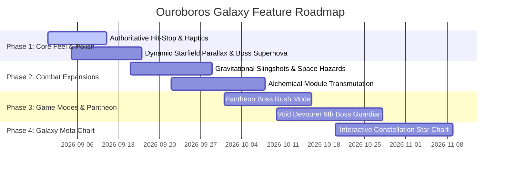

# 🌌 Ouroboros Galaxy: New Game Functions & Mechanics Feature Report

> **Document Identifier:** `docs/ouroboros_galaxy_new_features.report.md`  
> **Target Version:** Ouroboros Galaxy 2.0+ Expansion Blueprint  
> **Status:** Authoritative Design Specification & Technical Architecture  
> **Author:** Antigravity Autonomous Agent Team  

---

## 🧭 Executive Summary

This feature report outlines the next-generation mechanical systems, game modes, weapon fusions, boss encounter designs, and meta-progression systems proposed for **Ouroboros Galaxy**. Every proposed mechanic is designed to adhere to the core design pillars of the engine:
1. **Kinematic Purity & Modular Anatomy:** Mechanics leverage the serpent's physical body chain, head steering, distance constraints, and segment socket hardpoints.
2. **120 Hz Headless Determinism:** All mathematical formulas operate in pure float64 without DOM or browser dependencies, supporting 100% bit-exact replay validation.
3. **Zero-GC High Performance:** Rendering and particle techniques maintain 120 FPS on Desktop and 60 FPS on Mobile with up to 2,000 active body segments.
4. **Permissive Commercial Viability:** 100% procedural vector graphics and Web Audio synthesis with zero proprietary or copyleft dependencies.

---

## 🎮 1. Innovative New Core Mechanics

### 1.1 Gravitational Gravity-Slingshot (Orbital Gravity Wells)
- **Concept:** Celestial gravity anomalies (pulsars, black holes, solar beacons) populate higher floors. When the serpent enters a gravity well's event horizon:
  - The serpent's heading angle experiences centripetal gravitational acceleration:
    $$\vec{a}_{\text{grav}} = \frac{G \cdot M}{(r + \epsilon)^2} \cdot \hat{r}$$
  - Slingshotting around a gravity well accelerates the serpent up to $2.2\times$ base speed, conferring a temporary kinetic invulnerability shield and slingshot boost trail that crushes colliding mobs.
- **Player Skill Expression:** Mastering gravity orbits allows high-speed circular sweeps that whip the tail through dense enemy swarms with quadratic kinetic damage scaling.

```
       [Gravity Well (Pulsar)]
                ●
             .  '  .
           .   / \   .
         .    /   \    .   <-- Gravitational Slingshot Arc
        .    /  ●  \    .
       🐍-->[   ●   ]----->>> High-Speed Kinetic Whiplash Boost!
```

---

### 1.2 Wormhole Phase-Tunnels (Topological Arena Portals)
- **Concept:** Paired cosmic wormholes (Alpha & Omega) spawn on opposite flanks of the arena on Floor 3+.
- **Kinematic Mechanics:**
  - When the serpent's head enters Portal Alpha at $(x_A, y_A)$, it emerges immediately from Portal Omega at $(x_B, y_B)$ preserving velocity vector $\vec{v}$.
  - Body segments seamlessly transition across the wormhole: segment $i$ stays on Side A until its distance along the path pulls it through Portal Alpha, creating a dual-presence serpent spanning both sides of the arena simultaneously!
- **Constriction Synergy:** The player can loop their head back into Portal Alpha while their tail exits Portal Omega, closing a cross-arena topological loop that crushes the entire map corridor between the two portals!

---

### 1.3 Alchemical Segment Fusion (In-Run Bio-Transmutation)
- **Concept:** Players can transmute neighboring segment modules during a run when specific conditions are met:
  - **Superconductor Arc (Tachyon Laser + Tesla Coil):** Emits a continuous prism beam that splits into 4 arcing lightning tethers upon hitting any target.
  - **Glacial Inferno (Cryo Mortar + Magma Wake):** Leaves frozen magma puddles that shatter into shrapnel icicles when crushed by the snake's tail.
  - **Chrono-Nanite Swarm (Nanite Hive + Chrono Ward):** Spawns time-dilation micro-nanites that slow enemy projectiles on contact and repair damaged segments.

---

## 🐉 2. New Boss Encounters & Apex Evolutionary Modes

### 2.1 The 9th Apex Guardian: `singularity_core` — The Void Devourer
- **Arena Concept:** Floor 9 Endless Apex Boss Encounter.
- **Silhouette & Kinematics:** A gargantuan serpentine black-hole entity with 32 event-horizon accretion segments.
- **Phase Mechanics:**
  - **Phase 1 (100% - 50% HP):**
    - Fires orbiting gravitational micro-singularities that drag player projectiles and foods into their cores.
    - Tail Whip leaves spatial distortion fissures that explode after a 1.2s telegraph.
  - **Phase 2 (< 50% HP Enrage):**
    - The Void Devourer inverts the arena boundaries: edges become lethal anti-matter walls.
    - Casts *Cosmic Supernova Horizon*: A 360-degree spiraling bullet curtain of 64 tachyon darts while pulling the player toward its central maw with increasing gravitational acceleration.

---

### 2.2 Boss Rush & Pantheon of the Void Mode
- **Mode Description:** Unlocked via Sanctuary Meta-Progression.
- **Structure:** Consecutive boss battles against all 8 Boss Guardians with escalated health (+50%), reduced arena boundaries, and consecutive floor transitions without trash mob waves.
- **Modifiers & Ascensions:**
  - **Ascension Level 1–10:** Introduces dynamic mutators:
    - *Solar Flare:* Periodic laser grids sweep across the arena.
    - *Cryo Stasis:* Movement speed decays by 2% per second unless continuously eating food.
    - *Hyper-Velocity Bosses:* Boss attack cooldowns reduced by 35%.

---

## 🧬 3. Next-Gen Cranial Augments & Socket Synergies

| Augment Key | Name | Socket Type | Active / Passive Effect | Synergy Combination |
| :--- | :--- | :--- | :--- | :--- |
| `tachyon_horn` | Tachyon Piercer | Cranial Horn | Fires continuous particle lance forward; pierces all mob armor. | Combined with *Reflective Carapace* to reflect lasers into a dual-focus beam. |
| `void_visor` | Event Horizon Visor | Cranial Visor | Highlights critical weak-points on bosses for 3.5x critical damage strikes. | Combined with *Shadow Stalker* to guarantee 100% crit chance on weak-points. |
| `astral_crest` | Corona Diadem | Cranial Crest | Consuming golden fruit triggers an immediate radial plasma burst (120 dmg). | Combined with *Solar Drake* for infinite chain reactions across cooked foods. |
| `nanite_chassis` | Living Chitin Hive | Dorsal Socket | Automatically regenerates severed body segments at a rate of 1 segment per 12s. | Combined with *Autotomy* for sustainable emergency self-amputations. |

---

## 🏆 4. Meta-Progression: Galactic Star Chart & Constellation Perks

### 4.1 The Constellation Tree (Interactive Galaxy Meta-Map)
- Replaces linear upgrade lists with an interactive 2D star constellation tree rendered in Canvas 2D:
  - **The Viper Nebula (Offense):** Unlocks bite armor penetration, critical surge multipliers, and projectile ricochet perks.
  - **The Leviathan Shell (Defense):** Unlocks global energy barrier regeneration rates, hazard damage reduction, and autotomy cooldown reductions.
  - **The Chrono Cluster (Utility & Economy):** Unlocks permanent draft re-rolls, luck scaling, and starting essence multipliers.

```
       [The Void Apex]
             ▲
     ┌───────┴───────┐
     │               │
[Viper Nebula]   [Leviathan Shell]
 (Offense)          (Defense)
     │               │
     └───────┬───────┘
             │
     [Chrono Cluster]
        (Economy)
```

---

## 📱 5. Mobile & Platform Innovations

### 5.1 Dynamic Haptic Tactile Engine
- Integration of custom multi-frequency vibration synthesis via the Web Haptics / Gamepad API:
  - Dynamic haptic clicks corresponding to individual segment vertebrae bending during high-g turns.
  - Heartbeat pulse when HP < 25% with increasing frequency.

### 5.2 Companion Mini-Radar & Live Second-Screen Sync
- Leveraging the existing `MultiScreen.ts` and `BroadcastChannel` infrastructure:
  - **Minimap Secondary Window:** Displays a full tactical overview of enemy spawn trajectories and food clusters on a secondary tablet or monitor.
  - **Telemetry Dashboard:** Live telemetry graph showing DPS, segment count, combo multiplier history, and helmet affix synergy scores.

---

## 📈 6. Technical Feasibility & Implementation Roadmap



---

## 🏁 Conclusion

The architectural foundation of **Ouroboros Galaxy** in TypeScript 5.8+ and Native Canvas 2D is robust, decoupled, and exceptionally performant. Implementing the proposed features in this report will elevate gameplay depth, tactical variety, and commercial appeal while preserving 100% headless testability and 120 FPS performance integrity.
